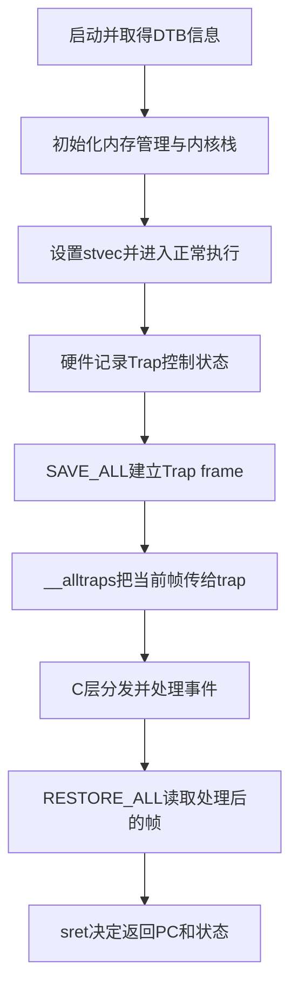
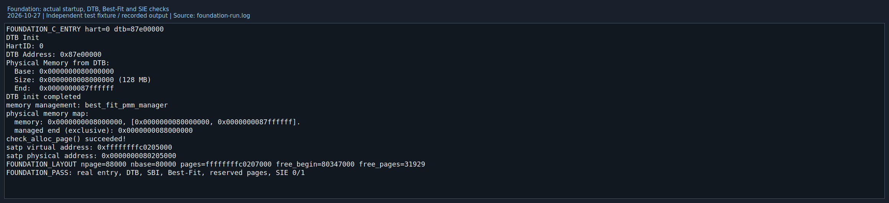
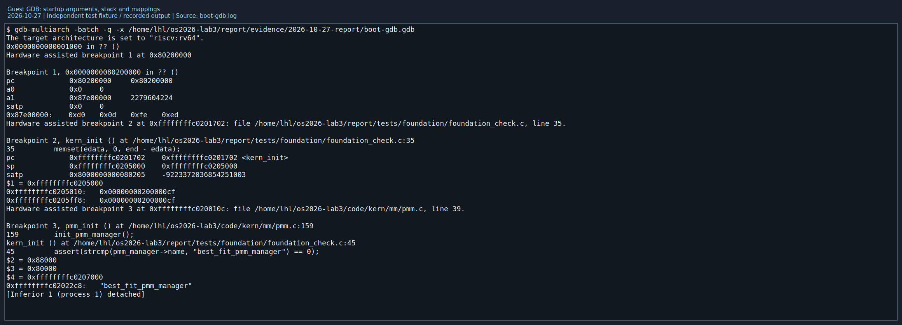
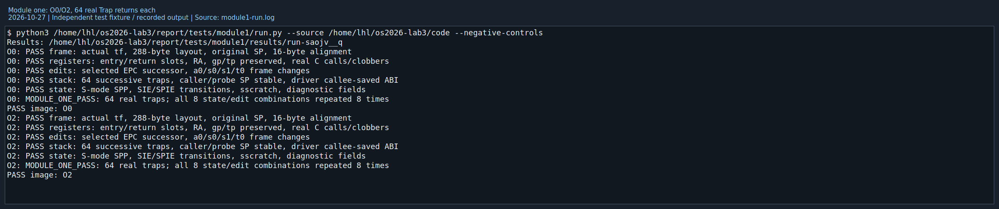
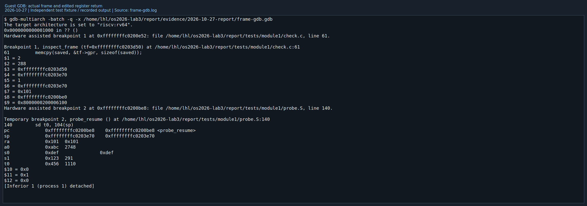
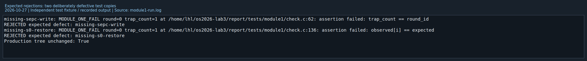

# 操作系统实验报告

## 实验基本信息

| 项目 | 内容 |
|------|------|
| **实验名称** | Lab 3：中断与异常处理 |
| **小组成员** | 2412351－李华濂；2412181－肖子昂；杨昊冉（学号待补） |
| **阶段整理日期** | 2026-10-27 |
| **实验分支** | `lab3` |
| **本阶段内容** | 实验二依赖迁移、启动与调试适配、功能模块一及本人部分验证 |

### 小组分工

| 成员 | 负责的练习/模块 |
|------|----------------|
| 2412351－李华濂 | 迁移`page_init()`和Best-Fit；必要的启动与构建适配；完成`RESTORE_ALL`和`__alltraps`；独立验证、演示及阶段材料 |
| 2412181－肖子昂、杨昊冉 | 共同负责模块二、完整集成及最终报告整理，两人自行安排内部工作 |

本报告先填写我负责的部分，模块二和整体验收的位置留空，供另外两位成员继续补充。当前成员A部分已经通过独立验证，正式源码中的两个模块二handler尚未实现，完整内核构建和评分还未通过。

## 一、实验目的

本实验学习内核怎样响应中断和异常。我负责的部分主要解决“发生Trap后，怎样保存被中断现场、调用C函数，再按照处理后的现场返回”的问题，具体目标如下：

1. 将实验二的内存初始化与Best-Fit迁移到Lab3，理解代码复用时接口、内存边界和中断保护之间的关系。
2. 理解启动参数、启动页表和内核栈怎样为C初始化及Trap处理提供基础。
3. 根据实际`SAVE_ALL`和`trapframe`计算槽位，完成与其对应的恢复过程。
4. 按RV64调用约定将当前帧传给`trap(tf)`，理解传参和函数调用为什么不会丢失原a0、ra。
5. 理解`sepc`、`sstatus`与`sret`的作用，并通过真实Trap和GDB检查返回结果。

## 二、实验环境

| 成员 | AI编程工具 | 底层模型 | 用途 |
|------|------------|---------|------|
| 2412351－李华濂 | Codex | GPT-5.6 sol（此前本人登记） | 辅助阅读源码、按规格迁移和实现、审查与设计独立检查 |

| 环境或工具 | 配置 |
|------------|------|
| 宿主系统 | Ubuntu 24.04.1 LTS，x86_64 |
| Conda环境 | `os2026`，Python 3.12.14 |
| 交叉编译器 | `riscv64-unknown-elf-gcc` 13.2.0 |
| 链接器与objcopy | GNU binutils 2.42 |
| 模拟器 | QEMU 8.2.2，RISC-V `virt`，单hart、128 MiB |
| 固件 | OpenSBI 1.3 |
| 调试器 | `gdb-multiarch` 15.1 |
| 构建工具 | GNU Make 4.3 |
| 截图工具 | 宿主已有PyQt5，X11可见窗口抓取 |

Makefile已将`make gdb`默认指向实际安装的`gdb-multiarch`，`make debug`和`make gdb`共用`GDBPORT`，默认1234；QEMU使用`-kernel bin/ucore.img`启动。双终端中一端运行`make debug`，另一端运行`make gdb`，并应加载同一次构建的ELF和镜像。**当前仍需先补齐模块二，才能用`make`、`make qemu`完成正式工程的构建和运行；本阶段验证使用下文说明的独立镜像。**

## 三、实验整体逻辑分析

### 3.1 本章节的逻辑主线

我对本章的理解是：内核在能够正常启动、访问内存以后，还需要处理打断当前执行流的事件。处理Trap不仅要识别发生了什么，还必须保证C处理函数使用寄存器和栈以后，被中断程序仍能按要求继续执行。

完整流程可以表示为：



其中我完成的是内存依赖、必要的启动适配，以及从汇编入口到恢复返回的底层模块。图中的C层具体异常和时钟处理由另外两位成员接入。

### 3.2 功能的逐步实现

我先迁移`page_init()`和Best-Fit，确认地址转换、保留页和空闲管理状态建立正确；然后排查当前QEMU的入口交接及开启分页后的取指问题。具备这些基础以后，再按帧布局实现`RESTORE_ALL`和`__alltraps`。最后用独立C处理入口触发真实断点，检查传参、寄存器恢复、帧修改和返回状态，避免把尚未完成的模块二与底层错误混在一起。

## 四、实验内容与实现

### 前置任务：实验二依赖迁移与启动适配

**负责人：2412351－李华濂。**

#### 4.1 功能描述与行为规格

本部分迁移来源为实验二已完成的`pmm.c`、`best_fit_pmm.c`。我只迁移Lab3需要的实现，保留目标框架已有的公共分配接口和检查函数，沿用Best-Fit作为本组的默认管理器。

`page_init()`以设备树已经初始化、启动映射和内核栈有效为前提。成功后应设置`va_pa_offset`、`npage`和`pages`，保留固件、内核与描述符占用页，只注册有效范围中的完整空闲页面。零基址或长度、范围溢出和空间不足等错误应在越界写入前panic；没有完整空闲页时不调用注册接口。

Best-Fit的规格是：空闲块头按地址升序排列，`property`表示连续页数，`nr_free`统计页数；申请时遍历全部候选，选最小的足够大块，同大小时选低地址。申请失败不改变状态，释放后正确插入并与物理相邻空闲块合并。

#### 4.2 page_init的关键计算

Lab3没有直接提供实验二使用的边界宏，我依据目标`memlayout.h`计算：

```c
memory_limit    = KERNTOP - PHYSICAL_MEMORY_OFFSET;
kernel_begin_pa = KERNBASE - PHYSICAL_MEMORY_OFFSET;
```

我先检查设备树范围和加法溢出，再将可管理上界限制在框架支持范围内并向下对齐。`va_pa_offset`在第一次使用`PADDR(end)`之前设置；`end`由链接脚本在BSS末尾定义。

```text
描述符起点 = ROUNDUP(PADDR(end), PGSIZE)
描述符数量 = npage - nbase
描述符字节数 = (npage - nbase) × sizeof(struct Page)
空闲区起点 = ROUNDUP(描述符结束物理地址, PGSIZE)
```

`npage`是物理页号的排他上界，不是描述符数组长度。默认128 MiB下，`nbase=0x80000`、`npage=0x88000`，数组有32768个元素。最终空闲页还要扣除保留区域。为防止乘法溢出及空间不足，我在写描述符之前用“剩余空间除以单个描述符大小”的方式校验数量。

描述符先全部设为保留，再交给管理器注册完整空闲区。这样内核和描述符自身占用的页不会被误分配。无完整空闲页的处理只针对`page_init()`，后面的分配器自测仍需要可分配页面。

#### 4.3 Best-Fit与中断保护

| 核心函数 | 本人的理解 |
|----------|------------|
| `best_fit_init()` | 建立空的双向循环链表，将空闲页数置零 |
| `best_fit_init_memmap()` | 将有效保留区域转成空闲块，只把块头挂入链表 |
| `best_fit_alloc_pages()` | 遍历全部块，选最小可用块，移除块头并按需建立剩余块 |
| `best_fit_insert()` | 按地址插入，先合并前块，再以更新后的块头检查后块 |
| `best_fit_free_pages()` | 清理本次归还页的状态，增加本次页数并交给插入合并 |
| `best_fit_nr_free_pages()` | 返回空闲页数，不是块数 |

链表有F个空闲块时，分配查找为O(F)，释放n页并插入合并为O(n+F)，页数查询为O(1)。Best-Fit在这里主要改变选块策略，链表仍保持地址顺序，便于释放时寻找相邻块。

迁移时，我保留了Lab3的`alloc_pages()`、`free_pages()`和`nr_free_pages()`包装：保存原SIE状态，关中断后调用管理器，结束时恢复原状态。原来关着的中断不能被无条件打开。相关宏使用`do { ... } while (0)`把多条语句封装成一条语句，避免在`if/else`等位置展开时改变控制关系。这里保护的是本hart的临界区，不能代替多核锁。

#### 4.4 启动、构建和调试适配

| 文件 | 本阶段修改 |
|------|------------|
| `kern/mm/pmm.c` | 迁移初始化并选用Best-Fit，保留公共接口中断保护 |
| `kern/mm/best_fit_pmm.c` | 迁移完整算法，保留目标包已有自测 |
| `kern/init/entry.S` | 增加根表下标2的恒等映射，保留下标511的高地址映射 |
| `Makefile` | 使用`-kernel`、实际GDB工具及一致的调试端口 |
| `tools/grade.sh` | 只同步QEMU加载参数，不改匹配条件、分值或超时 |

启动时仍保留a0作为hartid、a1作为DTB物理地址的含义。开启分页后、跳到高地址以前，处理器还要从低地址继续取指，因此需要这一段的映射。修复是补齐映射，不是用nop改变时序。

#### 4.5 规格与提示词的组织方式

我先要求核对目标框架与实验二的差异，再明确允许修改的初始化与管理器实现区。迁移要求中分别列出内存边界、对齐、溢出、保留区域、失败行为和中断保护，要求保留已有测试，且不实现同伴handler。这样的顺序能让生成代码以Lab3现有接口为准，避免直接复制整个文件造成包装丢失。

### 功能模块一：Trap上下文恢复与Trap入口

**负责人：2412351－李华濂。**

#### 4.6 模块功能与行为规格

目标文件为`kern/trap/trapentry.S`。我只填写`RESTORE_ALL`、`__alltraps`两个`lab3 function1`位置，保留标记并填写2412351，未改`SAVE_ALL`、结构体、`trap()`签名及题目测试。

```c
void trap(struct trapframe *tf);
```

本模块输入是当前有效的Trap frame。C层正常返回后，汇编应按处理后的帧恢复通用寄存器、返回PC及控制状态，并通过`sret`返回。读完帧之前不能破坏寻址基准；帧内合法的epc或寄存器修改不能被入口旧值覆盖。当前只讨论单hart内核S态，不包含用户栈切换、损坏帧容错和任意嵌套。

#### 4.7 保存布局与原sp

硬件进入S态Trap时记录`sepc/scause/stval`等状态，并调整中断与特权级相关位；通用寄存器则由`SAVE_ALL`保存到内存。RV64的`REGBYTES=8`，帧有36个槽，共288字节。

| 字段 | 槽位 | 字节偏移 |
|------|------|----------|
| x0～x31 | 与寄存器编号一致 | 编号×8 |
| 原sp，也就是x2 | 2 | 16 |
| status | 32 | 256 |
| epc | 33 | 264 |
| badvaddr | 34 | 272 |
| cause | 35 | 280 |

```text
进入前：sp = S
保存后：sp = F = S - 288
传入C： tf = F
帧内：  tf->gpr.sp = S
```

`SAVE_ALL`先把原sp放进`sscratch`，再减sp建立帧，之后将原值取出写入第2槽，同时把`sscratch`清零。由于288是16的倍数，原栈符合ABI对齐时，调用C仍保持16字节对齐。

#### 4.8 传参、C调用与恢复顺序

入口中我使用：

```asm
mv a0, sp
call trap
```

这里传的是当前帧首地址。虽然a0会被改成指针，`call`也会写ra，但原a0和ra此前已经保存，返回时从帧恢复。C函数按调用约定恢复自己的栈，汇编回来后仍使用同一帧进入`__trapret`。

恢复控制状态的关键顺序为：

```asm
LOAD s0, 32*REGBYTES(sp)
LOAD s1, 33*REGBYTES(sp)
csrw sstatus, s0
csrw sepc, s1
# 随后从各自槽位恢复通用寄存器，包括s0和s1
# 最后读取原sp；在此之前sp一直指向帧首
LOAD x2, 2*REGBYTES(sp)
```

先写CSR、再恢复通用寄存器，可以防止CSR临时值覆盖刚恢复的s0/s1。sp必须最后加载，否则后续字段会从错误地址读取。恢复sp采用帧内值，而不是固定加288；x0不用加载，始终为零。`cause/badvaddr`用于诊断，不需要机械写回。

#### 4.9 epc与sret的状态关系

C层需要改变返回位置时应修改`tf->epc`，最终恢复过程会把它写入`sepc`。如果只直接改硬件`sepc`，却不改帧，恢复时仍会被帧内值覆盖。

本场景从S态进入Trap时，保存的`SPP=1`、`SIE=0`、`SPIE=进入前的SIE`。恢复后执行`sret`，由SPP决定返回S态，并使`SIE=SPIE`、`SPIE=1`、`SPP=0`。因此我分别检查这些位的关系，不使用整个`sstatus`前后相等的断言。

恢复期间帧内SIE应保持0；返回后是否开中断通过SPIE表达。若handler提前使能中断，再遇到挂起事件，就可能在恢复未完成时重入，这不属于当前协议保证的场景。

#### 4.10 提示词设计与实现过程

实现前，我先要求分析`SAVE_ALL`、结构体和调用链，再把帧大小、原sp、a0传参、ra保护、CSR临时寄存器恢复以及C合法修改帧的要求写进规格。实现阶段限定只修改两个占位，不指定必须照抄的完整指令串，而要求生成的序列满足这些状态约束。实现后先做只读审查，再设计链接实际汇编的独立测试。

本阶段没有发现需要反复修改正式`RESTORE_ALL`的运行错误。后续新增的是测试覆盖，包括更多寄存器修改、连续Trap与测试驱动自身ABI检查；我没有把扩充测试写成修复不存在的实现Bug。本次报告只概述规格与提示词设计，不新增实际对话汇总。

### 功能模块二：中断与异常处理

#### interrupt_handler实现与说明

#### exception_handler实现与说明

#### 规格、提示词与实现过程

## 五、测试与验证

### 5.1 验证方法与证据

2026-10-27，我使用当前`code/`重新构建独立镜像并运行检查。基础镜像链接实际启动汇编、DTB解析、PMM、Best-Fit和SBI，只替换测试入口及panic处理；模块一镜像链接实际`trapentry.S`，提供最小测试`trap(tf)`检查帧和选择返回位置，不实现通用异常或时钟处理。模块一测试不解析DTB，也没有假DTB getter。两类镜像在检查SIE=1之前都清零`sie`中断来源。

新截图来自实际可见的X11只读日志窗口，显示本轮真实命令输出的原文或明确截取片段，并非IDE终端截图。原始日志和片段边界保存在[截图清单](evidence/2026-10-27-report/screenshot-manifest.json)，没有用图片绘制或修改测试结论。

### 5.2 基础内存与启动检查

基础镜像解析真实DTB，检测到128 MiB，实际使用`best_fit_pmm_manager`。它检查了描述符范围与保留状态，确认初始空闲块及页数一致，并分别在原SIE为0和1时申请、释放3页，验证计数、块状态和中断状态恢复。



图1：独立基础镜像的真实输出。图中的`pages`、`free_begin`和31929个空闲页属于本次隔离ELF，不是最终内核固定值。[完整日志](evidence/2026-10-27-report/foundation-run.log)

本轮GDB还观察到：内核物理入口a0=0、a1=`0x87e00000`，DTB魔数为`d0 0d fe ed`；进入高地址C时sp等于`bootstacktop`；启动根表下标2和511均为`0x200000cf`；PMM初始化后`npage=0x88000`、`nbase=0x80000`。



图2：本轮基础镜像的客户机GDB观测，ELF与QEMU镜像对应。[原始输出](evidence/2026-10-27-report/boot-gdb.log)、[执行的GDB命令](evidence/2026-10-27-report/boot-gdb.gdb)

此前的[13个初始化边界用例](evidence/foundation/page-init.log)和[Best-Fit O0/O2检查](evidence/foundation/best-fit.log)已通过，本轮没有重复运行。它们分别使用DTB getter与回调设施、测试启动与UART设施，覆盖边界输入和分配器逻辑，不能混写成真实完整内核启动。

### 5.3 模块一独立运行

```bash
conda activate os2026
cd /home/lhl/os2026-lab3
python3 report/tests/module1/run.py --source "$PWD/code" --negative-controls
```

| 检查 | 预期 | 本轮结果 |
|------|------|----------|
| tf地址与布局 | tf为触发前sp减288，原sp槽位正确且对齐 | O0/O2均通过 |
| 寄存器现场 | 原哨兵或处理后的帧值正确恢复 | O0/O2均通过 |
| 真实C调用 | C使用栈、调用辅助函数并覆盖临时寄存器后仍能恢复 | O0/O2均通过 |
| epc修改 | 从指定后继继续执行，不重新触发原断点 | O0/O2均通过 |
| GPR修改 | a0/s0/s1/t0修改能带回，其余值保持 | O0/O2均通过 |
| 连续Trap | 64次往返无栈漂移，驱动保护callee-saved及gp/tp | 每种优化级别64次通过 |
| 状态与诊断字段 | SIE/SPIE/SPP按架构转换，sscratch为0，诊断字段不机械写回 | O0/O2均通过 |



图3：每种优化级别覆盖8种状态/帧修改组合，各重复8次，共64次真实Trap。[脚本原始输出](evidence/2026-10-27-report/module1-run.log)、[结构化结果](evidence/2026-10-27-report/module1/summary.json)

### 5.4 GDB检查实际帧与返回值

我在第3次Trap，即`round_id=2`时断到独立C检查函数，观察到：

```text
sizeof(*tf) = 288
tf           = 0xffffffffc0203d50
原sp         = 0xffffffffc0203e70
tf地址 + 288字节 = 原sp
帧内ra       = 0x101
进入时epc    = 0xffffffffc0200be0
返回后pc     = 0xffffffffc0200be8 <probe_resume>
返回后a0/s0/s1/t0 = 0xabc / 0xdef / 0x123 / 0x456
返回后SIE/SPIE/SPP = 0 / 1 / 0
```

本例特意选择`epc+8`作为后继，跳过断点后的一条4字节非法指令，用于证明恢复服从修改后的帧；这不表示正式异常处理应该统一加8。正式handler仍需按实际异常指令长度和处理策略更新返回位置。



图4：`$1～$9`为进入时的帧观测，`$10～$12`依次为返回后SIE、SPIE、SPP。[原始输出](evidence/2026-10-27-report/frame-gdb.log)、[执行的GDB命令](evidence/2026-10-27-report/frame-gdb.gdb)

### 5.5 测试敏感性与实际问题

我只在副本中分别删掉`sepc`写回和`s0`恢复，保留同一测试预期。前者导致断点重放，被Trap次数断言检出；后者导致寄存器快照不符，被值比较检出。两个错误镜像均产生明确失败标记，没有超时。它们是预期拒绝的对照，不是正式实现曾经存在的Bug；脚本不能只根据QEMU退出码0判断通过。



图5：两个副本被拒绝，正式代码哈希不变。[负面对照原始日志](evidence/2026-10-27-report/module1-run.log)

| 实际问题或发现 | 证据与处理 |
|----------------|------------|
| loader方式未正确交接内核入口 | 既有固件日志显示Next Address为0；改用`-kernel`后为`0x80200000` |
| 分页切换时低地址取指失败 | 既有日志为cause=0xc、epc/tval=`0x80200038`；增加根项2恒等映射 |
| Makefile调试器与安装工具不匹配 | 改用已有且支持RV64的`gdb-multiarch`，统一调试端口 |
| 题目测试辅助函数未保持s0～s11 | 静态审查发现普通调用的ABI风险；未声称动态评分因此失败，保持题目测试不改，独立驱动自行保护ABI |

启动问题的修复前后证据保存在[阶段证据索引](evidence/README.md)。本轮没有修改生产实现、结构体、SAVE_ALL或评分测试，[源码哈希记录](evidence/2026-10-27-report/collection.json)确认`code/`未变化。

本阶段未覆盖正式模块二分发、连续时钟、关机阈值、压缩断点、用户态换栈、多hart、任意嵌套和浮点/向量现场。gp/tp没有被驱动主动破坏，因此动态结果只证明本场景值保持。完整构建仍受两个handler缺失阻塞，不能把独立镜像通过或SBI退出写成正式启动、计数关机或`make grade`通过。

### 5.6 模块二与完整工程验收

#### 异常处理与压缩指令测试

#### 连续时钟与正常关机测试

#### 正式构建、启动及make grade结果

## 六、实验总结与收获

### 6.1 对操作系统的理解

| 重要知识点 | OS原理与本实验的关系 |
|------------|---------------------|
| 中断与异常 | 都需要进入Trap处理路径；中断通常来自异步事件，异常与当前指令有关。本阶段重点实现共用的现场交接，而非全部事件处理 |
| 上下文保存 | 原理上需要保存恢复执行所需的状态；本实验用固定布局的Trap frame保存整数寄存器和四个CSR字段，不等于完整进程上下文切换 |
| 调用约定 | C调用允许覆盖caller-saved寄存器，Trap返回却要恢复被中断现场。因此只遵守普通函数ABI不足以替代Trap保存恢复 |
| 特权级与返回控制 | `sepc`决定返回PC，SPP参与选择返回模式，SIE/SPIE按架构转换；它不是普通`ret`，也不是把状态寄存器原样复制回来 |
| 临界区保护 | 分配器更新共享链表时需要避免本hart中断重入；保存并恢复原状态比无条件开中断更准确，但仍不能解决多核并发 |
| 内存发现与分配 | DTB报告RAM范围，页描述符和保留区处理后才能得到可分配页；物理内存总量不等于空闲页数 |

我认为OS原理中重要、但本阶段没有实际实现的内容包括：进程调度与抢占、用户态陷入时的内核栈切换、系统调用与权限检查、多核锁和内存一致性、嵌套中断策略，以及设备中断控制器和外设驱动。当前Trap frame的恢复也没有覆盖浮点、向量等扩展状态。

### 6.2 AI协作开发的经验

本阶段最有用的做法是先说明接口、状态变化和失败条件，再要求实现。以sp为例，如果只要求“恢复全部寄存器”，很容易忽略读取帧时仍要依赖sp；把原sp、帧sp与C参数的关系写清楚以后，恢复顺序就有了明确依据。

我也认识到测试驱动本身需要审查。题目辅助函数存在callee-saved保护风险，独立驱动因此单独检查自己的ABI。正常用例通过以后，再让两个错误副本接受同一套检查，可以确认测试是否真正观察到了epc和寄存器恢复，而不是只看到一个PASS字符串。

对验证结论，我将真实启动链路、使用替身的独立检查和正式集成分别记录。这样在同伴接入模块二以后，能够明确哪些结论可以沿用，哪些必须在最终版本上重新回归。

### 6.3 其他成员总结
