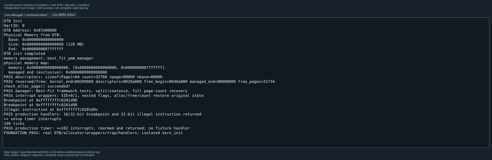
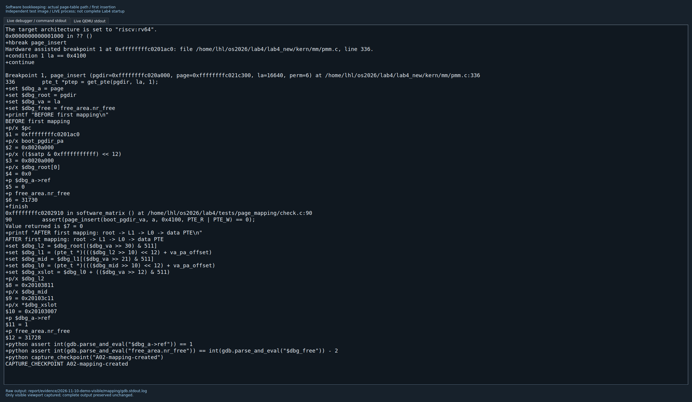
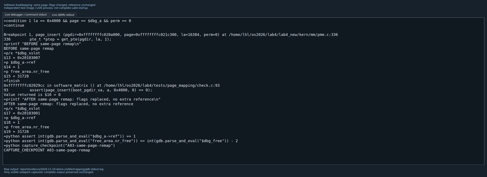
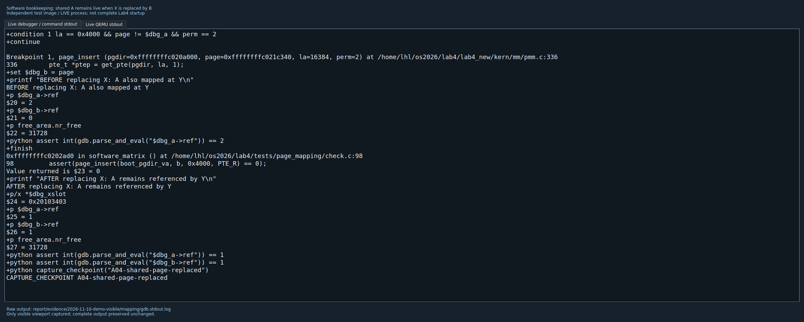
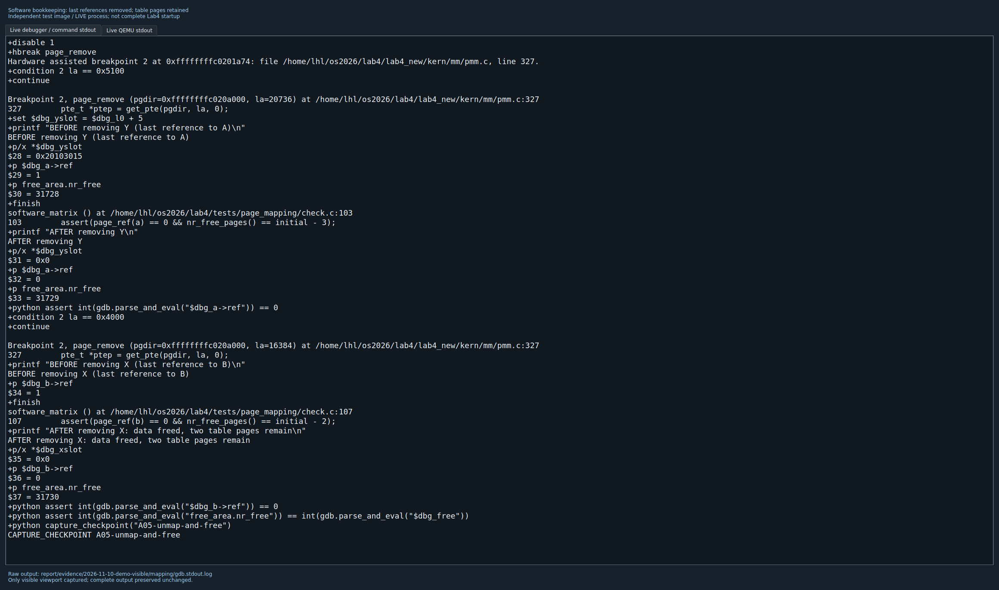
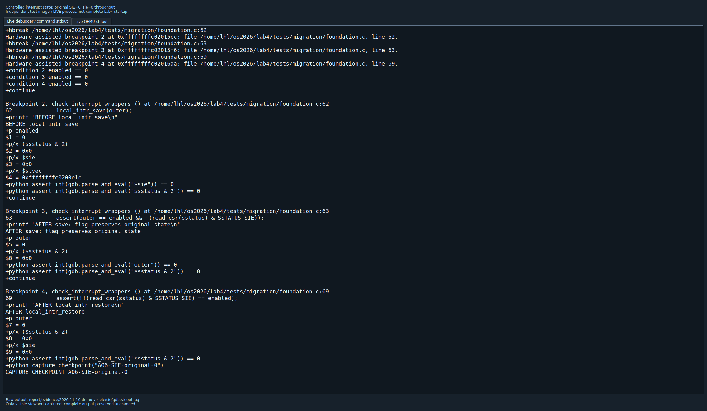
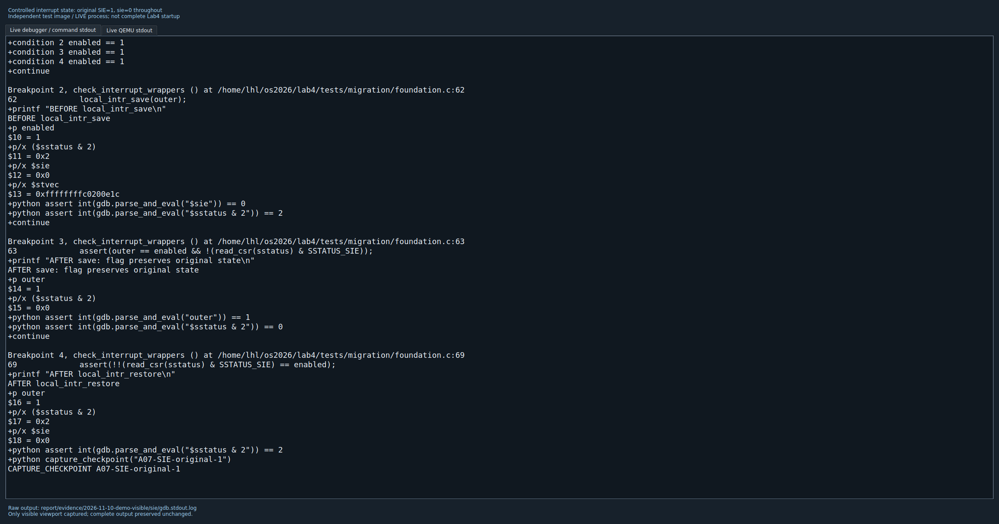
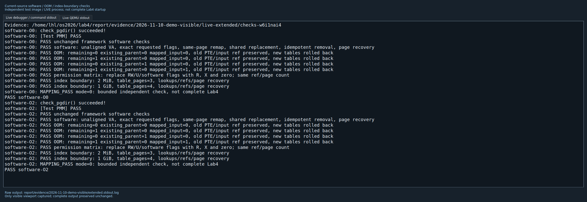
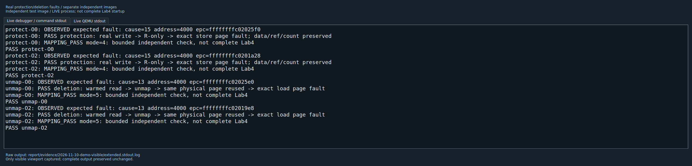
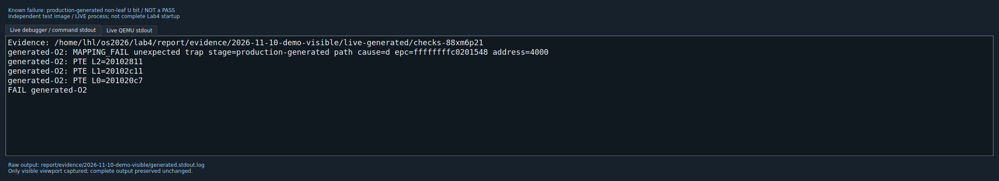

# 操作系统实验报告

## 实验基本信息

| 项目 | 内容 |
|---|---|
| 实验名称 | Lab4：进程管理 |
| 小组成员 | 2412351—李华濂、2412181—肖子昂、2312115—杨昊冉 |
| 本人阶段整理日期 | 2026-11-10；2026-11-14 补充功能模块二、三 |
| 实验分支 | `lab4` |
| 当前范围 | 成员A的依赖迁移、必要启动适配、功能模块一及全部Challenge；杨昊冉提交功能模块二、三的实现与说明 |
| 当前结论 | 成员A的独立检查已取得阶段结果；功能模块二、三的代码已补齐，整体构建、启动与评分验收由双人组在集成阶段完成 |

### 小组分工

按照[实验四1加2分工](实验四1加2分工.md)，我先完成内存和Trap基础、页映射接口与挑战题，向后续线程创建和调度提供接口；肖子昂、杨昊冉共同完成后半段，两人内部具体分配由他们确定。

| 成员 | 实现及验证责任 | 报告、截图责任 |
|---|---|---|
| 李华濂，2412351 | 实验二、三必要依赖迁移，启动调试适配，page_insert/page_remove，全部Challenge及本人验证 | 本文已填写的本人章节、A01～A10图片说明、阶段交接 |
| 肖子昂，2412181 | 与杨昊冉共同负责完整模块二、三及最终集成，内部任务待本人填写 | 本人实现章节、截图与提示词；协调合并 |
| 杨昊冉，2312115 | 与肖子昂共同负责完整模块二、三及最终集成，内部任务待本人填写 | 本人实现章节、截图与提示词；协调合并 |

三人各自撰写自己的报告并提供对应截图；最终合并不替代个人撰写。本文件创建时还没有同伴正文，模块二、三只保留标题、负责人和待填项。

## 一、实验目的

本实验将已有物理页管理和页表机制接到内核线程管理上。对本人部分，我主要完成三件事：使Lab4能够复用已完成的物理内存和Trap基础；维护普通4KiB页映射的PTE、引用计数与TLB一致性；通过独立检查和调试说明这些状态为什么正确，为同伴创建内核栈、构造首次运行现场和切换线程提供基础。

本实验仍采用预映射方式，不实现缺页调入和页面置换。内核线程共享内核地址空间，不能把本阶段结果写成已经实现用户进程隔离或完整虚拟内存系统。

## 二、实验环境

以下版本来自前几轮保存的实际工具记录，本轮整理文档时没有安装环境或重跑内核。

| 项目 | 实际环境 |
|---|---|
| 环境 | 已有Conda环境os2026：`/home/lhl/anaconda3/envs/os2026` |
| 编译器 | `/usr/bin/riscv64-unknown-elf-gcc`，13.2.0 |
| 链接器 | `/usr/bin/riscv64-unknown-elf-ld`，binutils 2.42 |
| 模拟器、固件 | `/usr/bin/qemu-system-riscv64`，8.2.2；OpenSBI 1.3 |
| 调试器 | os2026内的`gdb-multiarch`，15.1；已实际选择RV64并连接目标 |
| Python、Make | os2026 Python 3.12.14；GNU Make 4.3 |
| 本人独立检查配置 | QEMU virt、RV64、单hart、128MiB；部分检查比较-O0与-O2 |

| 成员 | AI编程工具 | 本实验底层模型 | 备注 |
|---|---|---|---|
| 李华濂，2412351 | Codex | 待本人补充确认 | 本实验现有记录未可靠确认具体版本，不沿用以前实验的模型名称 |
| 肖子昂，2412181 | 待本人补充 | 待本人补充 | 不代填 |
| 杨昊冉，2312115 | 待本人补充 | 待本人补充 | 不代填 |

环境证据见[迁移阶段摘要](evidence/2026-11-10-migration/run-xoikc2sx/summary.json)。截图窗口使用base环境已有PyQt5显示实时GDB/QEMU输出，构建和测试子进程仍使用os2026工具，未为截图安装新环境。

## 三、实验整体逻辑分析

### 3.1 本章节的逻辑主线

我对本章的理解是：先保证“页可以正确分配、映射和撤销”，再保证“线程拥有有效PCB、内核栈和初始现场”，最后让调度器选择线程并恢复其执行现场。页表解决CPU从哪个地址访问哪块内存的问题；线程上下文解决下一步从哪里执行、使用哪一个栈的问题。两部分通过内核栈、页表根和Trap返回链连接。

题目给出的完整主线为：

```text
kern_init
  → DTB及控制台
  → pmm_init：物理内存、页表与页映射检查、kmalloc
  → pic_init / idt_init：Trap入口及状态准备
  → vmm_init：已有VMA框架
  → proc_init：线程创建与登记（双人组）
  → clock_init / intr_enable
  → cpu_idle → schedule → proc_run → switch_to（双人组）
  → 新线程首次返回链
```

这是源码与题目规定的依赖关系，并非本组当前已经跑通的完整执行记录。正式构建还缺同伴实现，另外`get_pte`生成的非叶子U位与硬件要求存在冲突，二者分别阻塞链接和后续真实访存，不能混为一个问题。

### 3.2 本人实现顺序

我先对照Lab4接口迁移内存初始化、Best-Fit和Trap依赖，没有整文件覆盖旧实验；再依据启动观察补足分页过渡映射、QEMU加载和GDB选择。基础可独立验证后，先梳理页映射Spec，再实现模块一及必要的失败回滚，随后补充OOM、真实访存和索引边界检查。最后用匹配ELF进行GDB观察，整理全部Challenge和本次报告。

这个顺序可以把“启动基础故障”“映射记账错误”和“线程代码尚未完成”分开定位。同伴后续应使用正式入口重新回归，不能把独立测试入口的结果直接当成整体验收。

## 四、实验内容与实现

### 4.1 前置依赖迁移与必要启动适配

**负责人：2412351—李华濂。** 这是题目要求补入的lab2/lab3依赖，不是新增一套物理页算法或线程系统。

#### 功能、来源和实际差异

| 文件 | 本人实际修改 | 保留或兼容的接口 |
|---|---|---|
| [pmm.c](../code/kern/mm/pmm.c) | 迁移`static void page_init(void)`；模块一改动另述 | Lab4 Page结构、DTB getter、end、地址宏和页分配中断包装 |
| [default_pmm.c](../code/kern/mm/default_pmm.c) | 修复缺失头文件引用，迁移完整Best-Fit | 保持`default_pmm_manager`对象名和已有basic_check/best_fit_check |
| [trapentry.S](../code/kern/trap/trapentry.S) | 迁移RESTORE_ALL、__alltraps调用，清理sscratch约定并对齐入口 | SAVE_ALL、trapframe、forkrets保持不变 |
| [trap.c](../code/kern/trap/trap.c) | 迁移已有中断、异常handler及指令长度识别 | 保留Lab4 SUM、print_ticks、DEBUG_GRADE及分发入口 |
| [entry.S](../code/kern/init/entry.S) | 加入根项2的恒等映射，保留511高地址项 | hartid、DTB物理地址语义及原内核栈 |
| [Makefile](../code/Makefile) | GDB默认选gdb-multiarch；统一端口；QEMU用-kernel | 原构建组织及目标ELF |
| [grade.sh](../code/tools/grade.sh) | 仅适配QEMU加载方式 | 测试注入、断言、分数和通过条件未修改 |

`page_init`和Best-Fit参考`lab2/code`及`lab3/lab3_new`的已完成实现；Trap恢复来源为Lab3本人模块，handler来源包含杨昊冉的已有贡献。我负责本次迁移与兼容性处理，不把迁移来的同伴算法写成本人重新实现。来源摘要见[reference-sha256.json](evidence/2026-11-10-migration/reference-sha256.json)。

Best-Fit是本组集成选择。目标包头文件声明的是`default_pmm_manager`，因此保留对象名，内部绑定Best-Fit方法，`.name`设为`best_fit_pmm_manager`。实际输出已确认该名称；不能按文件名推断正在使用First-Fit。

#### 内存初始化的Spec和核心计算

`page_init()`由初始化链调用，无参数、无返回值；前提是启动映射、内核栈和DTB getter可用，管理器已经初始化。成功时建立偏移、页描述符和初始空闲管理状态。范围非法或描述符空间不足时panic，不能继续越界初始化。

| 计算或步骤 | 含义与约束 |
|---|---|
| `mem_end = mem_base + mem_size` | 先检查基址/长度非零及64位加法溢出；末端采用开区间 |
| `managed_end = ROUNDDOWN(min(mem_end, KERNTOP-PHYSICAL_MEMORY_OFFSET), PGSIZE)` | 同时服从设备树报告和框架上界；只管理完整页面 |
| `va_pa_offset = PHYSICAL_MEMORY_OFFSET` | 在使用PADDR(end)之前建立虚实地址偏移 |
| `npage = managed_end / PGSIZE` | 管理上界的绝对物理页号，不是Page数组长度 |
| `count = npage - nbase` | 描述符数量；pages[0]描述DRAM_BASE对应页 |
| `pages_pa = ROUNDUP(PADDR(end), PGSIZE)` | 在内核末尾之后安排描述符 |
| `count * sizeof(struct Page)` | 先用剩余空间除法检查乘法和容量，再计算数组大小，不硬编码64 |
| 初始化所有描述符为Reserved | 保留固件、内核和管理数据占用；初始化Lab4新增pra字段 |
| `free_begin = ROUNDUP(descriptors_end_pa, PGSIZE)` | 仅注册`[free_begin, managed_end)`完整空闲页；无完整页则不注册 |

默认128MiB独立镜像中，`nbase=0x80000`、`npage=0x88000`，32768个Page；本目标结构实际为64字节，描述符共2MiB。这是观测值，计算依然使用sizeof。固件报告区间不是全部空闲区；本实现保留启动占用部分，但未宣称已经解析任意多段内存、DTB所有reserved-memory或设备保留映射。

Best-Fit维持按地址升序的空闲块头链表，property表示块内连续页数，nr_free统计页数。分配遍历所有块取最小足够块，同大小取低地址；分割余块，释放按地址插入并与物理相邻前后块合并。若空闲块数为B，选块为O(B)；插入定位为O(B)，定位后的前后合并为O(1)，初始化/释放页状态还需遍历本次页数。

`alloc_pages/free_pages/nr_free_pages`仍使用原Lab4的local_intr_save/restore，保存原SIE状态后临时屏蔽，调用完恢复。没有绕开包装直接把分配器暴露给后续线程代码。

#### Trap恢复和启动适配

当前RV64帧为36×8=288字节：32个GPR槽，随后status、epc、badvaddr、cause。x2原sp在偏移16，status在256，epc在264，badvaddr在272，cause在280。SAVE_ALL保留原包行为，不初始化x0槽，真实x0仍硬连零。

`__alltraps`先保存现场，在原sp已经入帧后清sscratch，再用`a0=当前sp`向`trap(tf)`传递整个帧地址。call会改ra和参数寄存器，但原值已经在帧中。恢复先把帧中的status/epc写回CSR，再恢复通用寄存器，最后加载原sp，避免提前破坏帧寻址。C层合法修改epc或GPR会被带回；cause/badvaddr是诊断信息，不需要机械写回CSR。sret按SPP决定返回特权级，并按SPIE改变SIE，不能要求整个sstatus逐位等于进入前。

本范围是当前单hart内核S态，不承诺U态换栈、任意嵌套或浮点/向量现场。`forkrets`保留原接口，合成帧的有效性由构造者保证，详见[阶段交接](成员A阶段交接说明.md)。

启动适配有本次证据：原device loader启动时OpenSBI报告Next Address=0；改用-kernel后可到内核，但原根表缺低地址过渡映射，写satp后GDB无法读取下一条低地址指令。补根项2后，物理入口可进入高地址C代码，根项2、511均为`0x200000cf`。我没有插nop掩盖问题，也没有把当时停机记录中的mcause=3当成已捕获的取指页异常。保留了hartid/DTB传递和Lab4自身DEBUG_GRADE行为，没有迁入Lab3固定关机阈值。

#### 实际发送的迁移提示词

以下为[真实记录第003轮](prompt.md)的用户提问原文；它要求先对接口、保留基线、限定范围，再给出实际验证与局限。

```text
依据上一轮核对结果，实际完成我负责的Lab2/3依赖迁移和最小启动适配；若代码仍在压缩包中，将其安全解压到/home/lhl/os2026/lab4/lab4_new，先检查路径和现有文件，有同名目录时保留并核对差异，不覆盖已有工作，同时保留可比较的原包基线。参考/home/lhl/os2026/lab2/code及/home/lhl/os2026/lab3/lab3_new中已完成的代码，以Lab4的pmm.h、memlayout.h、mmu.h、dtb.h、trap.h、sync.h和启动调用为准，迁移page_init、完整Best-Fit、RESTORE_ALL、__alltraps调用及已有handler，处理default_pmm.c的头文件、管理器对象与现有测试的衔接，沿用Best-Fit作为本组集成选择并如实说明。初始化应校验设备树范围、溢出与描述符空间，正确设置偏移和页描述符，保留内核及管理数据，只注册完整可用页；保留物理页接口的中断保护及Lab4已有页表、kmalloc、VMA接口，保留forkrets和idt_init中的SUM设置，按当前SAVE_ALL检查恢复布局及sscratch约定，不能用旧文件覆盖。先提供证据再适配entry.S、QEMU加载和实际可用的RV64 GDB，核对旧Lab3关机策略、DEBUG_GRADE与Lab4流程的冲突，只做必要处理，不移植旧实验的关机要求或改变评分断言、分值和通过条件。本轮不实现Lab4模块一、二、三；若整体构建被这些未完成符号阻塞，使用清楚标注的临时镜像或对象检查，正式源码不能加入空函数或假输出。给出实际差异、工具路径、可执行命令、独立验证结果及其局限，至少核对页描述符和空闲管理器建立、中断保护恢复原状态、Trap返回基础及启动适配；无法运行的项目说明具体依赖，不把编译部分对象当作完整启动通过。
```

### 4.2 功能模块一：虚拟内存页操作

**负责人：2412351—李华濂。**

#### 函数及职责

```c
int page_insert(pde_t *pgdir, struct Page *page, uintptr_t la, uint32_t perm);
void page_remove(pde_t *pgdir, uintptr_t la);
/* 本文件私有辅助函数 */
static void page_remove_pte(pde_t *pgdir, uintptr_t la, pte_t *ptep);
```

| 函数 | 我的理解与实现选择 |
|---|---|
| get_pte | 定位普通三级路径；create=1时可分配两张下级表，返回末级槽位地址，不分配数据页 |
| page_insert | 先确保槽位；新映射取得一次引用；同页只更新权限；换页撤销旧引用后登记新页 |
| page_remove | create=0查询，缺表或无映射直接返回，删除时不创建表 |
| page_remove_pte | 清PTE、同步TLB，再减引用，降为0才回收数据页；保留中间表 |
| pte_create/pte2page | 页号与标志编码、从项取得描述符，不自动维护引用或验证全部硬件权限 |
| tlb_invalidate/flush_tlb | 分别按VA或全量执行本hart的sfence.vma；不是清数据缓存，不替其他hart同步 |

#### 本人确认的Spec

Spec来自第004轮逐项源码分析，第005轮实现沿用。它把输入约束、成功净变化和失败所有权分开，避免把“没有叶子”误认为“没有泄漏”。

指导书还提示了启动1GiB大页中的重新映射问题：不能把大页叶子当作下一张表指针。可在另一个根表中建立所需普通页映射，确保切换期间的取指、栈和关键数据仍可访问，再切satp并同步TLB；这是指导书的方案说明，本人没有实现大页拆分或宣称验证了这条替换流程。

| 条目 | 本次契约 |
|---|---|
| 前提 | 单hart、串行调用；pgdir可访问且页对齐，已有路径有效；不支持在中间大页叶子上操作 |
| 数据页 | 受管理范围内、由调用者持有的已分配页，可已有引用；不接受空闲页、保留页或释放后指针 |
| VA | 合法Sv39地址；允许页内偏移，修改包含la的4KiB页 |
| perm | 使用框架低10位标志；不注入PPN或未支持扩展位；V由pte_create加入，其他位按本次请求替换 |
| 成功 | 返回0；目标项、引用及失效一致；同页重映射净引用不变 |
| 内存不足 | 返回-E_NO_MEM，输入数据页、既有映射及原有表不变；回滚本次新建中间表 |
| 删除 | 无映射安静返回；有映射清项并减引用；最后引用撤销才回收 |
| 幂等 | 重复删除不减第二次、不重复释放、不新建表、不改变空闲页数 |
| 表页生命周期 | 正常删除保留中间表；回滚只处理本次新建资源 |
| 硬件使用 | 另需规范的非叶子项、合法叶子权限和匹配MMU状态；软件登记成功不等于实际可访存 |

`page_insert`取得ptep之前不修改数据页引用。若本来就是同一Page，仅覆盖标志；否则先增加新页引用，再撤销旧映射，最后写新PTE并按地址同步。这样不会在同页重映射时先将最后引用释放掉，也不会错误保留旧权限。

`get_pte`的必要修复在第二次分配失败处：保存完整原父项以及本次新建表指针；只有本次创建过上级表才恢复原项、全量失效、撤销结构引用并释放。已存在父表即使为空也不能由这次失败回收。`pmm.h`和`tlb_invalidate`的sfence增加memory clobber，约束编译器对表项写入的处理；没有证据证明此前已发生真实错误重排，因此不把这一点写成已复现Bug。

#### 一个实际GDB情景中的状态变化

第007轮software-image中，X为0x4000所在页，Y为0x5000所在页，A/B已由测试分配。下面记录的是该镜像真实状态，不是正式内核最终布局。

| 步骤 | 映射/项变化 | A.ref | B.ref | 空闲页数 |
|---|---|---:|---:|---:|
| 首次调用前 | X空槽，A/B均已分配 | 0 | 0 | 31730 |
| 插入0x4100→A，RW | X叶子0x20103007；新建两张表 | 1 | 0 | 31728 |
| 同页0x4000→A，perm=0 | X叶子变0x20103001 | 1 | 0 | 31728 |
| 测试将Y共享到A | 替换断点前观察到A有两引用 | 2 | 0 | 31728 |
| X替换为B，R | X叶子0x20103403 | 1 | 1 | 31728 |
| 删除0x5100所在Y页 | Y叶子清零，A最后引用释放 | 0 | 1 | 31729 |
| 删除X | X叶子清零，B最后引用释放 | 0 | 0 | 31730 |

0x4100与0x4000只差页内偏移，属于同一个槽。A刚分配时ref=0，但已经离开空闲集合，不代表可再次分配。删除完成后两张表仍保留，所以这里回到的是调用前31730，而不是A/B分配前的页数；测试随后显式清理表页并检查全部恢复。

perm=0和仅W的项用于课程软件记账，不是合法可读写叶子。当前生成父项低位0x11含U，真实访问仍失败，不能把上表解释成MMU已经通过这条路径完成读写。

#### 实际发送的最终实现提示词

以下为[第005轮实际提问](prompt.md)原文。它明确要求同页分支、最后引用释放、无副作用删除、精确回滚和不改测试，而不是只让AI“补齐两个函数”。

```text
根据刚确认的Spec，实际填写Lab4的kern/mm/pmm.c中LAB4 function1占位，保留注释并将我负责的YOUR CODE替换为2412351，完整实现page_insert和page_remove，必要时在本文件增加私有的page_remove_pte辅助函数。优先复用目标框架的get_pte、pte_create、Page引用计数接口和TLB失效接口，正确处理新映射、同页重映射、其他页替换、共享映射和权限变化，使目标映射、引用计数及物理页释放一致；page_remove对没有页表或没有有效映射的地址应安全返回，不能为了删除创建页表。创建失败返回-E_NO_MEM，保持原数据页引用和既有映射不变，并按已确认契约回滚本次新分配的中间页表资源，不释放原本已存在的页表；如果现有get_pte无法满足这一点，先说明证据和选用的最小适配位置，再只修复必要失败路径，不为Challenge任意拆分公共接口。合法输入及权限语义以已确认Spec为准，不为了看见PASS而修改题目测试或把软件记账结果当作硬件访问成功。只修改本人模块和经确认的必要依赖，不实现proc.c、sched.c、switch.S，也不改变已有结构体和函数签名。请先简要说明关键不变量与实现选择，再写入代码并核对差异，执行当前能进行的编译或模块检查，明确尚被模块二、三阻塞的部分，并给出每个实际修改文件、命令、结果及未覆盖项。
```

#### 实现与验证的真实推进过程

第003轮完成依赖迁移，第004轮先写规格并发现框架兼容性问题，第005轮完成模块一生产实现和必要回滚，第006轮补强独立检查，第007轮进行GDB与截图。第006、007轮没有再修改正式实现；不能把每个测试镜像都写成一次生产算法修复。

第005轮第一次真实访存就失败，我保留原始日志，随后将“自动建表路径”和“调用者预置规范路径”分开验证：后者可以访问和替换，前者即使叶子使用RWAD仍失败。第006轮又发现仅检查只读后的写故障不足以排除整张映射被破坏，于是加强测试，要求先读成功再写失败；只回归受影响的-O0/-O2权限镜像。这是测试补强，不是生产映射算法出现了新Bug。

### 4.3 功能模块二：进程创建及初始化

**负责人：杨昊冉2312115（模块二、三由肖子昂2412181与杨昊冉2312115共同负责，本轮提交模块二、三的实现与说明）。**

#### 函数与职责

- `alloc_proc()`：用 `kmalloc` 取一块 PCB，把所有字段置成安全初值——状态 `PROC_UNINIT`、`pid=-1`、`kstack=0`、`need_resched=0`、`parent/mm/tf` 为空、`context` 清零、`pgdir` 指向内核页表根物理地址、两个链表节点各自初始化。失败返回 `NULL`，由调用方回滚，不会把半初始化的 PCB 挂进任何链表。
- `proc_init()`：初始化 `proc_list` 和 1024 个哈希桶；把当前执行现场包装成 `idleproc`（`pid=0`、`PROC_RUNNABLE`、`kstack=bootstack`、`need_resched=1`），`current` 指向它；再调用 `kernel_thread(init_main, "Hello world!!", 0)` 创建 `initproc`，用 `find_proc` 找回并命名成 `init`。
- `kernel_thread()`：在栈上构造临时 trapframe，`gpr.s0` 放函数入口、`gpr.s1` 放参数（`kernel_thread_entry` 正是用这两个寄存器转交），`epc` 指向 `kernel_thread_entry`，`status` 置 `SPP|SPIE` 并清 `SIE`，然后带 `CLONE_VM` 调用 `do_fork`。
- `do_fork()`：分配 PCB → 挂父进程 → 分配内核栈 → `copy_mm` → `copy_thread` → 在关中断的临界区里取 PID、挂哈希表和进程链表、进程数加一 → `wakeup_proc` 置为可运行。前面任何一步失败都按已取得的资源逐级回滚（`put_kstack`、`kfree`），不会留下登记了一半的进程。
- `copy_thread()`：把 trapframe 拷到新线程内核栈顶，`gpr.a0` 置 0 作为新线程的返回值，`gpr.sp` 指向这份帧，`context.ra` 设为 `forkret`、`context.sp` 设为帧地址。这就是“第一次被切进来先到 forkret”的来源。
- `copy_mm()`：本阶段内核线程共享内核地址空间，断言 `current->mm == NULL` 后直接返回 0，保留完整接口形态供后续实验扩展。

#### 首次运行链路

`switch_to` 恢复新线程的 `ra=forkret` → `forkret` 拿 `current->tf` 调 `forkrets` → `forkrets` 把 `sp` 切到这份 trapframe 再跳 `__trapret` → `RESTORE_ALL` 从帧里恢复 `epc=kernel_thread_entry` 和其余寄存器 → `sret` 进入 `kernel_thread_entry` → 该入口用 `a0=s1`、`jalr s0` 调用真正的线程函数。这条链上的帧格式必须和 `SAVE_ALL`/`RESTORE_ALL` 完全一致，所以 `copy_thread` 只把帧摆在 `kstack+KSTACKSIZE-sizeof(struct trapframe)`，不另造结构，也不改 `proc.h` 里 `struct context` 的字段顺序。

#### 实际提示词

```text
在 Lab4 骨架里实现功能模块二：alloc_proc、proc_init、kernel_thread、
do_fork、copy_thread、copy_mm，填写在 //LAB4 function2 位置。

必须满足：
1. alloc_proc 用 kmalloc 拿 PCB，所有字段都要有安全初值：
   PROC_UNINIT、pid=-1、kstack=0、need_resched=0、parent/mm/tf 为空、
   context 清零、pgdir 指向内核页表根物理地址、两个链表节点都初始化。
2. proc_init 初始化 proc_list 和全部哈希桶；把当前执行现场登记成
   idleproc（pid 0、PROC_RUNNABLE、kstack=bootstack、need_resched=1），
   设置 current；再用 kernel_thread 创建 initproc 并命名。
3. kernel_thread 用临时 trapframe 传递函数入口和参数：s0 放入口、
   s1 放参数，epc 指向 kernel_thread_entry，status 置 SPP|SPIE 并清 SIE，
   带 CLONE_VM 调 do_fork。
4. do_fork 负责 PCB、内核栈、copy_mm、copy_thread、取 PID、挂链表、
   计数和唤醒；失败时按已取得资源逐级回滚，不能泄漏或留下半登记进程。
5. copy_thread 把帧放在新线程内核栈顶，a0=0，sp 指向该帧，
   context.ra=forkret、context.sp=帧地址；不要改 struct context 的布局。
6. copy_mm 本阶段不做用户地址空间复制，断言 current->mm==NULL 后返回 0。
7. 不修改函数签名，不改已有测试；保留 //LAB4 function2 标记并填学号。
```

#### 实现说明

顺序上先 `alloc_proc`，再 `copy_thread`/`copy_mm`，最后 `do_fork`、`kernel_thread`、`proc_init`，这样每个函数用到的都是已经定义好的东西，不需要额外的前置声明。`do_fork` 里唯一需要保护的是“取 PID + 挂链表 + 计数”这三步，它们必须一起完成，否则并发或中断到来时可能看到两个相同 PID 或一个没进链表的可运行线程；内核栈和 `copy_thread` 都在关中断之外做，临界区尽量短。

### 4.4 功能模块三：调度与上下文切换

**负责人：杨昊冉2312115。**

#### 函数与职责

- `cpu_idle()`：死循环，只在 `current->need_resched` 为真时调用 `schedule()`。`idleproc` 的 `need_resched` 在 `proc_init` 里置 1，所以 `kern_init` 走到 `cpu_idle` 后第一次检查就会让出 CPU 给 `initproc`。
- `schedule()`：关中断后清 `current->need_resched`；`idleproc` 从链表头开始扫，其他线程从自己的 `list_link` 后面开始扫，沿 `proc_list` 环形找第一个 `PROC_RUNNABLE`；扫完一圈没有可运行线程就退回 `idleproc`。选中后 `runs++`，目标不是当前线程才调用 `proc_run`。
- `proc_run()`：目标和当前线程相同就直接返回，避免无意义的页表刷新；否则在关中断的临界区里更新 `current`、把 `pgdir` 拼成 Sv39 的 satp 写下去、`sfence.vma` 刷 TLB，再 `switch_to` 换上下文，退出临界区时按原 `SIE` 恢复。
- `switch_to()`：按 `struct context` 的字段顺序，用 `sd` 保存旧线程的 `ra、sp、s0~s11`，用 `ld` 恢复新线程的同组寄存器，最后 `ret` 跳到新线程的 `ra`。偏移写成 `0*8` 到 `13*8`，和 `proc.h` 的结构体顺序一一对应。

#### satp 的写法

`proc->pgdir` 存的是页表根的物理地址，写 satp 时要自己拼模式位：`((uint64_t)SATP_MODE_SV39 << 60) | (next->pgdir >> RISCV_PGSHIFT)`。这里踩过一个真实的坑：一开始写成 `SATP_MODE_SV39 << 60`，`SATP_MODE_SV39` 是 `int`（值为 8），左移 60 位超过 32 位宽度，host 端语法检查直接报 `left shift count >= width of type`；先转 `uint64_t` 再移位才是对的。`libs/riscv.h` 里的 `lsatp()` 是 Sv32 遗留，表达不了 Sv39，这里不用它，写法参照 `pmm.c` 的 `enable_paging()`。

#### 调度为什么这样写

`schedule` 和 `proc_run` 都要在关中断的临界区里做，否则“选中的线程”和“实际切过去的线程”之间可能被时钟中断插进来，`current`、页表和真实执行现场就会不一致。`switch_to` 只做寄存器搬迁，不参与策略判断；`runs` 在真正选中目标线程时加一，切回 `idleproc` 也照样计数。本实验是协作式调度，线程只在主动调用 `schedule()` 时让出 CPU，没有时间片抢占。

#### 实际提示词

```text
实现功能模块三：cpu_idle、proc_run（proc.c 的 //LAB4 function3 位置）、
schedule（sched.c 的 //LAB4 function3 位置）和 switch_to（switch.S）。

必须满足：
1. cpu_idle 是死循环，current->need_resched 为真就调用 schedule()。
2. schedule 在关中断的临界区里清 need_resched；从当前线程的下一个
   沿 proc_list 环形扫描，idleproc 从链表头开始，选第一个 PROC_RUNNABLE；
   一圈都没有就退回 idleproc；选中的线程 runs 加一，不是当前线程才
   proc_run。
3. proc_run 在关中断的临界区里更新 current、按 pgdir 写 satp 并刷 TLB、
   调用 switch_to；目标等于当前线程直接返回。
4. 写 satp 用 Sv39：模式位 8 左移 60 位时要先转成 64 位再移位，
   pgdir 右移 12 位取物理页号；不要用 libs/riscv.h 里的 lsatp()，
   它是 Sv32 遗留，写法参照 pmm.c 的 enable_paging()。
5. switch_to 按 struct context 的字段顺序保存和恢复 ra、sp、s0~s11，
   偏移与结构体一致，最后 ret 跳到新线程的 ra。
6. 不修改函数签名，不动题目测试；保留 //LAB4 function3 标记并填学号。
给出每个函数的关中断范围，并说明为什么选线程和切线程必须在同一个
临界区语义内完成。
```

#### 与评分测试的关系

`tools/test_lab4.c` 里 `test_lab4_process_create()` 检查 `idleproc` 的 pid、状态、`kstack=bootstack`、`tf/context.ra` 为空，以及 `initproc` 的 pid=1、父进程、`mm==NULL`、`context.ra/sp` 非零；`test_lab4_schedule()` 用 `kernel_thread` 造两个测试线程，自己调用 8 次 `schedule()`，要求两个线程都真正跑过。评分脚本按 `[Test PMM] PASS`、`[Test Process Create] PASS`、`[Test Schedule] PASS` 三组各 10 分检查，第三组还要求出现 `this initproc, pid = 1, name = "init"` 和两句 `To U:` 输出，也就是要求 `initproc` 确实被调度执行过，而不只是结构上存在。

### 4.5 本人范围的真实问题、处理与未解决事项

| 问题及证据性质 | 实际处理 | 当前结论 |
|---|---|---|
| 静态发现default_pmm.c引用不存在的best_fit_pmm.h，对象又要求default_pmm_manager | 使用目标default_pmm.h，保留对象名并绑定完整Best-Fit | 独立构建和实际管理器输出已验证；未编造修改前编译报错 |
| 修改前启动观察：device loader下OpenSBI Next Address=0 | 改用-kernel，保留原评分判据 | 独立入口已启动；[修改前输出](evidence/2026-11-10-migration/run-h3h2cfz_/startup-before/console-loader.log) |
| 原entry写satp后GDB读不到下一条低地址指令；源码只有高地址映射 | 新增低地址过渡恒等映射，未插nop | [前后GDB证据](依赖迁移与验证说明.md)支持适配有效；不虚构精确异常cause |
| 静态发现get_pte上级成功、下级失败会残留表页 | 精确回滚本次新表，不回收原有表 | 修后OOM注入验证页数和旧映射；未保存修前动态泄漏日志 |
| 最初独立启动支架漏链intr.c，真实控制台依赖未解析 | 补链接真实intr.c，不写假中断函数 | [失败构建日志](evidence/2026-11-10-migration/run-owqwt95f/startup-before/build.log)保留；属于支架依赖错误 |
| 第005轮真实读0x4000发生cause=13；原check_boot_pgdir写0x100发生cause=15 | 保留失败，比较合法预置表，不修改生成项或断言 | 非叶子U位冲突尚未解决，不能记成修复成功 |
| 第007轮X11窗口读取返回黑图 | 弃作有效截图；捕获连接实时进程的Qt窗口并逐图校验 | [黑屏记录](evidence/2026-11-10-demo/CAPTURE-FAILURE.md)和有效图均保留；不是修改实验输出 |
| 静态发现check_boot_pgdir用int承接64位KERNBASE，默认条件下遍历可能不执行 | 保留原测试，另说明覆盖缺口 | 未修复，不以成功打印证明遍历全部内核映射 |

模块一首轮失败现场见[原始console](evidence/2026-11-10-page-mapping/run-4wdontj_/O0/console.log)。第007轮再现自动路径失败的两级父项分别为`0x20102811`、`0x20102c11`，叶子`0x201020c7`已经有VRWAD，仍发生读取页异常。这与非叶子U位冲突相符，不能归因于尚未完成的线程代码。

### 4.6 Challenge一：local_intr_save/restore如何开关中断

**负责人：2412351—李华濂。**

`local_intr_save(flag)`执行`flag=__intr_save()`：读取`sstatus.SIE`（掩码0x2），原来为1就调用`intr_disable()`清位并返回1，原来为0就返回0。`local_intr_restore(flag)`调用`__intr_restore`，只有flag为1才用`intr_enable()`置位。保存的是原开关状态，不是整个sstatus，退出临界区应恢复原状态而不是无条件开中断。

`do { ... } while (0)`使宏体作为一条语句执行一次，提供块作用域并便于if/else使用，不是等待循环或锁。原先SIE为0时，两次调用之间和之后都保持0。

嵌套时必须每层用独立标志、按后进先出恢复，临界区不擅自开启。原开时外层保存1并关闭，内层看到0，先恢复内层不打开，最后外层恢复1。这里restore(0)只是“不执行开启”，若临界区错误开过中断，它不会主动再清零。

这是本hart的S态中断控制，不能屏蔽同步异常、代替多核锁或充当通用内存屏障。页分配包装的临界区也不等于整个页表更新事务自动具有多核原子性。

第007轮在实际宏调用前后观察到：原SIE=0时0→0→0，原SIE=1时1→0→1；GDB显示后者掩码值0x2→0x0→0x2。测试入口已安装Trap，演示阶段sie=0隔离异步来源，初始状态由测试正常代码设置，没有用GDB修改SIE制造现场。

### 4.7 Challenge二：分页模式和get_pte设计

**负责人：2412351—李华濂。**

| 模式 | 级数 | 虚拟地址索引与偏移 | PTE大小 | 每表项数/表大小 |
|---|---:|---|---:|---|
| Sv32（RV32） | 2 | 10+10+12 | 4字节 | 1024项，4KiB |
| Sv39（RV64） | 3 | 9+9+9+12 | 8字节 | 512项，4KiB |
| Sv48（RV64） | 4 | 9+9+9+9+12 | 8字节 | 512项，4KiB |

Sv39与Sv48在64位寄存器中要求高位分别为bit38、bit47的符号扩展。都从satp根表物理页号开始，按本级索引取PTE；非叶子项给出下一表物理页号，叶子项给出物理页与权限，检查合法性后结合偏移得到PA。上层也可能是大页叶子；当前get_pte只面向普通4KiB路径。本人没有实现或运行Sv32/Sv48。

get_pte的两段代码相似，是因为根表以下还有L1、L0两层，都要“检查有效位—必要时分配—置结构引用—清零—写父项—进入下一层”。根表由调用者提供，所以三级表只有两段下级创建代码；Sv32相应一次，Sv48相应三次。C代码读取下一表先用KADDR转换为可访问的内核地址，硬件走表则直接按物理地址读取。

把查找和分配合并后，create=0提供纯查找，create=1按需创建路径，调用简单、遍历和初始化规则集中；缺点是分配副作用不明显，可能失败且需要跨层回滚，误传create会使查询消耗页。这里创建的是页表，不是缺页调入数据页。

本实验保留现有接口并补足失败契约即可，没有为思考题强拆API。若以后支持复杂并发、可阻塞分配或大页，可拆成纯walk与ensure路径，明确资源归属；代价是接口增多、可能重复遍历，还需处理两次遍历间结构变化。是否拆分应由复杂度和调用场景决定。

当前非叶子U位和软件权限组合的问题需要另行解决。架构依据见[RISC-V特权规范Supervisor章节](https://raw.githubusercontent.com/riscv/riscv-isa-manual/main/src/priv/supervisor.adoc)；本报告引用的是前轮已核对的规则，本轮未重新访问网站。

#### Challenge与演示实际提示词

第007轮实际发送的提问同时限定了挑战范围、真实镜像、只读GDB和截图真实性。它不是事后将指南改写成一次成功对话。

```text
结合当前已验证的Lab4源码完成我负责的全部Challenge，并准备模块一及迁移基础的GDB演示与真实截图，本轮不新增生产功能或实现同伴模块。先顺着local_intr_save和local_intr_restore、__intr_save和__intr_restore、intr_enable和intr_disable说明sstatus.SIE如何保存、关闭和恢复，解释do while零的作用、原来已关闭时的行为、嵌套保存恢复的前提以及局部屏蔽不能替代多核锁的边界；再比较Sv32、Sv39、Sv48的级数、索引、PTE大小、地址构成与遍历过程，结合现有get_pte解释两段相似代码和查找分配合并的利弊、失败清理、拆分的适用条件，不能把思考题扩展成重新实现三种分页模式。使用已构建且匹配的ELF和QEMU镜像，给出两个终端的启动及连接命令，实际验证能执行的GDB步骤，观察一次映射建立、同页重映射或替换、删除时的页表路径、叶子PTE、Page.ref及空闲页变化，挑战中的中断状态演示需保持测试来源受控。地址和断点以当前符号和反汇编为准，不混用旧实验地址，不为截图修改内存或输出制造现场；若正式工程仍缺同伴模块，清楚标注独立测试镜像。把调试命令、每步目的、预期和实际结果整理成演示文档，将本人需要的测试和调试截图保存到/home/lhl/os2026/lab4/report/images，截图应来自实际终端或调试界面并能对应原始日志；图形环境不能截图时明确缺项并提供准确的人工截图位置，不生成仿真截图。最后给出截图文件与证明事项的对应表，并用问答检查我能否解释引用计数、TLB、SIE和多级页表。
```

## 五、测试与验证

### 5.1 实际命令、证据及结果

以下命令均在前轮实际使用过；本轮仅核对旧日志、差异和图片，没有重新执行make、QEMU或测试脚本。目录内保留了对应ELF、镜像、命令和原始输出。

```bash
conda activate os2026
cd /home/lhl/os2026

# 第003轮：迁移基础与启动调试
python3 lab4/tests/migration/run.py
python3 lab4/tests/migration/run.py --gdb-after

# 第005轮：软件路径、规范预置路径
python3 lab4/tests/page_mapping/run.py --mode software
python3 lab4/tests/page_mapping/run.py --mode prebuilt

# 第006轮补强、第007轮为截图重跑
python3 lab4/tests/page_mapping/run.py --mode extended
python3 lab4/tests/page_mapping/run.py --mode protect

# 实际保留失败：预期宿主脚本退出码1，不是通过命令
python3 lab4/tests/page_mapping/run.py --mode generated

# 第005轮正式构建：实际失败，退出码2
cd /home/lhl/os2026/lab4/lab4_new
make -j2
```

| 检查 | 实际结果与证据 | 可以证明/不能证明 |
|---|---|---|
| 默认DTB、描述符、保留区及管理器 | 第003轮-O0/-O2通过；[摘要](evidence/2026-11-10-migration/run-xoikc2sx/summary.json) | 真实DTB默认输入与内存基础；不是任意畸形DTB测试 |
| SIE包装与嵌套 | 两种优化级通过，第007轮GDB再观察原0/1 | 当前单hart、受控来源；不是多核互斥 |
| Trap帧恢复 | 第003轮两种优化级各64次受控Trap通过 | 实际汇编，C trap替身；不是完整线程首次运行 |
| 正式handler/时钟 | 两种优化级断点、非法指令及各至少102次定时器通过；第007轮基础镜像再次通过 | 使用正式handler；独立C入口，不是正式全启动 |
| 异常内存输入 | 5个隔离panic用例及1个无完整空闲页用例通过 | 替换getter输入，不验证DTB解析器健壮性 |
| 原check_pgdir和题目PMM检查 | 第005轮及第007轮-O0/-O2通过 | 软件PTE与引用检查；不代表真实自动走表成功 |
| 同页、共享、替换、删除、权限及恢复 | 第006/007轮-O0/-O2通过 | 链接实际pmm及分配器，没有复制映射算法 |
| OOM精确回滚 | 首次分配失败、只余1页、已有父表、输入页已有映射等四种布局通过 | 真实耗尽，保持旧资源；不修改生产分配器 |
| 索引边界 | 2MiB与1GiB边界通过，分别占3/4张表 | 软件路径；不是全部地址或大页覆盖 |
| 真实替换访问 | 第005轮prebuilt的-O0/-O2通过 | 规范预置路径上换页生效；不验证生产创建父项 |
| 权限收紧/删除 | 第007轮四个-O0/-O2镜像通过；[输出](evidence/2026-11-10-demo-visible/extended.stdout.log) | 真实读写后观察cause=15/13，不只是检查sfence存在 |
| 自动建表真实读 | 第005/007轮失败，cause=13，VA=0x4000；[输出](evidence/2026-11-10-demo-visible/generated.stdout.log) | 非叶子U位冲突仍在，不能算通过 |
| 原check_boot_pgdir | 第005轮失败，cause=15，VA=0x100；[综合结果](evidence/2026-11-10-page-mapping/checks-birpehib/checks.json) | 保留失败，不改原断言 |
| 正式构建 | [make日志](evidence/2026-11-10-page-mapping/run-4wdontj_/production-make.log)仍缺proc_init/cpu_idle，退出码2 | 模块一符号已链接参与；未得到可运行正式ELF |
| 正式make qemu / make grade | 待完成 | 当前没有正式运行通过截图或最终分数 |

第005轮综合检查是4个镜像通过、2个失败，不能说“全部通过”；第006轮extended是6个镜像通过，之后增强只读正向对照，仅回归2个权限镜像；第007轮截图重跑extended六个镜像通过，并单独重现generated失败。上述不同批次不叠加虚报为全部功能均已通过。

真实访存用例由调用者事先建立规范非叶子表，再调用正式page_insert/remove；未修补get_pte生成项。映射支架提供独立kern_init、panic出口和只接受指定cause/地址/PC的Trap观察器，预期异常分别隔离并设置超时，测试结束只清理本次进程。对比基础镜像使用的正式handler，不混淆替身范围。

#### 测试提示词怎样设计

我要求观察真实PTE、ref、空闲页和实际访问，而不是只匹配PASS字符串；失败测试必须检查旧资源保留，异常测试必须核对cause、stval与故障PC，并包含正常访问对照。完整原文见[第006轮提示词与回答](prompt.md)，实际发送内容为：

```text
为我负责的Lab4内存基础和模块一设计并运行必要的独立测试，先说明每项行为、观察方式和预期，再在lab4下独立测试目录或临时副本中实现，不改题目已有测试或同伴生产代码；测试必须链接实际迁移后的内存管理和pmm实现，不能另写一套映射算法作为被测对象，也不能只检查输出字符串。复用已有PMM检查并补足同页重映射的计数与权限、不同页替换、多地址共享、最后引用释放、无映射及重复删除、首次和后续中间页表分配失败、失败前已有映射不变及页数恢复，必要时覆盖跨页表索引边界；注入分配失败时只影响独立测试，并验证未误回收原有页表，检查TLB时应在受控真实访存中观察映射变化，不能只看到sfence指令就宣称缓存行为已验证。模块二、三未完成时可使用明确说明的独立启动入口、DTB输入或测试支架，但不能往正式源码加入空进程函数，不能把替身测试说成完整Lab4通过。对第5轮指出且本轮证实的本人范围错误做最小修复，保留失败证据，再回归受影响检查；根因属于同伴任务时只提供复现，不代写。预期panic和异常用例独立运行并设置超时，启用SIE之前确保Trap入口及中断来源受控，必要时比较-O0和-O2，测试结束只清理本次启动的进程。交付可复现脚本、实际命令和原始日志，逐项列出预期与结果、替身范围和未覆盖内容，未运行或不能验证的部分如实说明，避免靠修改测试预期、伪造PASS或无限增加无关测试掩盖问题。
```

### 5.2 第007轮测试与调试图片

全部图片为独立镜像，来源和日志见[截图清单](evidence/2026-11-10-demo-visible/screenshot-manifest.json)。`software-image/kernel`与同目录ucore.img配对；`foundation-image`亦同，已用objcopy导出逐字节核对。图中符号地址只属于该ELF，不混用旧实验地址。

**图A01：迁移基础。** foundation-image，独立kern_init，实际DTB、pmm、Best-Fit、Trap汇编、handler及时钟；证明描述符与保留区检查、页数恢复、原SIE恢复和返回基础，不证明正式pmm_init到线程的全链路。[原始输出](evidence/2026-11-10-demo-visible/sie/qemu.stdout.log)。



**图A02：首次插入。** software-image，实际page_insert及get_pte；根表PA与satp均为0x8020a000，A.ref 0→1，空闲31730→31728；证明软件路径和两张表分配，不证明自动路径的MMU合法性。[映射GDB日志](evidence/2026-11-10-demo-visible/mapping/gdb.stdout.log)。



**图A03：同页更新。** 同一software-image，perm=0仅作软件检查，叶子标志替换而ref与页数不变，不作为可访存叶子截图。



**图A04：共享后替换。** 同一software-image，X换B后A仍被Y引用，A从2降1、B从0升1，空闲页不变。



**图A05：删除最后引用。** 同一software-image，Y和X分别清零，A/B各释放一次，空闲页逐次加1；中间表仍保留。



**图A06：原SIE为0。** foundation-image，实际save/restore前后均关闭，sie始终0；只观测宏的外层前后，嵌套由该镜像断言检查。[SIE日志](evidence/2026-11-10-demo-visible/sie/gdb.stdout.log)。



**图A07：原SIE为1。** 同一foundation-image，总开关0x2→0→0x2，保存标志为1；sie=0用于隔离异步来源，没有手工修改寄存器制造结果。



**图A08：软件独立检查。** 第007轮extended中的software-O0/O2，实际pmm/分配器与原题PMM检查，独立入口；证明记账、OOM、边界和页数恢复，不含线程创建或调度。[完整输出](evidence/2026-11-10-demo-visible/extended.stdout.log)。



**图A09：真实权限与删除故障。** 第007轮protect/unmap四个独立镜像；先有效访问，再改变权限或删除，核对cause=15/13和指定PC。父表由支架预置为规范项，Trap为受控观察器，不能冒充自动建表或正式异常路径全验收。



**图A10：保留失败。** 第007轮generated-O2，实际get_pte自动建表后读取0x4000仍失败；两级非叶子U位未被修改。它是故障证据，不是通过截图。[原始输出](evidence/2026-11-10-demo-visible/generated.stdout.log)。



第一轮QScreen窗口读取的黑图已单独归档且标记无效。以上十张由连接实时GDB/QEMU输出的Qt窗口直接捕获，无离线日志重绘、图像编辑或目标内存修改，图像和日志前缀摘要可核对。

### 5.3 调试复现与正式验收缺图

完整双终端命令、逐步读取、每步目的及实际值见[Challenge与GDB演示](实验四Challenge与GDB演示.md)。例如先在终端一启动software-image并暂停：

```bash
conda activate os2026
qemu-system-riscv64 -machine virt -m 128M -smp 1 -nographic \
  -bios default -monitor none \
  -kernel /home/lhl/os2026/lab4/report/evidence/2026-11-10-demo-visible/software-image/ucore.img \
  -S -gdb tcp:127.0.0.1:37133
```

终端二的同目录`mapping/manual.gdb`包含匹配ELF和端口、断点与读取。实际截图运行的是session.gdb，在相同命令之间增加主机截图握手；裁剪握手后的manual.gdb未额外重跑，不能称其为第二次已运行记录。

```bash
conda activate os2026
gdb-multiarch -q -nx -batch \
  -x /home/lhl/os2026/lab4/report/evidence/2026-11-10-demo-visible/mapping/manual.gdb
```

正式ELF生成并回归后，才可用`cd lab4/lab4_new; make`、一终端`make debug`、另一终端`make gdb`调试正式内核；`make qemu`用于正常运行，`make grade`用于题目评分。现有Makefile已指向gdb-multiarch，但当前正式链接仍失败，不写成上述正式命令均已成功运行。

| 模板要求的最终图片 | 当前状态 |
|---|---|
| 正式make构建、make qemu全启动 | 待补：需要同伴实现和页表兼容性问题处理后实际运行 |
| 正式make grade结果 | 待补：三组PMM/Process Create/Schedule，尚无最终分数 |
| 模块二、三个人测试与调度切换 | 待双人组各自提供 |

这里用文字标记待补，不引用不存在的图片，也不用A01/A08代替正式全链路截图。

## 六、实验总结与收获

### 6.1 与OS原理的对应

| 本实验知识点 | OS原理中的含义 | 联系与差异 |
|---|---|---|
| Page及Best-Fit | 物理内存分配、连续空间与外部碎片 | Page是描述符不是物理页数据；本实验线性选块，没有NUMA或复杂分区 |
| 多级页表和PTE | 地址转换、分级组织与权限保护 | 每表4KiB，整体表数按映射增长；软件V检查不能替代硬件合法性检查 |
| 引用计数 | 共享资源的生命周期 | 映射增减决定最后释放；分配器所有权、表页结构占用与映射引用不能混用 |
| TLB与sfence.vma | 缓存的地址转换与一致性 | PTE内存更新后还要同步翻译；TLB不是数据缓存，本地失效不是多核shootdown |
| 失败回滚 | 资源获取的原子性与异常安全 | 不只检查返回值；本次新表要撤销，原有表和输入页不能误回收 |
| Trap frame与context | 中断现场与线程切换现场 | Trap保存更完整寄存器及CSR，context按调用约定保存切换所需状态；后者由同伴实现 |
| local_intr_save/restore | 临界区与并发控制 | 恢复调用前开关，不无条件开启；仅适用于本hart相关场景 |
| VMA与页表 | 虚拟地址区间的逻辑描述与实际翻译 | VMA描述布局和属性，PTE建立具体映射；本阶段保留已有框架，不实现缺页换入 |

### 6.2 重要但本实验本人范围没有实现或验证的内容

用户态进程与独立地址空间、系统调用及用户/内核切换、按需分页、页面置换、写时复制、交换区、完整进程退出和资源回收、抢占调度与优先级、多核锁及TLB shootdown、NUMA和内存热插拔等仍是重要OS内容。本实验当前的单hart内核线程、预映射与局部屏蔽不能替代这些机制。浮点/向量现场、任意嵌套Trap和畸形DTB也不在本人已验证范围。

### 6.3 AI协作开发的实际经验

我先要求AI读取目标工程，而不是按旧实验文件名直接搬运。这样发现了目标Page结构变化、管理器命名、forkrets与SUM等必须保留的接口。写Spec时，我把输入前提、页表资源所有权、同页重映射净引用和失败回滚写清，再让AI实现，减少了只补选块或只覆盖PTE的风险。

测试时，软件状态通过后仍发生真实访存异常，说明“有PASS”和“硬件能用”需要分别验收。我没有让AI修改断言使两者看似一致，而是保留失败、建立合法路径对照、记录未解决冲突。权限测试还补了先读成功的正向对照，避免单凭写失败就错误判断保护正确。

真实提问及完整回答保存在[prompt.md](prompt.md)，本报告只引用实际已发送的第003、005、006、007轮。另有全流程提示词指南，但它是规划材料，不作为已发生对话、不复制进实际记录。当前模型信息未确认，保留待补。

## 七、本人材料和阶段结论

本人交付包括本报告、[成员A阶段交接说明](成员A阶段交接说明.md)、[文档核对清单](成员A文档核对清单.md)、A01～A10截图、已有独立测试入口及原始证据。最新正式文件摘要由交接说明定位，文档整理阶段没有修改实现；本次按交付约定导出为code/report并提交成员A进度，生产源码与本机已验证版本逐文件一致。

已验证的是本人内存/Trap基础、模块一软件契约，以及规范预置路径上的部分真实访问效果；静态推导的是接口边界、分页模式比较和部分旧测试覆盖缺口。待完成的是非叶子U位冲突处理、正式启动与评分、双人组模块二三及个人材料、模型信息与小组最终日期。上述缺项没有用独立测试结果补成整体验收结论。

提交布局、仓库内复现命令和历史路径说明见[交付说明](交付说明.md)。报告中的实际提示词和历史命令保留发送/运行时原文，不视为仓库当前路径。
