# 操作系统实验报告

## 实验基本信息

| 项目 | 内容 |
|---|---|
| **实验名称** | Lab4：进程管理 |
| **完成日期** | 小组最终完成日期待确认 |
| **格式整理日期** | 2026-11-21 |
| **小组成员** | 李华濂（2412351）、肖子昂（2412181）、杨昊冉（2312115） |
| **整理日期** | 2026-11-20 |
| 实验依据 | [实验题目](题目.txt)、当前 `code/` 源码、已有测试日志与截图 |
| 主要内容 | 实验二、三依赖迁移；虚拟内存页操作；内核线程创建；协作式调度；两个 Challenge |
| 当前完成情况 | 三个功能模块均已有生产实现；用户提供Debian正式启动输出及make grade三组全通过、总分30/30；正常退出及全部独立回归不在此结论内 |

本报告以当前源码说明实现，以原始日志说明测试结果。旧文档中“缺少 proc_init/cpu_idle”的说法描述的是模块二、三补入前的版本，不能继续作为当前代码状态。原报告已保存在[整理前版本](evidence/2026-11-20-report-review/report-before-review.md)，历史日志和截图保持原样。

### 小组分工

**练习与模块分工：**

| 成员 | 责任与代码依据 |
|---|---|
| 李华濂（2412351） | Lab2/3必要依赖迁移、启动适配、模块一、全部Challenge及独立验证；源码保留2412351标记 |
| 肖子昂（2412181） | 按原分工与杨昊冉共同负责模块二、三及集成；当前资料未提供可独立核实的更细分贡献记录 |
| 杨昊冉（2312115） | 模块二、三已有实现及说明，`proc.c`、`sched.c`、`switch.S`保留2312115标记 |

分工依据见[原分工文件](实验四1加2分工.md)。迁移的既有handler保留了杨昊冉的来源说明，不将已有算法重新归为迁移者原创。

**实验报告分工：** 李华濂负责依赖迁移、模块一和全部Challenge的报告及截图；肖子昂、杨昊冉各自补充本人负责的模块二、三实现、验证和截图，双人组协调最终合并。具体内部任务沿用已确认分工，不在本次排版中重新分配。

---

## 一、实验目的

1. 理解页映射维护中PTE、物理页引用计数和TLB一致性的关系，掌握建立、更新、删除映射及失败回滚。
2. 理解内核线程创建、初始化和首次执行过程，区分PCB、context、trapframe与内核栈。
3. 理解协作式调度、上下文切换和局部中断保护，并通过实际源码、测试及调试证据说明实现。

---

## 二、实验环境

### 2.1 系统与开发环境

历史独立验证环境为Linux、Conda `os2026`、RISC-V GCC 13.2.0、binutils 2.42、QEMU 8.2.2、OpenSBI 1.3、GDB 15.1、Python 3.12.14及Make 4.3。模拟平台为QEMU virt、RV64、单hart、128MiB，部分测试分别使用-O0和-O2。版本来源见[历史摘要](evidence/2026-11-10-migration/run-xoikc2sx/summary.json)。

2026-11-20的报告核对在macOS工作区完成。当前PATH没有 `riscv64-unknown-elf-gcc`、链接器、QEMU和 `gdb-multiarch`；Apple Clang没有可用的RISC-V代码生成后端。已对 `proc.c`、`sched.c`、`pmm.c`、`vmm.c` 执行RISC-V目标的前端语法检查，四项退出码均为0；其中原有static_assert宏产生两处布尔switch警告。尝试生成目标文件未成功，不能宣称正式构建、链接或运行通过。命令与诊断见[本次核对记录](evidence/2026-11-20-report-review/review.json)。

### 2.2 AI工具与模型

| 成员 | AI编程工具 | 底层模型 | 备注 |
|---|---|---|---|
| 李华濂（2412351） | Codex | 历史实验会话待本人确认 | 历史协作记录见prompt.md，不推测未登记版本 |
| 肖子昂（2412181） | 待本人补充 | 待本人补充 | 按本人实际使用填写 |
| 杨昊冉（2312115） | 待本人补充 | 待本人补充 | 已有模块二、三提问及回答摘要，具体工具/模型待确认 |

历史AI协作使用Codex，完整对话见[prompt.md](prompt.md)。历史会话的具体底层模型没有可靠记录，不推测版本。本次报告整理使用Codex（GPT-6），工作内容为源码核对、报告修订与答辩材料整理；没有重写生产实现。附件中的历史提问仅作为实验过程材料，不作为本次操作指令。

---

## 三、实验整体逻辑分析

### 3.1 本章节的逻辑主线

Lab2解决物理页如何分配，Lab3解决中断、异常如何进入内核并恢复现场。Lab4在这两者之上，建立从内存资源到可执行线程的完整管理链：先维护虚拟地址与物理页的映射，再为线程分配PCB和内核栈、构造首次执行现场，最后由调度器选择可运行线程并切换CPU寄存器。

这里包含两种不同的管理对象。页表记录“虚拟地址对应哪一页、允许怎样访问”；PCB和context记录“谁可以运行、下一步从哪里执行、使用哪个栈”。VMA进一步记录合法虚拟区间，但不会因为创建VMA就自动建立PTE。

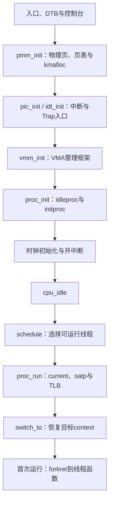

本图表达源码调用关系；本轮用户提供的Debian输出已到init_main并执行三行线程输出，支持正式入口到首次线程执行的链路成立，随后在do_exit占位处panic。实验中的线程均在S态运行，共享内核地址空间；没有实现用户进程隔离、按需分页或页面置换。

### 3.2 功能的逐步实现

1. 先迁移物理内存和Trap依赖，核对启动映射、描述符及管理器接口，为后续分配页和恢复现场提供基础。
2. 再完成页映射接口，统一PTE、引用计数、资源回滚和TLB失效，供内核地址空间操作使用。
3. 然后完成PCB、内核栈和合成Trap frame，建立idleproc/initproc及新线程首次运行通路。
4. 最后接入协作式调度和context切换，通过正式启动、评分与独立检查分别验证运行链及边界。

### 3.3 相较Lab3新增的功能

| 新增或扩展 | 作用 | 当前代码 |
|---|---|---|
| 页映射维护 | 建立、更新、删除4KiB页映射，同步PTE、引用计数与TLB | `kern/mm/pmm.c`：get_pte、page_insert、page_remove |
| VMA和mm框架 | 描述虚拟区间、维护有序不重叠区域、查找和销毁 | `kern/mm/vmm.h`、`vmm.c` |
| 小块内核分配器 | 为PCB、mm和VMA等小对象提供kmalloc/kfree | `kern/mm/kmalloc.c`，已有SLOB式实现 |
| PCB与进程登记 | 管理pid、状态、父线程、栈、context及查找链表 | `kern/process/proc.h`、`proc.c` |
| 内核线程创建 | 将普通函数和参数包装为有独立栈、可调度的线程 | `kernel_thread`、`do_fork`、`copy_thread` |
| 首次运行通路 | 将人工构造的现场接入已有Trap恢复代码 | `forkret`、`forkrets`、`kernel_thread_entry` |
| 调度与上下文切换 | 环形扫描可运行线程，切换current、页表和寄存器 | `kern/schedule/sched.c`、`proc_run`、`switch.S` |
| 初始化链扩展 | 建立VMA框架和线程系统，再进入idle循环 | `kern/init/init.c` |

VMA、kmalloc以及部分辅助函数由实验骨架提供，理解并使用它们不等于本次从零实现。Best-Fit和基本Trap恢复是此前实验依赖的迁移。

---

## 四、实验内容与实现

### 4.1 前置依赖迁移与启动适配

**负责人：** 李华濂（2412351）；既有handler的迁移来源另按原记录保留。

#### 模块功能描述

**涉及的核心函数与入口：**

```c
static void page_init(void);
static void init_pmm_manager(void);
void trap(struct trapframe *tf);
void interrupt_handler(struct trapframe *tf);
void exception_handler(struct trapframe *tf);
/* 汇编入口：kern_entry、__alltraps、__trapret、forkrets */
```

##### 物理内存初始化与Best-Fit

`page_init()`读取设备树中的内存范围，先检查零值、加法溢出和可管理上界，再设置虚实偏移、按当前 `sizeof(struct Page)` 在内核末尾安排页描述符。先将所有页标记为保留，再把描述符末尾之后的完整空闲页交给分配器。这样不会将固件、内核、页描述符自身当作空闲内存。

`npage`表示物理页号上界，描述符数为 `npage-nbase`；`pages[0]`对应DRAM起始页。Lab4扩充了Page结构，因此描述符占用不能沿用旧实验的固定大小。

目标文件仍叫 `default_pmm.c`，对外对象仍为 `default_pmm_manager`，内部接入完整Best-Fit，启动名为 `best_fit_pmm_manager`。空闲块按地址组织，分配选最小足够块、必要时分割，释放与相邻空闲块合并；这样同时兼容目标头文件和保留的Best-Fit测试。

##### Trap恢复与启动

当前trapframe共36个8字节槽，大小288字节。`__alltraps`保存现场后设置 `a0=sp` 调用 `trap(tf)`；`RESTORE_ALL`恢复sstatus、sepc和通用寄存器，最后恢复sp，随后sret返回。C处理函数对帧中epc的合法修改会生效。`forkrets(tf)`则直接把sp指向合成帧，复用这条返回路径。

启动时写satp之前仍在低物理地址执行，必须保留过渡取指映射；因此入口增加低地址恒等映射，同时保留高地址映射。QEMU加载方式适配为 `-kernel`，GDB目标改用可配置的 `gdb-multiarch`，没有修改评分断言或分值。

迁移Spec要求：以Lab4接口为准、保留forkrets及SUM、兼容新增Page字段、保留原测试、失败不越界，且不整文件覆盖旧实验。真实迁移提示词和前后证据见[prompt第003轮](prompt.md)及[依赖迁移说明](依赖迁移与验证说明.md)。

#### 最终提示词

以下引用已有真实记录第003轮的迁移要求，不是本次格式整理新增的实验对话。

```text
依据上一轮核对结果，实际完成我负责的Lab2/3依赖迁移和最小启动适配；若代码仍在压缩包中，将其安全解压到/home/lhl/os2026/lab4/lab4_new，先检查路径和现有文件，有同名目录时保留并核对差异，不覆盖已有工作，同时保留可比较的原包基线。参考/home/lhl/os2026/lab2/code及/home/lhl/os2026/lab3/lab3_new中已完成的代码，以Lab4的pmm.h、memlayout.h、mmu.h、dtb.h、trap.h、sync.h和启动调用为准，迁移page_init、完整Best-Fit、RESTORE_ALL、__alltraps调用及已有handler，处理default_pmm.c的头文件、管理器对象与现有测试的衔接，沿用Best-Fit作为本组集成选择并如实说明。初始化应校验设备树范围、溢出与描述符空间，正确设置偏移和页描述符，保留内核及管理数据，只注册完整可用页；保留物理页接口的中断保护及Lab4已有页表、kmalloc、VMA接口，保留forkrets和idt_init中的SUM设置，按当前SAVE_ALL检查恢复布局及sscratch约定，不能用旧文件覆盖。先提供证据再适配entry.S、QEMU加载和实际可用的RV64 GDB，核对旧Lab3关机策略、DEBUG_GRADE与Lab4流程的冲突，只做必要处理，不移植旧实验的关机要求或改变评分断言、分值和通过条件。本轮不实现Lab4模块一、二、三；若整体构建被这些未完成符号阻塞，使用清楚标注的临时镜像或对象检查，正式源码不能加入空函数或假输出。给出实际差异、工具路径、可执行命令、独立验证结果及其局限，至少核对页描述符和空闲管理器建立、中断保护恢复原状态、Trap返回基础及启动适配；无法运行的项目说明具体依赖，不把编译部分对象当作完整启动通过。
```

#### 实现迭代过程

迁移时先核对目标接口与保留项，再根据实际启动观察修正加载方式和分页过渡映射。原问题、处理及来源见4.5；独立验证和正式集成结果分别列在第五节，不把每个测试镜像当作一次代码迭代。

### 4.2 功能模块一：虚拟内存页操作

**负责人：** 李华濂（2412351）。

#### 模块功能描述

**需要实现/修改的函数：**

```c
int page_insert(pde_t *pgdir, struct Page *page, uintptr_t la, uint32_t perm);
void page_remove(pde_t *pgdir, uintptr_t la);
static void page_remove_pte(pde_t *pgdir, uintptr_t la, pte_t *ptep);
pte_t *get_pte(pde_t *pgdir, uintptr_t la, bool create);
```

##### Spec与不变量

| 接口 | 前提与输入 | 成功状态 | 失败或边界 |
|---|---|---|---|
| get_pte(pgdir, la, create) | 普通4KiB三级页表路径，根表可访问 | 返回末级PTE槽地址；create为1时按需分配下级表 | 无路径且不创建，或内存不足时返回NULL；回滚本次新建表 |
| page_insert(pgdir, page, la, perm) | 合法Page、页表根及约定权限 | 将该虚拟页映射到page，设置权限并同步引用/TLB | 失败返回-E_NO_MEM，保留既有映射和输入页引用 |
| page_remove(pgdir, la) | 同一普通页表约定 | 有映射则清除，引用减至0时释放数据页 | 无映射和重复删除均安全；不分配中间表 |

核心不变量为：一份有效数据页映射贡献一次引用；同页更新净引用不变；替换不能误释放仍被其他地址引用的旧页；撤销叶子之后不能继续使用旧TLB翻译。

##### 实现思路

`page_insert()`先调用 `get_pte(..., 1)`。如果无法得到槽位，立即返回错误，此时不改变数据页引用。已有映射若恰好就是目标页，只替换权限；否则先给新页加引用，再调用私有 `page_remove_pte()`撤销旧映射，最后写入新PTE并执行定点 `sfence.vma`。

`page_remove()`使用 `get_pte(..., 0)`，不会为删除分配页表。私有辅助函数检查有效位，先清PTE并失效TLB，再减少引用，只有计数变为0才释放物理页。正常删除保留中间页表，符合已有检查由调用者回收表页的约定。

`get_pte()`中若第一张下级表新分配成功、第二张分配失败，需要恢复原父项并释放本次新增表页；若第一张表本就存在，则绝不能回收它。当前代码用 `new_pd` 和旧父项记录实现精确回滚。

##### 引用计数示例

| 操作 | A.ref | B.ref | 说明 |
|---|---:|---:|---|
| X映射A | 1 | 0 | 新增一次映射 |
| X仍映射A，仅改权限 | 1 | 0 | 不重复计数，也不先释放A |
| Y也映射A | 2 | 0 | 多地址共享一页 |
| X改映射B | 1 | 1 | A仍被Y引用，不能释放 |
| 删除Y | 0 | 1 | A最后引用消失，回收A |
| 删除X，再重复删除 | 0 | 0 | B只回收一次 |

引用为0并不自动等于“在空闲链表中”：刚分配而尚未映射的页也可能ref为0。

#### 最终提示词

先让AI分析接口与不变量，再要求实现三个分支：新映射、同页改权限、不同页替换；同时明确删除幂等、OOM回滚、保留原有资源、不得修改评分测试。实际实现提示词在[prompt第005轮](prompt.md)，测试设计在第006轮，调试与截图在第007轮。

这比只要求“补齐两个函数”多定义了资源所有权和失败后状态，也使测试能够检查旧映射、ref和空闲页数量，而非只看返回码。

以下为实际发送的第005轮实现提示词：

```text
根据刚确认的Spec，实际填写Lab4的kern/mm/pmm.c中LAB4 function1占位，保留注释并将我负责的YOUR CODE替换为2412351，完整实现page_insert和page_remove，必要时在本文件增加私有的page_remove_pte辅助函数。优先复用目标框架的get_pte、pte_create、Page引用计数接口和TLB失效接口，正确处理新映射、同页重映射、其他页替换、共享映射和权限变化，使目标映射、引用计数及物理页释放一致；page_remove对没有页表或没有有效映射的地址应安全返回，不能为了删除创建页表。创建失败返回-E_NO_MEM，保持原数据页引用和既有映射不变，并按已确认契约回滚本次新分配的中间页表资源，不释放原本已存在的页表；如果现有get_pte无法满足这一点，先说明证据和选用的最小适配位置，再只修复必要失败路径，不为Challenge任意拆分公共接口。合法输入及权限语义以已确认Spec为准，不为了看见PASS而修改题目测试或把软件记账结果当作硬件访问成功。只修改本人模块和经确认的必要依赖，不实现proc.c、sched.c、switch.S，也不改变已有结构体和函数签名。请先简要说明关键不变量与实现选择，再写入代码并核对差异，执行当前能进行的编译或模块检查，明确尚被模块二、三阻塞的部分，并给出每个实际修改文件、命令、结果及未覆盖项。
```

#### 实现迭代过程

##### 非叶子页表项修正与验证范围

此前 `get_pte()`用 `PTE_U | PTE_V` 创建非叶子项，违反Sv39非叶子项U/A/D必须为0的规则。历史自动建表真实读在VA=0x4000发生cause=13。根据本轮Debian启动失败，已将两处创建改为 `ptd_create()`，并将原自检中错误要求根项带U的断言改为检查U/A/D均为0；保留叶子U位检查和评分逻辑。修后本地前端语法检查通过；用户随后提供的Debian输出显示check_boot_pgdir通过且init_main已执行。后续make grade三组通过、总分30/30；完整独立测试矩阵尚未重跑。

此外，课程软件测试包含 `perm=0`、仅W等组合：它们能检查软件记账，却不都是合法硬件叶子。`get_pte()`也未识别中间层的大页叶子，不能承诺对任意启动大页映射安全下降。本轮只修正非叶子标志，未扩展大页下降能力，也未改变叶子权限接口。

### 4.3 功能模块二：进程创建与初始化

**负责人：** 肖子昂（2412181）、杨昊冉（2312115）按原1+2分工共同负责；当前实现保留2312115标记，不在本次格式调整中改写贡献归属。

#### 模块功能描述

**需要实现/修改的函数：**

```c
static struct proc_struct *alloc_proc(void);
void proc_init(void);
int kernel_thread(int (*fn)(void *), void *arg, uint32_t clone_flags);
int do_fork(uint32_t clone_flags, uintptr_t stack, struct trapframe *tf);
static void copy_thread(struct proc_struct *proc, uintptr_t esp, struct trapframe *tf);
static int copy_mm(uint32_t clone_flags, struct proc_struct *proc);
```

##### Spec与实现

| 函数 | Spec及实现要点 | 失败处理或约束 |
|---|---|---|
| alloc_proc | kmalloc分配PCB；状态UNINIT、pid=-1、context清零，栈/父线程/mm/tf为空，pgdir为内核根，链表节点初始化 | 分配失败返回NULL，不登记半成品 |
| proc_init | 初始化全局链表与哈希桶，包装idleproc，设置current，再创建并命名initproc | 关键分配失败panic；idle复用bootstack |
| kernel_thread | 临时帧s0=fn、s1=arg、epc=kernel_thread_entry；设置SPP、SPIE并清SIE，交给do_fork | 返回PID或负错误码；加入CLONE_VM |
| do_fork | 检查数量上限，分配PCB和内核栈，copy_mm/copy_thread，登记PID与链表，最后唤醒 | 失败按栈、PCB逆序释放；不遗留已登记对象 |
| copy_thread | 把帧复制到新栈顶，a0=0，设置帧sp及context.ra/sp | 依赖已取得的内核栈和正确帧布局 |
| copy_mm | 当前只断言current->mm为NULL并返回0 | 不复制用户地址空间；本阶段共享内核页表 |

`do_fork()`把PID分配、哈希登记、进程链表登记和数量更新放入关中断区域。较大的分配和复制工作在登记之前完成，避免暴露资源尚未准备好的线程；`wakeup_proc()`最后将状态改为 `PROC_RUNNABLE`。这是当前单hart、协作式设计，不能据此推导出多核安全。

##### PCB、context和trapframe

PCB保存线程的身份和资源信息，包括pid、state、parent、kstack、mm、pgdir、context、tf等。`PROC_RUNNABLE`同时包含就绪和正在运行的情形，是否正在执行由 `current` 判断，没有独立的RUNNING枚举值。

`context`按调用约定保存ra、sp、s0～s11，共14个RV64寄存器；它服务于普通函数调用边界上的线程切换。trapframe保存更完整的通用寄存器及sstatus、sepc等状态，服务于Trap返回。两种结构不可以互换。

##### 新线程首次运行

新线程从未执行过，所以没有自然留下的返回地址；`copy_thread()`人工设置 `context.ra=forkret`，并将context.sp指向新栈上的trapframe。第一次 `switch_to()`恢复这组寄存器后，ret跳入forkret；forkret调用 `forkrets(current->tf)`，后者将sp切到帧并进入 `__trapret`。sret使用帧中的epc进入 `kernel_thread_entry`，该入口将s1转交a0，再经s0调用真正的fn(arg)。

临时帧在 `kernel_thread()`返回前已复制到新栈，因此不会引用已失效的调用者局部变量。每个线程有独立内核栈，即使共享页表，局部变量、返回地址和调用链仍能分开保存。

#### 最终提示词

以下为prompt.md中同伴已提供的第008轮提问原文；该记录附的是回答摘要，不将其称作另行取得的完整原始会话。

```text
在 Lab4 骨架里实现功能模块二：alloc_proc、proc_init、kernel_thread、
do_fork、copy_thread、copy_mm，填写在 //LAB4 function2 位置。

必须满足：
1. alloc_proc 用 kmalloc 拿 PCB，所有字段都要有安全初值：
   PROC_UNINIT、pid=-1、kstack=0、need_resched=0、parent/mm/tf 为空、
   context 清零、pgdir 指向内核页表根物理地址、两个链表节点都初始化。
2. proc_init 初始化 proc_list 和全部哈希桶；把当前执行现场登记成
   idleproc（pid 0、PROC_RUNNABLE、kstack=bootstack、need_resched=1），
   设置 current；再用 kernel_thread 创建 initproc 并命名。
3. kernel_thread 用临时 trapframe 传递函数入口和参数：s0 放入口、
   s1 放参数，epc 指向 kernel_thread_entry，status 置 SPP|SPIE 并清 SIE，
   带 CLONE_VM 调 do_fork。
4. do_fork 负责 PCB、内核栈、copy_mm、copy_thread、取 PID、挂链表、
   计数和唤醒；失败时按已取得资源逐级回滚，不能泄漏或留下半登记进程。
5. copy_thread 把帧放在新线程内核栈顶，a0=0，sp 指向该帧，
   context.ra=forkret、context.sp=帧地址；不要改 struct context 的布局。
6. copy_mm 本阶段不做用户地址空间复制，断言 current->mm==NULL 后返回 0。
7. 不修改函数签名，不改已有测试；保留 //LAB4 function2 标记并填学号。
```

#### 实现迭代过程与验证范围

原报告保存的模块二提示词按六个函数列出字段初值、idle特殊性、s0/s1约定、回滚顺序、context布局及不改测试等要求，见[原报告4.3](evidence/2026-11-20-report-review/report-before-review.md)。该段来自已有报告，当前没有另附可独立核实的同伴完整会话；不将其写成本次新执行的提示词。

当前源码已具备这六个函数，本次proc.c前端语法检查通过。历史成员A的独立镜像没有运行这一模块，不能据其截图认定当前线程创建已通过运行验收。

### 4.4 功能模块三：调度与上下文切换

**负责人：** 肖子昂（2412181）、杨昊冉（2312115）；实现与原报告署名保留。

#### 模块功能描述

**需要实现/修改的函数：**

```c
void cpu_idle(void);
void schedule(void);
void proc_run(struct proc_struct *proc);
void switch_to(struct context *from, struct context *to);
```

##### Spec与职责

| 函数 | 实现逻辑 | 关键约束 |
|---|---|---|
| cpu_idle | 永久循环，need_resched为真时调用schedule | idle初始化时该标志为1，触发首次调度 |
| schedule | 保存并关闭中断，清标志，从当前之后环形扫描可运行线程；无候选时选idle；runs加1 | 跳过链表头；非可运行对象不可被选；按原SIE恢复 |
| proc_run | 目标不同于current时，保护current更新、satp切换、TLB刷新及switch_to | pgdir为物理地址；同一目标直接返回 |
| switch_to | 保存from的ra/sp/s0～s11，恢复to的同组寄存器，ret | 8字节偏移必须和struct context一致；不决定选谁 |

骨架称其为FIFO调度；准确描述当前实现是按进程链表顺序，从当前之后循环寻找首个可运行线程，没有时间片、优先级或独立FIFO入队/出队机制。`do_fork()`采用头插，因而不能承诺严格按创建先后执行。

##### satp与原子性

当前使用Sv39，写法为：

```c
write_csr(satp, ((uint64_t)SATP_MODE_SV39 << 60)
                 | (next->pgdir >> RISCV_PGSHIFT));
flush_tlb();
switch_to(&prev->context, &next->context);
```

模式值8先转64位再左移60位；根表物理地址右移12位得到PPN。旧 `lsatp()`为Sv32遗留接口，不能直接用于当前Sv39。所有内核线程虽然共享页表，代码仍保留统一切换路径。

切换时current、页表根和CPU现场必须在同一保护语义下更新。schedule与proc_run的嵌套关中断各自保存标志，内层通常读到原状态为关闭，恢复时不会提前开中断。

`switch_to()`切走后，旧线程的C函数并未立即返回；旧线程以后再次被调度，才会从该调用后继续，执行自己的中断恢复。新线程第一次则沿人工构造的返回链进入线程函数。

##### 为什么只保存14个寄存器

线程主动在函数调用边界切换，调用者保存寄存器已经由编译器按ABI处理；切换函数负责保住ra、sp及被调用者保存的s0～s11。异步中断可发生于任意指令，必须用更完整的trapframe，不能只用context。

#### 最终提示词

以下为prompt.md中已有第009轮的实际提问原文，保留同伴提供的记录范围。

```text
实现功能模块三：cpu_idle、proc_run（proc.c 的 //LAB4 function3 位置）、
schedule（sched.c 的 //LAB4 function3 位置）和 switch_to（switch.S）。

必须满足：
1. cpu_idle 是死循环，current->need_resched 为真就调用 schedule()。
2. schedule 在关中断的临界区里清 need_resched；从当前线程的下一个
   沿 proc_list 环形扫描，idleproc 从链表头开始，选第一个 PROC_RUNNABLE；
   一圈都没有就退回 idleproc；选中的线程 runs 加一，不是当前线程才
   proc_run。
3. proc_run 在关中断的临界区里更新 current、按 pgdir 写 satp 并刷 TLB、
   调用 switch_to；目标等于当前线程直接返回。
4. 写 satp 用 Sv39：模式位 8 左移 60 位时要先转成 64 位再移位，
   pgdir 右移 12 位取物理页号；不要用 libs/riscv.h 里的 lsatp()，
   它是 Sv32 遗留，写法参照 pmm.c 的 enable_paging()。
5. switch_to 按 struct context 的字段顺序保存和恢复 ra、sp、s0~s11，
   偏移与结构体一致，最后 ret 跳到新线程的 ra。
6. 不修改函数签名，不动题目测试；保留 //LAB4 function3 标记并填学号。
```

#### 实现迭代过程、Bug与边界

原报告模块三prompt明确了环形扫描、idle兜底、关中断范围、Sv39模式位、寄存器偏移和保留测试等约束，见[原报告4.4](evidence/2026-11-20-report-review/report-before-review.md)。原报告记录曾用32位int直接左移60位，后改为先转uint64_t；当前源码已采用修正写法，本次未重现修改前错误。

当前时钟handler仅设置下一次时钟事件、增加ticks并打印，没有时间片扣减和自动schedule，因此是协作式调度。`do_exit()`仍直接panic，线程函数返回后会经 `kernel_thread_entry` 到达该占位，不具备正常退出、僵尸回收或wait机制。

### 4.5 实现过程中遇到的问题与解决策略

| 问题 | 分析与处理 | 状态及证据 |
|---|---|---|
| 评分测试回调返回void，但kernel_thread要求int返回值 | 将tools/test_lab4.c中的test_lab4_thread改为static int，保持无限调度循环、所有断言和分值不变 | 本地严格函数指针类型检查通过；Debian重跑评分30/30 |
| Debian正式编译在kmalloc.c:92报告整数传给指针参数 | `kva`是保存内核虚拟地址的unsigned long，调用时显式转为`(void *)kva`，不关闭类型诊断 | 根据用户提供的真实GCC错误修复；本地前端检查结果另存，Debian完整编译仍需重跑 |
| 分配器包含不存在的best_fit_pmm.h，管理器对象衔接不一致 | 使用目标default_pmm.h，保持导出对象，接入Best-Fit | 历史独立检查通过 |
| 原加载方式与分页过渡不匹配 | QEMU改-kernel，补低地址恒等映射 | 有前后GDB证据，见依赖迁移说明 |
| get_pte第二次表页分配失败残留新表 | 记录本次新建表及旧父项，失败时只撤销本次资源 | OOM与旧映射保持检查通过 |
| 同页重映射可能多加引用或误释放 | 单独识别同页分支，只替换权限 | 软件测试及GDB证据A03 |
| 只看PTE和PASS就以为硬件访问成功 | 增加真实访问、权限与删除故障检查，并使用合法父表作对照 | 历史自动建表失败保留A10；本轮已修正标志与错误父项断言，Debian启动真实访问检查已通过，完整矩阵待回归 |
| 只读测试若只观察写失败，可能漏掉整张映射不可用 | 增加先读成功的正向对照 | 属于测试补强，非生产算法修复 |
| satp模式值按32位表达式左移60位 | 先转uint64_t再移位 | 来自原同伴报告；当前源码已修正 |
| 新报告仍沿用“模块二、三未实现” | 比较当前源码与旧证据摘要，区分历史状态及当前状态 | 本次已改正文档；没有将未测改为已通过 |

另有原 `check_boot_pgdir()`以int承接64位KERNBASE的遍历覆盖问题，以及大页下降保护缺失，当前未修复。问题没有通过删断言、改预期或伪造输出处理。

#### 评分回调编译兼容性修复

用户运行make grade时，注入后的kern/test/test_lab4.c编译失败：test_lab4_thread原声明为void返回，kernel_thread要求int返回的函数指针。构建未生成kernel.sym和QEMU输出，随后脚本打印的0/30不是执行三个功能测试后的结果。本轮只将源模板tools/test_lab4.c中的回调返回类型改为int，未改函数体、断言或评分条件；该线程末尾为无限调度循环，无正常返回路径。make grade下次会从模板重新生成临时测试，不能只修改/tmp中的副本。修后前端检查见[记录](evidence/2026-11-20-report-review/grade-thread-signature-fix.json)，用户随后在Debian重跑，提供三组OK、总分30/30的结果。

### 4.6 Challenge：local_intr_save/restore如何实现中断保护

**负责人：** 李华濂（2412351）。

`local_intr_save(flag)`通过 `__intr_save()`读取sstatus.SIE。原先为1则清SIE并保存1；原先为0则保存0。`local_intr_restore(flag)`仅在flag为1时重新置SIE，所以正常使用会恢复调用前的开关状态，而非一律开中断。

| 原状态 | save后 | 保存值 | restore后 |
|---|---|---|---|
| SIE=0 | 0 | 0 | 0 |
| SIE=1 | 0 | 1 | 1 |

`do { ... } while (0)`使宏作为一条语句执行一次，便于if/else使用。嵌套时每层使用独立标志并逆序恢复：外层保存1，内层保存0，先恢复内层仍关闭，最后恢复外层才开启。restore(0)只是“不执行开启”，不负责纠正临界区内部错误开中断的行为。

局部关中断仅作用于当前hart，不能屏蔽同步异常，也不能替代多核锁。已有分配器包装不会自动让整个页表操作具备多核原子性。

### 4.7 Challenge：Sv32、Sv39、Sv48及get_pte设计

**负责人：** 李华濂（2412351）。

| 模式 | 级数 | 地址有效位划分 | PTE大小 | 每表项数 |
|---|---:|---|---:|---:|
| Sv32 | 2 | 10+10+12 | 4字节 | 1024 |
| Sv39 | 3 | 9+9+9+12 | 8字节 | 512 |
| Sv48 | 4 | 9+9+9+9+12 | 8字节 | 512 |

三者每张基本页表均占4KiB。Sv39/Sv48在64位地址中分别要求高位是bit38/bit47的符号扩展，不能任意使用高位。根表地址来自satp，硬件逐层读取PTE，最终组合物理页号与页内偏移；上层也可能是大页叶子。

Sv39的根表已由调用者提供，还需要L1、L0两层，所以 `get_pte()`有两段类似代码：检查有效位、必要时分配表页、设结构引用、清零、写父项并进入下一层。Sv32对应一次下级创建，Sv48对应三次。软件遍历用KADDR访问表页；硬件走表使用物理地址。

查找与分配合并的好处是接口少、规则集中；不足是查找可能有分配副作用，失败需要跨层回滚。当前用create区分，保留接口并修复失败清理即可。以后支持复杂并发、阻塞分配或大页时，可以拆分纯walk和ensure路径，但需处理重复遍历及结构变化。这里按需分配的是页表页，不等于按需调入数据页。

---

## 五、测试与验证

### 5.1 已有证据能证明什么

| 检查 | 保存的实际结果 | 适用范围 |
|---|---|---|
| 内存初始化、Best-Fit、SIE及Trap基础 | 历史-O0/-O2通过 | 独立入口；部分Trap测试有明确替身范围 |
| 映射软件状态与课程PMM检查 | 历史通过 | ref、PTE、共享、替换、删除、OOM、索引边界 |
| 真实替换、权限收紧、删除后访问 | 合法预置父表路径上通过 | 不证明get_pte自动创建的父项合法 |
| 自动建表真实读 | 历史VA=0x4000用例失败；修后Debian的check_boot_pgdir真实访问通过 | 历史独立generated用例尚未重跑，不混淆具体用例 |
| 原check_boot_pgdir真实写 | 修前历史失败：cause=15，VA=0x100；修后Debian输出为succeeded | 修后正式启动已运行该检查 |
| 模块二、三 | Debian正式入口已执行init_main的三行输出 | 启动输出证明init首次执行；后续Schedule评分通过证明两个测试线程都运行过 |
| 正式构建 | 用户提供Debian成功生成kernel及ucore.img的截图B01 | B01为kmalloc修复后的构建；后续修复也已在Debian重新构建并完成评分 |
| QEMU启动到init | B02为修前失败；修后输出及截图B03显示check_boot_pgdir、VMA及init线程输出 | 随后在do_exit占位panic，非正常退出 |
| make grade | 签名修复前编译失败、显示0/30；修复后PMM/Process Create/Schedule均OK，30/30 | 用户提供真实终端文本和评分截图B04；完整日志未另取得 |

初次报告核对时，与打包时的[软件检查摘要](evidence/packaging-check/checks-digc1fdo/checks.json)比对发现差异为 `proc.c`、`sched.c`、`switch.S`。后续为Debian集成另修改了kmalloc参数转换、pmm非叶子标志与对应父项断言、评分回调签名。旧独立日志只支持当时版本和覆盖范围；修后正式启动及30/30评分使用本节后续用户提供的证据，不能将旧日志说成修后全矩阵已重跑。

### 5.2 复现命令

以下在具备RISC-V工具链、QEMU与GDB的环境执行；在实验根目录运行。独立检查新生成证据，不覆盖历史日志。

```bash
python3 report/tests/migration/run.py
python3 report/tests/page_mapping/run.py --mode extended
# 自动建表真实访问回归；历史修前失败，修后此独立用例尚未重跑
python3 report/tests/page_mapping/run.py --mode generated

cd code
make -j2
make qemu
make grade
```

后三条是正式集成验收命令；已获得修正kmalloc后的Debian构建截图，修正非叶子项后用户输出支持启动到init；测试回调签名修正后，用户提供评分30/30。`make grade`在临时副本中向pmm_init末尾、proc_init末尾和init_main入口分别注入PMM、创建、调度测试；三组各10分，总计30分。调度测试实际创建两个线程并主动调度，不只是观察“init存在”。正式构建成功也不代表运行通过，运行输出也不替代评分。

GDB详细演示见[原演示文档](实验四Challenge与GDB演示.md)。该文件中的冻结ELF、镜像及地址属于当时独立镜像；使用时必须保持配对，必要时设置substitute-path，不能把旧ELF地址用于新内核。

### 5.3 保留截图及其证明范围

以下均来自已有独立测试/调试记录；本次没有生成新的运行截图。A02～A05展示软件页表和引用状态，A09使用预置规范父表，A10为明确失败。原始输出及截图对应关系见[manifest](evidence/2026-11-10-demo-visible/screenshot-manifest.json)。

**A01：内存、分配器及Trap基础的独立验证。**

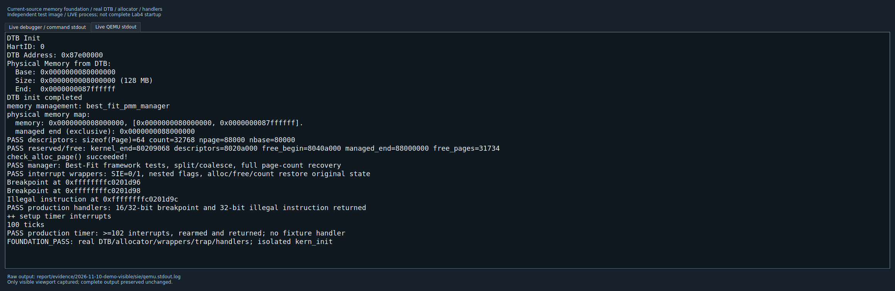

**A02：首次建立映射，观察下级表分配和ref变化。**

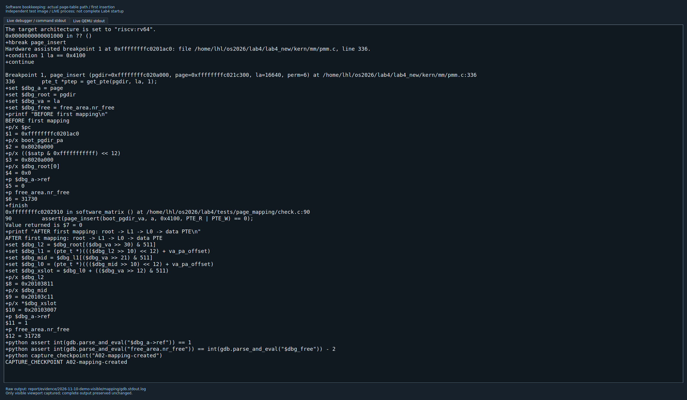

**A03：同页重映射，引用不重复增加。**

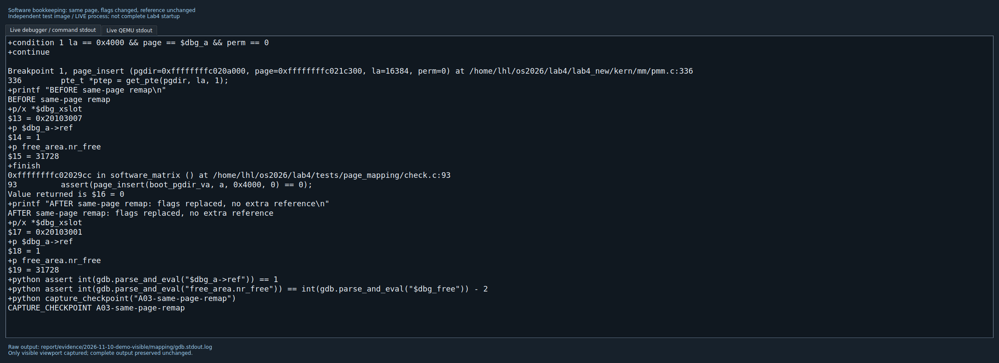

**A04：共享映射后替换，旧页仍有引用时不释放。**

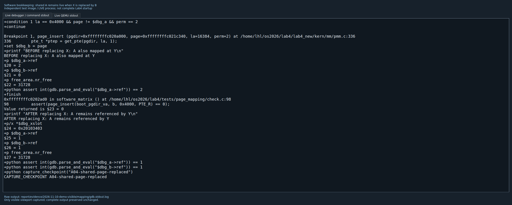

**A05：删除最后引用，释放数据页，保留中间表。**

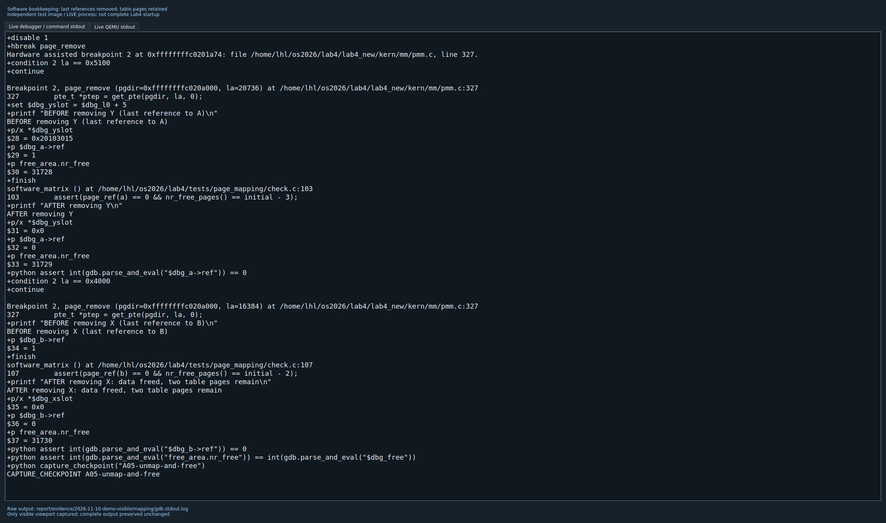

**A06、A07：原SIE分别为0和1时的保存恢复。**

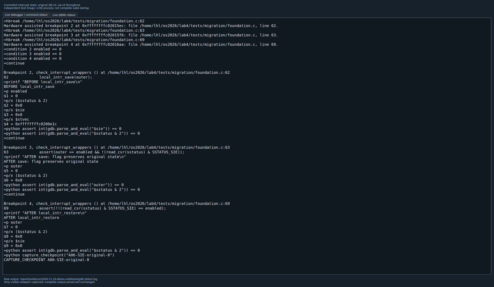

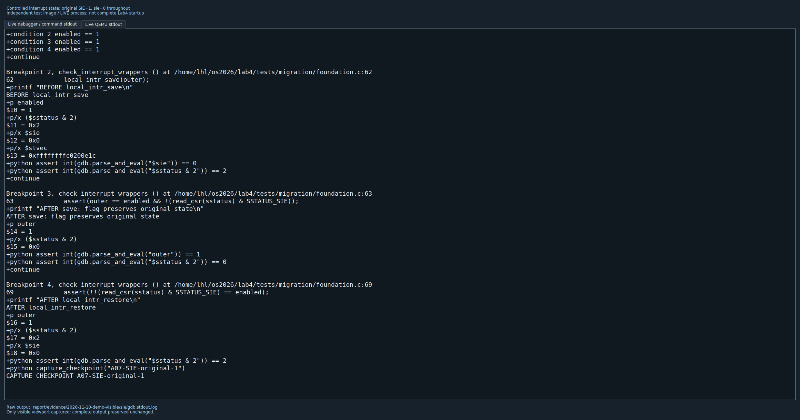

**A08：两种优化级的软件映射检查。**

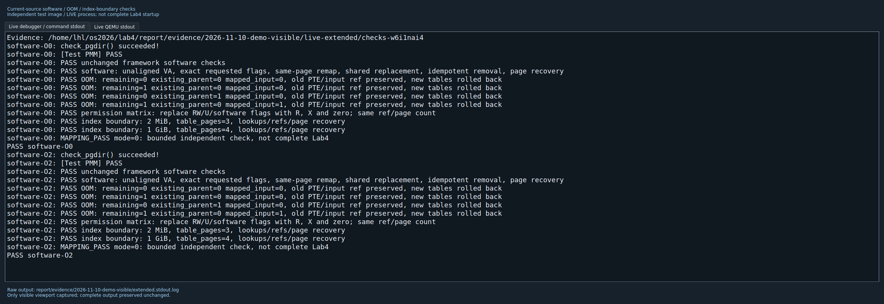

**A09：规范预置路径上的真实权限及删除故障。**

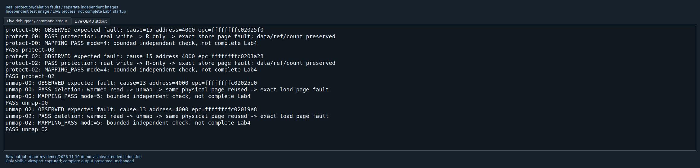

**A10：历史自动建表路径读取失败。** 此图保留修复前现场；后续非叶子项修正及正式启动结果见B03。

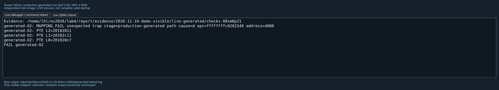

### 5.4 Debian正式构建及修前启动截图

以下两张为用户提供的2026-11-20 Debian终端原图，未修改图片内容。B01证明目标文件已链接并生成镜像，链接器的“removing unused section”是垃圾回收提示。B02证明进入正式初始化、识别128MiB内存且check_alloc_page/check_pgdir通过；之后重复初始化并panic，不能作为线程创建或调度通过截图。截图未显示首次异常的scause/sepc，非叶子U位是源码确认的问题，尚不能仅靠图片断言首次异常的精确cause和PC。

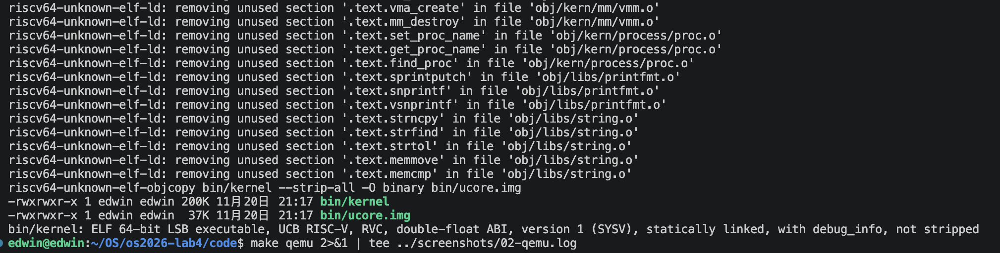

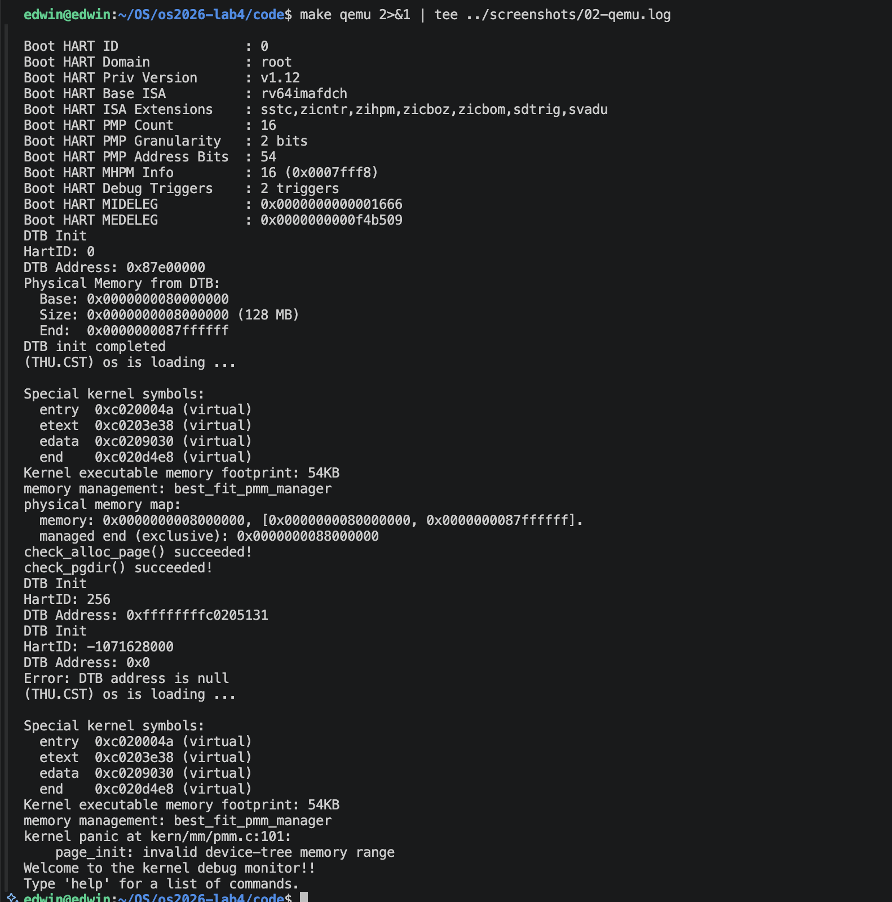

### 5.5 修后Debian已进入init线程

用户提供的[修后输出](evidence/2026-11-20-report-review/debian-boot-after-nonleaf-fix.user-provided.log)显示：check_alloc_page、check_pgdir、check_boot_pgdir、kmalloc、VMA检查均通过，时钟完成初始化，随后打印init的PID=1、名称init和两句To U。它支持正式入口已完成init线程创建与首次调度，并实际执行init_main。

init_main返回0后，kernel_thread_entry调用do_exit，当前do_exit直接panic("process exit!!.")。这符合当前占位的行为，不能写成正常退出或资源已回收。本项同时保留用户粘贴的终端文本和下方Debian真实终端截图B03。该启动输出本身不证明多线程轮换；后续评分结果见5.6，全部独立回归仍未重跑。来源见[来源与范围](evidence/2026-11-20-report-review/debian-boot-after-nonleaf-fix.provenance.md)。

**B03：修后正式启动并实际执行init线程。** 截图显示物理页、页表、SLOB和VMA检查通过，init的PID为1且打印两句To U；随后发生的process exit panic来自do_exit占位，不表示正常资源回收。

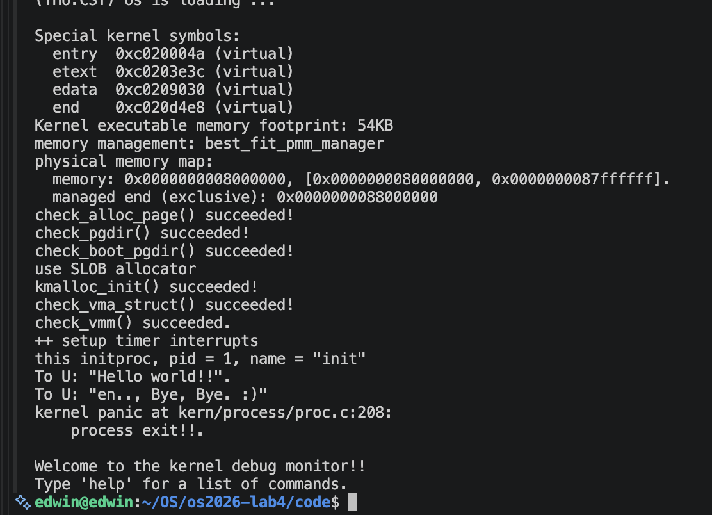

### 5.6 Debian正式评分：30/30

修正评分线程函数返回类型后，用户提供的[实际终端结果](evidence/2026-11-20-report-review/debian-grade-30of30.user-provided.log)为：

```text
  -check PMM:                                OK
  -check Process Create:                     OK
  -check Schedule:                           OK
Total Score: 30/30
```

PMM检查覆盖映射、同页更新、共享替换及删除等软件状态；Process Create检查idle/init身份、关系和初始现场；Schedule创建两个测试线程，经主动调度后检查二者都运行过。因此可以报告“正式评分三组全部通过”，不能扩展为用户进程、正常退出回收、抢占或多核机制已完成。

**B04：正式评分三组全部通过，总分30/30。** 用户提供的原始终端截图可见PMM、Process Create、Schedule均为OK，与上述文本结果一致。

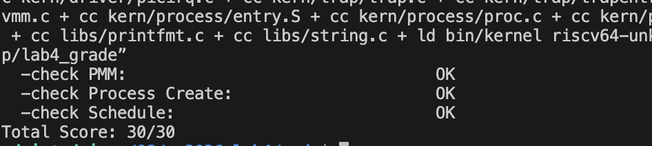

B01、B03、B04分别来自用户提供的三张原图，复制到报告图片目录，未裁剪、重绘或修改像素，来源与SHA-256见[截图清单](evidence/2026-11-20-report-review/debian-final-screenshot-manifest.json)。本机未重新运行Debian评分，也未取得完整评分日志；证据来源和范围见[说明](evidence/2026-11-20-report-review/debian-grade-30of30.provenance.md)。

---

## 六、实验总结与收获

### 6.1 对操作系统的理解

#### 本实验知识点与OS原理的对应

| 实验知识点 | OS原理含义 | 本实验体现与差异 |
|---|---|---|
| Page与Best-Fit | 物理资源管理和外部碎片 | 按连续页分配；Page是描述符，不是页内容 |
| 页表与TLB | 地址翻译和翻译缓存一致性 | 改PTE后执行sfence.vma；不是刷新数据缓存 |
| VMA与mm | 地址空间的逻辑布局 | 区间合法性描述与具体PTE分离；当前线程mm为NULL |
| 映射引用计数 | 共享资源生命周期 | 最后映射释放数据页；与表页结构占用区分 |
| PCB及状态 | 执行实体的身份、资源和生命周期 | RUNNABLE合并就绪/运行，current标识当前线程 |
| 内核栈与context | 分时保存执行进度 | 独立栈、14个切换寄存器，线程共享内核页表 |
| 调度 | CPU在多个执行实体间分配 | 按链表循环选择，协作让出，没有时间片抢占 |
| Trap | 异步中断和同步异常处理 | 更完整现场，同时复用恢复路径启动新线程 |
| 关中断临界区 | 防止当前hart的中断交错 | 保存原SIE并恢复；不提供多核互斥 |
| 失败回滚 | 资源获取的原子性 | 页表创建和线程创建都需释放本次取得的资源 |

#### OS原理中重要但本实验未完整覆盖的知识点

OS原理中重要但本实验没有完整实现的内容包括：用户进程及独立地址空间、系统调用、用户/内核切换、按需分页、换页和交换区、写时复制、正常退出/wait与僵尸回收、抢占和优先级调度、多核锁及TLB shootdown、文件系统、设备I/O和持久化。

### 6.2 AI协作开发的经验

实验的主要收获是将“映射内存”“创建线程对象”“让线程真正执行”区分后再连接起来。AI生成代码时，Spec必须同时规定正常分支、资源所有权和失败后状态；验证必须覆盖真实访存和实际切换。当前材料支持内存/Trap部分的历史独立结论、正式入口到init首次执行，以及评分覆盖的多线程调度检查通过（30/30）。正常退出和全部独立矩阵仍未因此得到验证。
