# 操作系统实验报告

## 实验基本信息

| 项目 | 内容 |
|------|------|
| **实验名称** | Lab 2：物理内存和页表 |
| **小组成员** | 2412351－李华濂；杨昊冉；2412181－肖子昂 |
| **阶段整理日期** | 2026-10-15 |
| **更新日期** | 2026-10-22：同步远端最新进度，补充两个 Challenge、完整启动和页表/TLB 复核截图 |
| **实验分支** | `lab2` |
| **本次提交范围** | 物理内存初始化、First-Fit 分析、Best-Fit 实现与验证、内存范围获取思考题、启动入口分页修复、Buddy System 实现与测试、QEMU 页表/TLB 调试 |

### 小组分工

| 成员 | 负责的练习/模块 |
|------|----------------|
| 2412351－李华濂 | 物理内存初始化；First-Fit 分析与改进思考；Best-Fit 实现、接入和检查；内存范围获取思考题；本阶段报告材料和截图整理 |
| 杨昊冉 | Buddy System 实现、管理器自测、隔离测试与接入；SLUB Challenge 实现与测试提示词 |
| 2412181－肖子昂 | QEMU 页表切换、TLB 调试、阶段 C 报告汇总与最终交付检查 |

本次提交包含已完成的代码、分析和测试材料，以及 Buddy System、页表切换和 QEMU TLB 调试证据。SLUB Challenge 已附成员 B 提供的实现与测试提示词，当前 `lab2` 分支没有 SLUB 实现或运行结果，不能作为该算法已通过测试的证明。当前工程可以编译，初始化、Best-Fit 和 Buddy 的隔离检查齐备；正式内核启动的入口分页切换问题已按 5.5 节完成修复。

## 一、实验目的

本实验围绕物理内存的发现和分配展开。我在本阶段主要学习以下内容：

1. 理解内核如何从启动参数和设备树中取得物理内存范围。
2. 区分物理地址、虚拟地址、物理页号和 `Page` 描述符地址，正确处理地址转换和页对齐。
3. 建立页描述符数组，保留固件、内核及管理数据占用的页面。
4. 理解 First-Fit 的空闲链表组织、分割、释放及相邻合并过程。
5. 实现完整的 Best-Fit 分配器，并通过独立检查验证选块策略、页面状态和页数恢复。
6. 实现 Buddy System 分配器，理解阶、地址对齐、伙伴计算，以及只合并伙伴、不合并普通邻居的规则。
7. 比较设备树、固件接口与启动协议提供内存信息的方法，理解物理内存范围与可分配空闲页的区别。

页表翻译过程和 QEMU TLB 调试属于阶段 C 的必做内容，本报告已经根据实际终端输出、MMU 日志和宿主 GDB 断点结果整理；未直接观察到的底层变量单独标明覆盖边界。

## 二、实验环境

| 成员 | AI 编程工具 | 底层模型 | 用途 |
|------|------------|---------|------|
| 2412351－李华濂 | Codex | GPT-5.6 sol | 辅助分析代码、实现初始化和 Best-Fit、设计检查并解释结果 |

| 环境或工具 | 配置 |
|------------|------|
| 系统 | Ubuntu 24.04.1 LTS，x86_64 |
| Conda 环境 | `os2026`，Python 3.12.14 |
| 交叉编译器 | `riscv64-unknown-elf-gcc` 13.2.0 |
| 模拟器 | QEMU 8.2.2，RISC-V `virt` |
| 固件 | OpenSBI 1.3 |
| 客户机调试器 | `gdb-multiarch` 15.1 |
| 构建工具 | GNU Make 4.3 |

阶段 C 在 Debian 虚拟机中复核的工具版本为 QEMU 10.0.13、GDB 16.3、`gdb-multiarch` 16.3 和 `riscv64-unknown-elf-gcc` 14.2.0；QEMU 4.1.1 宿主源码调试使用 `/home/edwin/OS/qemu-4.1.1/build/riscv64-softmmu/qemu-system-riscv64`。

在本机进入工作目录后，可以使用以下命令构建和运行检查：

```bash
conda activate os2026
cd /home/lhl/os2026/lab2/code
make
python3 tools/check_page_init.py
python3 tools/check_best_fit.py
python3 tools/check_best_fit_review.py
python3 tools/check_buddy.py
```

从仓库克隆后，应进入克隆目录下的 `code/` 执行命令。`make` 生成带符号的 `bin/kernel` 和加载镜像 `bin/ucore.img`，默认构建选择 Best-Fit 管理器。`make clean` 后执行 `make USE_BUDDY_PMM=1` 切换到 Buddy 管理器构建，题目评分路径仍走默认的 Best-Fit。`make debug`、`make gdb` 分别在两个终端启动 QEMU 和连接客户机 GDB；当前 Makefile 已将 GDB 指向 `gdb-multiarch`。启动入口缺页问题的定位与修复见 5.5 节。

## 三、实验整体逻辑分析

### 3.1 本章节的逻辑主线

我对本章的理解是：先确定可以管理哪些物理页面，再组织这些页面，最后通过统一接口实现连续页面的申请与归还。

物理地址空间中既有 RAM，也有设备地址和空洞。即使一段地址确实属于 RAM，其中也可能存放着固件、内核、页表和管理数据。因此，分配器工作前必须先建立可信的页面范围及状态。

代码设计的初始化顺序如下：

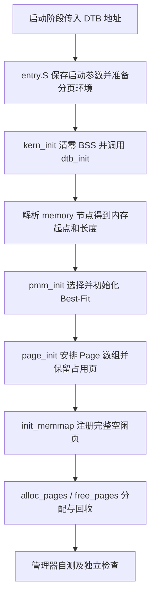

这张图说明代码的预期调用关系。正式入口的分页切换修复见 5.5 节；隔离检查使用独立入口验证其中的初始化与分配逻辑。

### 3.2 功能的逐步实现

首先阅读 `dtb.c`、`memlayout.h`、`pmm.h` 和 `default_pmm.c`，明确内存范围的来源、页描述符下标以及分配器接口。

接着实现 `page_init()`。它不决定采用哪种分配策略，只负责安排描述符、标记保留页，并通过 `init_memmap()` 将空闲区域交给已选择的管理器。

随后分析 First-Fit，理解一个空闲块为什么只需要一个链表节点，分割和合并时块头如何变化。在此基础上实现 Best-Fit，将选择规则改为扫描全部候选，取最小的足够大块，同时补齐初始化、注册、释放和计数等接口。

最后进行边界检查和反向验证。除了观察正常输出，我还用独立位图核对分配结果，并确认将临时副本改成 First-Fit 后，现有检查确实会失败。

## 四、实验内容与实现

### 功能模块一：物理内存初始化

**负责人：** 2412351－李华濂。

#### 模块功能描述

需要实现的函数位于 `code/kern/mm/pmm.c`：

```c
static void page_init(void);
```

该函数通过 `get_memory_base()`、`get_memory_size()` 取得设备树解析结果，设置 `va_pa_offset`、`npage`、`pages`，并将可用页面交给当前物理内存管理器。实现处保留 `//lab2 function1 2412351` 注释。

#### 关键计算与状态

1. 检查基址、长度是否为零，先验证长度加法不会溢出，再计算报告的末尾地址。
2. 取设备树末尾和 `PHYSICAL_MEMORY_END` 的较小值，并向下按页对齐，得到 `managed_end`。检查管理范围能否覆盖内核。
3. 首次使用 `PADDR` 前设置 `va_pa_offset = PHYSICAL_MEMORY_OFFSET`。内核尾部通过链接符号 `end` 取得，再换算为物理地址。
4. 将内核尾部向上对齐，安排 `Page` 数组。先通过剩余容量除以 `sizeof(struct Page)` 检查数组能否放下，再计算长度乘积和尾地址。
5. 所有描述符先清理状态、引用计数和链表节点，并标记为保留。最后只注册描述符数组之后的完整页面。

核心计算式为：

```text
managed_end = 向下对齐(min(设备树报告末尾, PHYSICAL_MEMORY_END), PGSIZE)
nbase = DRAM_BASE / PGSIZE
npage = managed_end / PGSIZE
描述符数量 = npage - nbase
描述符物理起点 = 向上对齐(PADDR(end), PGSIZE)
描述符字节数 = (npage - nbase) × sizeof(struct Page)
空闲区起点 = 向上对齐(描述符数组物理末尾, PGSIZE)
```

`npage` 是物理页号上界，不是从 RAM 起点开始计算的页数。`pages[0]` 对应物理页号 `nbase`，所以数组长度应为 `npage - nbase`。默认 128 MiB 下，`nbase=0x80000`、`npage=0x88000`，需要 32768 个描述符。本环境中 `sizeof(struct Page)=40`，数组占用 `0x140000` 字节。

如果没有完整空闲页，函数不调用 `init_memmap()`。设备树范围无效、内核不在有效范围内或描述符空间不足时，通过 `panic` 终止初始化，不能继续释放不可信的页面。

#### 最终提示词

以下为实现时实际使用的提示词，完整记录见 [提示词汇总第 03 条](prompt.md)。

```text
根据已确认的 Spec，实现 kern/mm/pmm.c 中的
static void page_init(void)，填补 lab2 function1 对应位置。

必须满足：
1. 通过设备树接口读取内存基址和长度，校验无效信息及范围溢出。
2. 正确设置 va_pa_offset、npage、pages。
3. 结合 PHYSICAL_MEMORY_END 等框架限制确定可管理上界，
   解释 npage 与 npage - nbase 的区别。
4. 在内核 end 之后按页对齐安排 Page 描述符数组，
   正确计算数组占用空间，并检查其是否落在有效范围内。
5. 初始化页描述符状态，保留固件、内核及描述符数组占用的页。
6. 把剩余可用区间向内对齐，只注册完整页面。
7. 设备树信息无效时终止初始化；没有完整可用页面时
   不调用 init_memmap()；不允许把内核或描述符区域释放。
8. 输出探测到的物理内存范围。
9.注意有“lab2”的注释，代码中所有需要完成的地方（challenge 除外）都有“lab2”和“YOUR CODE”的注释，在修改时特别注意保持注释，并将“YOUR CODE”替换为我的学号2412351，并把所有标有对应注释的部分填上正确的代码。

优先使用已有宏、接口和链接符号，不硬编码 Page 结构体大小。
保持物理页分配器的具体算法与 page_init() 解耦。
说明关键计算式，并提供构建和检查方法。
```

#### 实现与审查过程

本模块完成一次主要实现后，增加了独立检查，并对地址偏移、数组下标、对齐、范围溢出和保留页进行只读审查。后续审查没有修改 `page_init()` 的实现。

检查不是在同一次正常启动中连续制造 panic，而是为不同输入分别生成测试镜像，每例单独启动 QEMU。预期失败场景由测试专用 panic 处理函数核对原因，并确认没有提前调用空闲页注册接口，避免一个错误场景中断后续全部用例。

13 个用例涵盖默认和较小内存、上界裁剪、非整页末尾、零值和溢出、内核范围不符、描述符不足、没有完整空闲页及变化的内存起点，均通过隔离检查。

这些用例使用设备树 getter 和管理器回调的替身，直接执行实际 `page_init()`；覆盖范围以隔离检查为限，题目测试的评分条件未改动。

### 功能模块二任务一：First-Fit 分析及改进思考

**负责人：** 2412351－李华濂。

#### 核心函数的理解

| 函数 | 我的理解 |
|------|----------|
| `default_init()` | 建立空哨兵链表并令 `nr_free=0`，此时尚未向分配器注册空闲页 |
| `default_init_memmap()` | 清理待注册页的描述符，建立空闲块头并按地址加入链表，计数增加注册页数 |
| `default_alloc_pages()` | 从低地址开始找第一个足够大的块；从块首分配，剩余部分建立新块头；计数减少申请页数 |
| `default_free_pages()` | 清理释放页面的状态，按地址插入，再检查前后块是否物理连续并合并 |
| `default_nr_free_pages()` | 返回空闲页总数，不是链表中的块数 |

一个 8 页空闲块只需要把首个描述符挂入链表。块头设置 `PageProperty`，`property=8`，其余 7 页不设置块头标志。申请前 3 页后，原块头标志清除，剩余块从第 4 页开始，长度为 5，`nr_free` 减少 3。

`PageProperty=0` 不能单独证明页面已经分配，因为空闲块内部页面也没有块头标志。链表中相邻的节点也不一定物理相邻，合并前仍要检查“前块起点加长度是否等于后块起点”。

释放时，先与前块合并后必须更新 `base`，再用合并后的整体检查后块。`nr_free` 只增加本次归还的页数，左右邻块本来已经计入空闲页数，不能重复增加。

#### 阅读中发现的问题

当前 `default_init_memmap()` 和 `default_free_pages()` 的尾插分支在插入后没有退出循环。下一轮可能遍历到刚插入的节点，再次将其插入，破坏链表链接。前期用局部程序复现了新节点前驱指向自身的情况。

本阶段按思考题要求保留该文件，记录其问题；默认管理器已切换为本次实现的 Best-Fit。上述表格描述的是 First-Fit 的管理意图，不能据此认为当前 `default_pmm.c` 的所有分支均已修复或验证通过。

#### First-Fit 的改进空间

First-Fit 找到首个候选就停止，通常扫描较少，但最坏仍需遍历全部空闲块。可以增加查找索引，或使用 Next-Fit 减少每次从链表头重复扫描；不过 Next-Fit 会改变选块顺序，也不保证碎片更少。

按地址维护链表有利于寻找合并邻居，但不能直接快速找到最合适大小。若增加按大小的树或分桶，还需同步维护地址关系，增加元数据和插入、删除成本。及时合并可减少相邻空闲块形成的外部碎片，但无法合并被已分配页隔开的块。

Best-Fit 能减小当前请求的剩余长度，但也可能留下许多小块。因此，我认为应结合实际申请序列比较扫描次数、最大连续空闲块、分配失败情况和管理开销，不能直接认定 Best-Fit 在所有情况下都更好。

### 功能模块二任务二：Best-Fit 实现与接入

**负责人：** 2412351－李华濂。

#### 模块功能描述

实现位于 `code/kern/mm/best_fit_pmm.c`，保留 `//lab2 function2-2 2412351` 注释，包含以下函数：

```c
static void best_fit_init(void);
static void best_fit_init_memmap(struct Page *base, size_t n);
static struct Page *best_fit_alloc_pages(size_t n);
static void best_fit_free_pages(struct Page *base, size_t n);
static size_t best_fit_nr_free_pages(void);
static void best_fit_insert(struct Page *base);
```

`best_fit_pmm_manager` 绑定这些接口，并将 `.check` 绑定到已有的 `best_fit_check()`。`pmm.c` 的 `init_pmm_manager()` 选择该管理器，输出管理器名称。已有 `basic_check()`、`best_fit_check()` 内容保持不变。

#### 内部状态与选块规则

`free_area` 包含 `free_list` 和 `nr_free`。链表按物理页地址递增，只挂空闲块首个描述符。块头的 `property` 表示连续页数，`PageProperty` 标记有效块头；`nr_free` 等于所有空闲块长度之和。

分配时扫描所有块，选择长度不小于请求值的最小块。同大小时保留先遇到的低地址块。关键判断是：

```c
if (p->property >= n &&
    (best == NULL || p->property < best->property)) {
    best = p;
}
```

循环中没有找到候选后立即退出的操作。扫描过程中，`best` 始终是已访问候选中最小的足够大块。总页数不足时直接返回 NULL；总数足够但缺少连续块时，扫描结束后同样返回 NULL，两种失败都不改变空闲状态。

#### 分割与合并

选中块后先摘链。整块分配时不建立剩余节点；需要分割时，从 `best+n` 建立剩余块头，在原位置挂回，并令 `nr_free-=n`。例如低地址到高地址的块大小为 8、5、3、3 页，申请 2 页时选择第一个 3 页块，剩余 1 页成为新块。

注册和释放共用 `best_fit_insert()`：先按地址插入一次，再检查与前块是否物理连续。前向合并后更新基址，再检查后块。被吸收的块头清除 `PageProperty`、将 `property` 清零并摘链，计数不因合并再次增加。

例如已有空闲区间 `[0,2)`、`[4,6)`、`[10,12)`，合计 6 页。释放 `[2,4)` 后合并为 `[0,6)` 和 `[10,12)`，计数变为 8；再释放 `[6,10)` 后合并为 `[0,12)`，计数为 12。最终只保留第 0 页作为块头，长度为 12。

#### 最终提示词

以下为实现时实际使用的提示词，完整记录见 [提示词汇总第 05 条](prompt.md)。审查和检查分析另见其中第 06 条。

```text
参考 default_pmm.c 和 pmm.h 中的 struct pmm_manager，
补齐 best_fit_pmm.c 的完整 Best-Fit 模块。
先解释内部状态和不变量，再生成代码。

要求：
1. 补齐初始化、初始空闲区域注册、分配、释放、空闲页计数，
   定义 best_fit_pmm_manager 并绑定现有 best_fit_check。
2. 兼容文件中测试使用的 free_list、nr_free 状态约定。
3. basic_check()、best_fit_check() 的内容必须保持不变。
4. 遍历所有候选块，选择满足请求的最小空闲块；
   对同样大小的候选块采用明确且一致的选择规则。
5. 正确处理整块分配、剩余块分割、相邻空闲块合并、
   页状态与空闲页计数。
6. 在 pmm.c 的 init_pmm_manager() 接入 best_fit_pmm_manager，
   启动输出应能确认实际使用的管理器。
7. 保留 lab2 注释，填写负责人的学号。注意有“lab2”的注释，代码中所有需要完成的地方（challenge 除外）都有“lab2”和“YOUR CODE”的注释，在修改时特别注意保持注释，并将“YOUR CODE”替换为我的学号2412351，并把所有标有对应注释的部分填上正确的代码。

不要只实现选块循环；也不要为了通过测试改变测试函数。
给出修改文件、复杂度分析和实际验证结果。
其他未完成模块阻塞编译时，说明依赖，不擅自替别人完成。
```

#### 实现与检查过程

先解释内部状态和不变量，再完成全部接口与管理器接入。实现完成后完整工程能够编译，现有自测在独立入口下通过。

随后补充独立检查，按页记录保留、空闲和已分配状态，每次操作后核对返回地址、块长度、链表顺序、双向链接、引用计数和空闲页总数。检查覆盖精确匹配、多候选、同大小规则、分割、内存不足、碎片失败、乱序释放、单侧与双侧合并，以及最终页数恢复；在 `-O0`、`-O2` 下均通过，各包含 512 次固定种子操作。

后续审查没有修改生产分配器或已有测试。新增的审查脚本只在临时副本中构造两种错误选块策略，确认现有测试能够检出，结束后删除临时副本。

#### 现有自测如何区分 First-Fit 和 Best-Fit

`best_fit_check()` 先申请 5 页，再隔离空闲链表，只释放其中低地址的 2 页块和高地址的 1 页块。先申请 1 页时，Best-Fit 应选择高地址的 1 页块，随后申请 2 页仍可成功。若改成 First-Fit，则先拆开低地址的 2 页块，之后只剩两个不连续的 1 页，第二次申请失败。

临时 First-Fit 版本实际在 `alloc_pages(2) != NULL` 断言处失败；临时“同大小选择高地址”版本通过框架自测，但被独立检查的返回地址断言拒绝。这也说明原有自测没有覆盖全部选块约定。

`tools/test_lab2.c` 中的 `test_best_fit()` 只检查管理器指针，不能单独证明其内部实现了 Best-Fit。

#### 复杂度和改进空间

设空闲块数为 k、本次注册或释放页数为 n：初始化和计数查询为 O(1)，分配为 O(k)，注册和释放为 O(n+k)。合并最多处理前后两个邻居，本身为 O(1)。除已有描述符外，当前管理器只使用 O(1) 额外空间。

进一步可以考虑：

1. 找到精确匹配后停止扫描。此时剩余空间为零，不可能出现更优大小；按地址扫描还能保持低地址优先。最坏复杂度不变，但可能减少平均扫描量。本次按全遍历要求保留现状。
2. 增加按 `(块大小, 地址)` 排序的平衡树，进行 O(log k) 下界查找，同时维护地址索引以便合并。这样会增加节点字段和多索引同步成本；现有自测会单独恢复链表头和计数，额外索引还需解决恢复一致性。
3. 使用精确页数分桶和非空桶位图，减少逐块查找，但需维护桶、地址邻接关系及同大小低地址顺序。粗粒度分桶若随意取块，可能改变严格 Best-Fit 的含义。
4. 对小剩余块保持完整记录。1 页剩余块仍能用于单页请求，不能直接丢弃。若按阈值整块分配，必须记录真实分配长度，否则调用者按请求页数释放会遗漏额外占用的页面。

### 功能模块二任务三：Buddy System 实现与测试

**负责人：** 杨昊冉。

#### 模块功能描述

实现位于 `code/kern/mm/buddy_pmm.c` 和 `code/kern/mm/buddy_pmm.h`，保留 `//lab2 function3-1`、`//lab2 function3-2` 注释，包含以下函数：

```c
static void buddy_init(void);
static void buddy_init_memmap(struct Page *base, size_t n);
static struct Page *buddy_alloc_pages(size_t n);
static void buddy_free_pages(struct Page *base, size_t n);
static size_t buddy_nr_free_pages(void);
static void buddy_check(void);
```

内部辅助函数有 `buddy_insert()`（按地址有序插入）、`ceil_order()`（向上取 2 幂的阶）、`count_blocks()`（统计某阶块数）和 `buddy_audit()`（审计空闲链表）。`buddy_pmm_manager` 绑定这些接口，`.check` 绑定到自写的 `buddy_check()`。

接入方式：`pmm.c` 的 `init_pmm_manager()` 增加 `#ifdef USE_BUDDY_PMM` 分支，Makefile 增加同名开关（`make USE_BUDDY_PMM=1`）。默认构建仍然选择 `best_fit_pmm_manager`，题目评分路径不受影响；Buddy 与 Best-Fit 的隔离检查互相独立。最终提示词见 [提示词汇总第 09 条](prompt.md)，隔离测试部分见其中第 10 条。

#### 内部状态与不变量

阶数取 0 到 `MAX_ORDER=14`，第 k 阶的块是 2^k 页。`free_areas[k]` 每阶一条双向链表，按物理页地址递增，所以链首一定是该阶最低地址的块。约定如下：

- 空闲块头：`PageProperty=1`，`property=2^k`（真实块大小）；块内其余页 `property=0`，没有块头标志。
- 已分配块头：`property` 保留真实块大小（2^k），`PageProperty=0`。释放时按这个字段恢复块大小，不依赖调用者传入的 n。
- `nr_free_of(k)` 记录第 k 阶空闲页数，`total_free` 记录全部空闲页数。
- 对齐按全局页下标 `p - pages` 判断。`nbase = DRAM_BASE / PGSIZE = 0x80000` 是 2^19 的倍数，阶数不超过 14，所以下标对齐等价于物理地址对齐。
- 伙伴地址用异或计算：下标为 idx、阶为 k 的块，伙伴是 `idx ^ (1<<k)`。

#### 分配过程

请求 n 页时先向上取成 2 的幂，k = ceil(log2 n)。从第 k 阶开始往上找第一条非空链表，取链首块；块比 k 阶大就一级级拆开，每次把上半块挂回低一阶链表，保留下半块，直到正好是 k 阶。块头记下真实大小并清掉 `PageProperty`。总数不够，或者没有足够大的连续块，都返回 NULL，两种失败都不改动空闲结构。

用第 3 阶块 [X, X+8) 连续申请 1 页举例：依次得到 X、X+1、X+2……每次拆分保留下来的都是低地址那一半，上半块挂回对应阶的链表。

#### 释放过程

释放时从块头的 `property` 取真实大小，断言它不小于调用者给的 n 且是 2 的幂，再逐级向上找伙伴。伙伴必须满足三个条件才合并：在描述符范围内、不是保留页、是恰好同阶的空闲块头。合并后基址取两者中较低的一个，继续向上尝试；最高阶没有更高的链表可去，到此为止。最后把合并结果按地址插回对应阶链表。

只合并伙伴、不合并普通邻居，这是 Buddy 和 First-Fit、Best-Fit 的本质区别：物理上紧挨着的两块，如果不同阶或者同阶但不是伙伴，也不能合并。

#### 初始注册

`buddy_init_memmap()` 先清理整个区间的页描述符，再把区间贪心分解成地址对齐的 2 幂块：每次取能满足“不超过剩余长度且下标对齐”的最大阶。分解出的每一块直接走释放路径插入，所以多次 `init_memmap()` 注册的相邻区间也能合并，行为和释放一致。非 2 幂区间由这个分解自然覆盖，例如 20000 页的区域会分成 16384 + 2048 + 1024 + 512 + 32 页五块。

块头必须记真实大小的原因：申请 3 页实际占 4 页，释放时要按 4 页去找同阶伙伴。如果按调用者给的 n 算阶，伙伴地址就会算错，链表里会出现互相重叠的块。

#### 管理器自测

`buddy_check()` 在 `pmm_init()` 里跟着执行，只使用分配器本身和一个私有位图，结束后把空闲布局恢复原样，不影响后续启动：

1. 先快照初始分解的各阶块数，再审计链表：地址有序、块头唯一、大小和对齐正确、块与块不重叠、各阶页数之和等于总空闲页。
2. 申请 1 到 32 页，检查返回块的大小、对齐和 `property`，归还后布局恢复。
3. 两次耗尽全部空闲页：一次按申请顺序归还，一次逆序归还。合并结果与顺序无关，两次都必须恢复到初始分解，这同时验证了级联合并和只合并伙伴。
4. 耗尽后单独释放 16 个单页，确认 16 页请求失败，证明邻居不能合并。
5. 128 步固定种子的随机申请与释放，每步之后审计。

#### 隔离测试

`tests/buddy_check.c` 用影子模型做独立验证：模型按阶维护有序的块头下标数组，复现选阶、取块、拆分和合并规则，因此能预测每一次分配的精确返回地址；每次操作后同时用位图审计链表。脚本 `tools/check_buddy.py` 在 -O0 和 -O2 下分别编译隔离镜像并启动 QEMU，核对串口标记。

用例覆盖：空区域申请失败；乱序注册后按释放路径合并；同阶但非伙伴的相邻块不合并；合并与拆分级联；确定性下半拆分（同一块拆出的单页按地址升序返回）；整个 arena 耗尽后还原到初始分解；512 步固定种子随机操作，每一步的返回地址都与影子模型一致。

题目给的 `basic_check()`、`best_fit_check()` 未改动，默认构建的 Best-Fit 回归不受影响。运行方式见 5.6 节。

#### 复杂度和改进空间

设阶数上界为 L（当前 14），实际分配块为 s 页。找阶和拆分/合并链最多经过 O(L) 层，但当前每阶链表按地址插入，需要扫描该阶已有块；分配与释放还会逐页处理描述符。因此不能将完整实现统一写成 O(L)：分配还包含 O(s) 状态清理和各次有序插入的扫描成本；释放包含 O(s+L) 及最终插入扫描；注册还要累计这些维护成本。计数查询为 O(1)。除页描述符外，管理器链表头占 O(L) 空间，自测使用的位图和指针数组另计。

可改进方向：每阶维护位图或再分桶来加速找非空阶，当前 L 很小，收益有限；把真实大小记录改到独立的块头数组，避免占用页描述符字段；对高阶块做延迟合并，降低拆分和合并频率。这些都没有实现，记录备选。

### QEMU 调试：页表翻译、TLB 与分页前后比较

**负责人：** 2412181－肖子昂。

本节对应阶段 C 的 P10～P14。P10 使用宿主 GDB 调试 QEMU 进程、客户机 GDB 调试 uCore；P11 用实际页表项完成一次 VA 到 PA 的翻译；P12 对照 QEMU 10 的 MMU fill 日志和 QEMU 4.1.1 的 `victim_tlb_hit` 断点；P13 比较分页关闭、分页开启以及软件 TLB 与 RISC-V 硬件 TLB 的区别；P14 记录连接、断点筛选和多条命令粘贴导致的排错过程。

#### 双层调试方法

宿主 GDB 调试的是 QEMU 进程本身，加载 QEMU 4.1.1 的 C 源码和调试符号；客户机 GDB 调试的是 QEMU 内运行的 RISC-V uCore，加载 `bin/kernel` 的符号。宿主侧使用 `-S -gdb tcp::1234` 启动并暂停虚拟 CPU，先由宿主 GDB 执行 `run`，再由客户机 GDB 连接 `localhost:1234`。宿主断点命中时，整个 QEMU 进程会暂停，客户机 GDB 暂时没有新的执行进度；应在宿主窗口继续后再观察客户机。

本次实际使用的宿主调试命令如下。宿主 GDB 停在 `(gdb)` 后逐条输入设置断点并启动 QEMU：

```bash
gdb -q --args /home/edwin/OS/qemu-4.1.1/build/riscv64-softmmu/qemu-system-riscv64 \
  -machine virt -nographic -bios default \
  -kernel /home/edwin/OS/lab2/code/bin/ucore.img -S -gdb tcp::1234
```

```gdb
set pagination off
set breakpoint pending on
break victim_tlb_hit
run
```

另一个终端连接客户机并加载 uCore 符号：

```bash
cd /home/edwin/OS/lab2/code
gdb-multiarch -q -ex 'set pagination off' -ex 'file bin/kernel' \
  -ex 'set architecture riscv:rv64' \
  -ex 'target remote localhost:1234'
```

客户机 GDB 输入 `continue` 后运行内核；宿主 GDB 命中 QEMU 断点时，在宿主窗口用 `continue` 恢复。为避免 GDB 把多条输入拼成一个命令，每次在 `(gdb)` 后只输入一条，再等待提示符。

这一区分解决了调试过程中的主要混淆：`victim_tlb_hit` 是 QEMU 宿主源码函数，不是 uCore 的函数；客户机 GDB 的 `x` 命令读取目标机内存，也不能直接当作 QEMU CPUTLB 命中证据。

#### 一次实际页表翻译

启动入口先在低地址 `0x80200000` 执行，此时 `satp=0`。执行 `csrw satp` 后，客户机 GDB 读到 `satp=0x8000000000080205`，即 Sv39、ASID 0、根页表 PPN `0x80205`，根页表物理地址为 `0x80205000`。`sfence.vma` 后跳转到 `0xffffffffc02000d6` 的 `kern_init`。

本次启动页表的 `root[511]` 为 `0x200000cf`。它是 Sv39 根级叶项，覆盖 1 GiB，不再继续读取 VPN[1] 和 VPN[0]。高地址 `0xffffffffc02000d6` 的页内/低 30 位偏移为 `0x002000d6`，加到叶项指向的物理段基址 `0x80000000`，得到 `0x802000d6`。客户机 GDB 在两个地址处反汇编得到相同指令，QEMU 10 的 MMU 日志也记录了同一 VA 到 PA 的翻译。

#### TLB 查询、未命中和填充

QEMU 的访存快速路径先查软件 CPUTLB；主 TLB 未命中时，慢路径检查 victim TLB。若 victim TLB 也未命中，`tlb_fill()` 调用 RISC-V 目标的 `riscv_cpu_tlb_fill()`，后者通过 `get_physical_address()` 执行客户机页表翻译，成功后调用 `tlb_set_page()` 回填 CPUTLB。`victim_tlb_hit()` 命中时不需要重新走页表遍历，而是恢复或交换缓存项。

QEMU 10 的 `-d mmu` 日志捕获到高地址取指的 `ret 0`、`prot 7` 和 `tlb_size 4096`，说明翻译成功并按 4 KiB 粒度回填软件 TLB。QEMU 4.1.1 宿主 GDB 进一步在 `victim_tlb_hit` 断点捕获到 `mmu_idx=1`、`page=0xffffffffc0200000`，说明进入了 S-mode 高地址的 victim 查询路径；仅凭入口断点不能判断函数是否返回 true。

宿主 GDB 的高地址命中记录为：

```text
Thread 4 hit Breakpoint 1, victim_tlb_hit(...,
    mmu_idx=1, index=0, elt_ofs=16, page=18446744072637906944)
(gdb) p/x page
$ = 0xffffffffc0200000
```

其中十进制 `page` 值转换为十六进制后是 `0xffffffffc0200000`。同一次高地址命中信息中的 `mmu_idx=1` 表明该访问属于 S-mode。另有低地址 `page=0x1000`、`0x80000000`、`0x80009000` 的 victim 命中；它们只作排错记录，不作为高地址结论的依据。

#### 分页前后与软件/硬件 TLB

分页关闭阶段的入口访问处于低地址和 `satp=0`，QEMU 可直接使用客户机地址完成翻译；分页开启后，CPU 处于 S-mode，访问 `0xffffffffc...` 地址时必须依据 Sv39 页表得到物理地址。两阶段都可能使用 QEMU 的 CPUTLB，因为 CPUTLB 是模拟器内部缓存客户机地址到宿主 RAM/设备访问路径的机制；它不等同于被模拟的 RISC-V 硬件 TLB。RISC-V 硬件 TLB 是客户机架构中的地址转换缓存，QEMU CPUTLB 是宿主模拟器为执行效率维护的数据结构。

原有记录直接观察到了分页前后的 PC、satp、页表映射、MMU fill 和 victim 查询入口；没有把“未再次进入 `riscv_cpu_tlb_fill()`”单独当作主 TLB 命中的直接证据，也没有把调试器自己的内存读取当作客户机访存。

#### 排错与修复记录

调试初期将多条 GDB 命令一次粘贴，造成 `Junk after item` 和表达式语法错误；之后改为每次只输入一条命令。客户机连接超时是因为宿主 GDB 尚未 `run` 或 QEMU stub 尚未监听。首次命中的 victim TLB 页面是低地址 `0x1000`、`0x80000000` 和 `0x80009000`，不能作为高地址证据；设置条件并继续运行后，捕获到目标查询页面 `0xffffffffc0200000`。早期对优化构建 QEMU 中 `env->pc`、`env->satp` 的局部调试值不可靠，因此没有写入最终结论。

阶段 C 的实际 Prompt、反馈和排错材料见 `report/prompt.md` 的第 11 节；本节的终端结果和截图见 5.7 节。

#### 源码依据与验收边界

uCore 侧的启动切换位于 `code/kern/init/entry.S`：写入 `satp`、执行 `sfence.vma`，再从低地址跳到 `kern_init` 的高地址别名。QEMU 4.1.1 侧重点阅读 `target/riscv/cpu_helper.c` 的 `riscv_cpu_tlb_fill()`、`get_physical_address()`，以及 `accel/tcg/cputlb.c` 的 `victim_tlb_hit()`、`tlb_fill()` 和 load/store 慢路径。调用关系可概括为：

```text
访存快速路径
  -> CPUTLB 主表未命中
  -> victim_tlb_hit()
  -> 两级均未命中时 tlb_fill()
  -> riscv_cpu_tlb_fill()
  -> get_physical_address()
  -> tlb_set_page() 回填 CPUTLB
```

本阶段使用三种相互独立的材料：客户机 GDB 验证 uCore 的寄存器、页表和指令地址；QEMU 10 `-d mmu` 日志验证运行时翻译和软件 TLB 回填；QEMU 4.1.1 宿主 GDB 断点验证 `victim_tlb_hit`。这三类证据分别回答“客户机如何映射”“QEMU 如何填充”和“是否进入 victim 查询路径”，不能相互替代。

### Challenge：硬件可用物理内存范围的获取方法

**负责人：** 2412351－李华濂。

内核不需要预先知道完整内存容量，但需要启动协议提供取得信息的入口。本实验由启动阶段通过 `a1` 传入 DTB 物理地址，`entry.S` 保存为 `boot_dtb`，`dtb_init()` 检查魔数并解析 `memory` 节点的 `reg`，得到起点和长度，再由 getter 交给 `page_init()`。

在 QEMU virt 的默认路径中，QEMU 根据虚拟硬件配置生成设备树，固件参与传递或调整。这不能理解为 OpenSBI 必须逐个地址读写以探测 RAM。当前解析固定采用 64 位地址和长度，只取第一组范围，没有通用解析父节点 cell 数量、多段 RAM 或完整保留区。

| 方法 | 适用条件和处理要求 |
|------|--------------------|
| 设备树 | 常用于本实验的 RISC-V 启动方式；读取 memory/reg，并结合保留表、reserved-memory 和内核自身占用区 |
| BIOS E820 | 传统 x86 启动加载器在实模式通过 INT 15h/E820 获取带类型的地址图，再传给内核；不能直接套用于 RISC-V |
| UEFI GetMemoryMap | 加载器在 ExitBootServices 前获取带类型的描述符并完成交接；运行时固件、NVS、设备区继续按要求保留，启动服务占用区按生命周期处理 |
| Multiboot2 | 兼容加载器通过内存图等标签传递地址、长度和类型；内核仍需排除自身、模块及正在使用的启动信息 |
| 板级信息与内存控制器 | 固定 SoC/开发板可根据硬件地址图、已初始化的控制器配置和启动记录获得 RAM bank；依赖具体平台，单知道总容量不等于知道可分配地址区间 |

无论哪种方法，都应从有效 RAM 中扣除常驻固件、内核、栈、页表、描述符、设备专用区域及仍在使用的启动数据，再将剩余区间向内按页对齐。DTB、initrd 等数据只有在完成使用且无后续引用时才可回收。`no-map` 保留区还有避免普通直接映射的要求。

当前 `dtb.c` 没有处理 DTB 内存保留表或 `/reserved-memory`，`page_init()` 采用的是本实验固定布局的保留方式。因此我不能把当前实现描述成适用于任意平台的完整内存图处理器。

盲目试读写物理地址有三个问题：一是地址可能对应 MMIO，读写会改变设备状态；二是地址即使属于 RAM，也可能存放内核或固件，写入测试图案会破坏数据；三是未实现地址、访问权限或分页映射问题可能导致异常。访问成功不能证明页面空闲，访问失败也不能简单证明该处没有 RAM。

参考资料：[QEMU virt](https://www.qemu.org/docs/master/system/riscv/virt.html#hardware-configuration-information)、[设备树规范](https://devicetree-specification.readthedocs.io/en/latest/chapter3-devicenodes.html)、[DTB 保留表](https://devicetree-specification.readthedocs.io/en/stable/flattened-format.html#memory-reservation-block)、[系统地址图接口](https://uefi.org/specs/ACPI/6.5/15_System_Address_Map_Interfaces.html)、[Multiboot2](https://www.gnu.org/software/grub/manual/multiboot2/html_node/Boot-information-format.html)。

#### 范围、保留区与页管理的关系

设备树提供的是内存地址布局。完整实现应先验证各段地址加法和边界，再从可支持的 RAM 区间中扣除保留区及占用区，对每段剩余区间向内按页对齐，最后逐段调用 `init_memmap()`。保留洞不能因为首尾地址落在 RAM 中就被一起释放。

例如父节点采用 `#address-cells=2`、`#size-cells=2` 时，`reg=<0x0 0x80000000 0x0 0x08000000>` 表示 `[0x80000000,0x88000000)`，不是从零开始的连续地址空间。当前 `page_init()` 以固定映射范围建立描述符，先将所有页保留，再注册数组之后的完整页；这符合本实验的单段 RAM 假设，但不能替代通用的保留表解析。

DTB 自身和 initrd 等启动数据应在仍被引用时保留，复制或解析完成且不存在后续引用后才可回收。OpenSBI 常驻代码、内核栈和启动页表不能因为控制权已经交给内核就释放。设备 MMIO 与设备专用 RAM 缓冲区也要区分：前者不是普通 RAM，后者属于 RAM 但仍可能被设备使用。

内核尚不知道完整容量，并不表示启动阶段毫无已知条件。固件可以先利用 ROM、片上 SRAM 或已初始化的 RAM 工作，再通过约定入口传递 DTB 或内存图。硬件控制器或内存条信息可以提供容量线索，但不能单凭容量推导地址空洞和保留区。本题为思考题，说明来源、适用条件和保留规则即可，不要求额外伪造运行截图。

### Challenge：SLUB 实现与测试

**负责人：** 杨昊冉。

#### 本次提交内容和完成边界

本节依据成员 B 提供的《Lab2挑战2-SLUB提示词.txt》补充。该材料包含实现和测试两份提示词，并说明代码拟在 `lab2-challeng2` 分支另行提交。本次拉取时远端没有该分支，`lab2` 分支也没有 SLUB 源文件，因此本报告只提交提示词和设计约束，不写成已实现、已运行或已取得挑战加分。完整提供文本另存于 [SLUB 提示词材料](challenge2-slub-prompts.md)。

#### 设计约束与核心接口

SLUB 在页分配器之上管理对象。底层 Buddy 提供一页或多页，slab 将这些页划分为同一大小的对象；一个 `kmem_cache` 维护一类对象，分别覆盖 8、16、32、64、128、256 字节。默认内核仍选择 Best-Fit，SLUB 只通过单独的构建开关进入使用 Buddy 的路径。

| 接口 | 应实现的行为 |
|------|--------------|
| `kmem_cache_create(name, size)` | 建立缓存及统计、对象大小和对齐约束 |
| `kmem_cache_alloc(cachep)` | 优先取已有 slab 中的空闲对象，不足时从 Buddy 取得新页 |
| `kmem_cache_free(cachep, obj)` | 验证归属和对象边界，归还空闲链；满足约定时回收全空 slab |
| `kmem_cache_destroy(cachep)` | 按明确的未释放对象处理规则销毁缓存，并将 slab 页归还 Buddy |

实现时应明确 slab 元数据所在位置。如果元数据与对象共享页面，可用对象数要扣除页头及对齐填充，不能直接用 `PGSIZE/size`。缓存的已用与空闲对象数应分别等于各 slab 计数之和；对象只属于一个缓存和一个 slab。

释放对象不清零，并不一定表示所有字节完全不变；若用对象开头存放空闲链指针，该部分会被覆盖。重复释放、跨缓存释放和销毁仍有活跃对象的缓存，都应有明确的拒绝规则。测试预计 panic 的用例需单独运行，不能使一次非法操作中断全部正常用例。

#### 实现提示词

```text
在已完成 Buddy System 的 ucore Lab2 代码上实现一个简化版 SLUB 分配器。
先说明设计（结构体、空闲链、统计字段、和 Buddy 的接口关系），再给代码。

要求：
1. 用 kmem_cache 管理一类固定大小的对象。每类缓存维护自己的 slab 链表
   和空闲对象链表；slab 从 Buddy 分配器申请一页或多页，再按对象大小
   切分。对象大小按 8、16、32、64、128、256 字节分档，每档一个缓存。
2. 提供四个接口：
   - kmem_cache_create(name, size)：创建一档缓存；
   - kmem_cache_alloc(cachep)：取出一个对象；
   - kmem_cache_free(cachep, obj)：归还对象；
   - kmem_cache_destroy(cachep)：销毁缓存，占用的 slab 页还给 Buddy。
3. 每档缓存记录 slab 数、空闲对象数、已用对象数，初始化后能打印各档统计。
4. 分配时优先用当前 slab 的空闲对象，没有空闲对象再向 Buddy 要一页
   新建 slab；释放时把对象挂回所属 slab 的空闲链；某个 slab 全空且
   缓存里还有别的 slab 时，把这一页整页还给 Buddy。释放的对象只挂回
   空闲链、不清零内容。
5. 不改动 basic_check()、best_fit_check() 和评分脚本，默认构建仍选
   Best-Fit；SLUB 用独立的编译开关接入，Buddy 的隔离检查还要继续通过。
6. 保留 lab2 注释风格，代码注释一行一句、简单直接，不要过度封装。
给出关键结构、各接口实现、复杂度和接入方法。
```

#### 独立测试提示词

```text
给上面的 SLUB 实现写一份独立测试，不修改题目已有的测试文件。

要求：
1. 测试入口自定义：先初始化 Buddy 并注册一块固定大小的 arena，
   再在这块 arena 上跑 SLUB 用例，测试结束后 arena 要恢复原状。
2. 用例覆盖：
   - 创建、销毁缓存；
   - 同一档缓存连续分配多个对象，地址不重叠、按对象大小对齐；
   - 对象重用：释放后再次分配能拿到同一个地址；
   - 一个 slab 用满后自动向 Buddy 申请新页；
   - slab 全空时整页归还 Buddy，用 Buddy 的空闲页数变化核对；
   - 多档缓存交替分配释放，互不影响；
   - 重复释放、跨缓存释放等边界情况要有明确断言。
3. 每一步都核对：对象不重叠、统计里的已用/空闲对象数正确、
   slab 链表和空闲链长度与统计一致。
4. 正常结束输出 PASS 标记；失败时打印用例名、地址和期望值。
5. 题目原有测试和评分路径不许改，Best-Fit 的检查要继续通过。
给出测试文件结构、用例划分和运行方法。
```

#### 测试有效性和当前结果

两份提示词将实现与测试分开提出。测试使用固定 Buddy arena，可用独立位图或对象区间集合检查对象不重叠，并逐步核对 slab 数、已用/空闲对象数和链表长度。耗尽单个 slab 验证扩容，全空 slab 验证整页回收；跨缓存交错操作验证隔离，重复释放等验证边界约束。最终销毁所有缓存后，Buddy 空闲页数及 arena 布局应恢复到起始状态。

这些是提交的设计与验收要求，不是已有测试结果。本次没有可运行的 SLUB 测试命令、PASS 标记或运行截图；若按题目实现并运行的要求申请完整挑战验收，还需补交代码和真实测试结果。


## 五、测试与验证

### 5.1 清理后完整编译

```bash
make clean
make
```

截图显示所有源文件完成编译和链接，生成 `bin/ucore.img`。这证明当前工程可以构建，不代表内核已经完整启动。

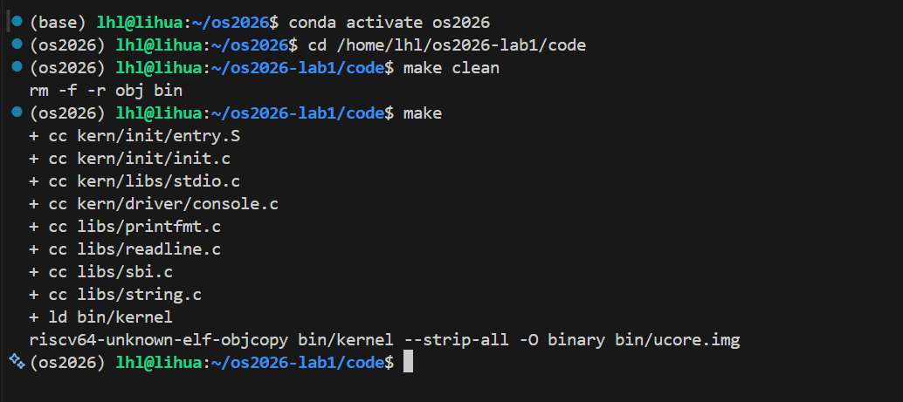

### 5.2 物理内存初始化隔离检查

```bash
python3 tools/check_page_init.py
```

13 个用例全部通过，其中无效范围和溢出等场景是预期拒绝用例。


查看默认用例日志：

```bash
sed -n '/physical memory map:/,/PAGE_INIT_CASE_0_PASS/p' \
    obj/check-page-init/case-00.log
```

结果显示物理区间为 `[0x80000000,0x88000000)`，默认容量为 128 MiB；题目提供的初始化检查通过。


这些检查通过 getter 替身提供内存范围，并使用独立测试入口，不验证正式启动路径和真实 DTB 解析。

### 5.3 Best-Fit 隔离检查

```bash
python3 tools/check_best_fit.py
sed -n '/memory management:/,/BEST_FIT_PASS/p' \
    obj/check-best-fit/console-O2.log
```

两种优化级别均通过，输出确认选择 `best_fit_pmm_manager`，管理器自测及独立检查成功。


图中的 `grading: 6 / 6 points` 是管理器内部自测的检查计数，不是整个实验的最终评分。`[Test 2] Best-Fit: PASS` 只对应题目中的管理器指针检查，选块策略还由自测和独立位图检查共同验证。

### 5.4 测试有效性的反向验证

```bash
python3 tools/check_best_fit_review.py
```

正常版本在 O0/O2 下通过。两个临时错误版本在 O0 下分别被运行时断言拒绝；`rejected` 表示测试成功检出错误，不是当前实现失败。脚本还核对代码和已有测试没有被改动。


### 5.5 正式启动的当前结果

```bash
make qemu
```

图 7 记录的是修复前的启动现象：只看到 OpenSBI 的虚拟平台和固件信息，没有内核里的 DTB 解析、管理器名称和分配自测输出。


排错时用 GDB 读到 `scause=0xc`、`stval=0x80200000`：`satp` 已经切到 Sv39 并指向内核内的启动页表，缺页地址正是内核加载地址。原因是 `csrw satp` 之后、跳转到高地址之前，CPU 还在低位物理地址上取指，而 `boot_page_table_sv39` 原来只映射了 `0xffffffffc0000000` 高地址，缺少低位恒等映射，发生取指页缺页，内核进不了 `pmm_init()`。`make grade` 走的就是这条真实启动路径并检查串口输出。

2026-10-17 参照隔离测试入口 `tests/page_init_boot.S` 的既有做法，在 `entry.S` 的 `boot_page_table_sv39` 中补齐第 3 个页表项，把 VA `0x80000000` 映射到 PA `0x80000000`（1GiB 超级页，标志 `0xcf`），页表总大小仍为 4KiB；同时删除遗留的调试注释。控制台输出经 SBI 完成，不需要 UART MMIO 映射，因此没有追加 VA 0 的恒等映射。修复后的启动输出以仓库最新代码为准。

初始化与分配器的隔离检查使用独立入口、UART 输出和设备树 getter 替身，直接执行生产的 `page_init()` 和分配器代码；正式启动路径见本节。详细文字证据见 [初始化记录](evidence/2026-10-15-page-init/README.md)、[Best-Fit实现记录](evidence/2026-10-15-best-fit/README.md)、[Best-Fit审查记录](evidence/2026-10-15-best-fit-review/README.md) 和 [本次提交前检查](evidence/2026-10-15-delivery/README.md)。

2026-10-22 在本机对最新代码重新运行默认构建，真实启动已完成 DTB 解析、Best-Fit 选择、自测及启动页表地址输出。图 12 为本次运行日志窗口截图；图 7 保留为修复前记录。

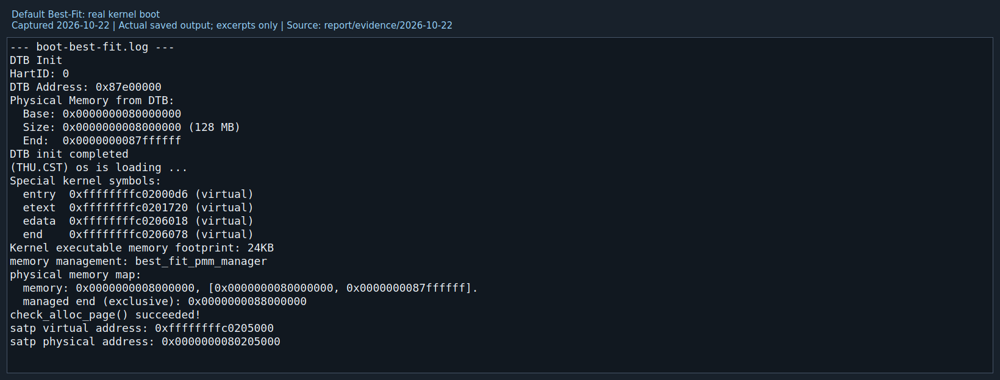

### 5.6 Buddy System 测试

```bash
make clean
make USE_BUDDY_PMM=1
make USE_BUDDY_PMM=1 qemu
# 退出 QEMU 后运行独立检查
python3 tools/check_buddy.py
```

切换管理器前先清理，因为当前 Makefile 不自动记录编译宏变化。返回默认构建同样执行 `make clean` 后再 `make`。

隔离测试编译 `tests/page_init_boot.S`、`tests/buddy_check.c` 与生产源文件，在 QEMU 里跑完后核对串口标记，包括 `memory management: buddy_pmm_manager`、`buddy check: PASS`、`[Test 1] Page Init: PASS` 和 `BUDDY_PASS`。脚本在 -O0 和 -O2 下各执行一遍。

检查覆盖的内容：

- 管理器选择：独立入口调用实际 `pmm_init()`，确认切到 Buddy 管理器，题目 Test 1 通过。
- 管理器自测：链表审计、1 到 32 页的大小与对齐、两次不同顺序的耗尽归还、孤立单页不能满足 16 页请求、128 步随机操作，结束后空闲布局恢复初态。
- 影子模型用例：空区域、乱序注册合并、非伙伴相邻块不合并、合并与拆分级联、确定性下半拆分、整个 arena 耗尽还原、512 步固定种子随机操作，每一步的返回地址都由模型预测。
- 位图审计：每个空闲页恰好属于一个对齐的 2 幂块，已分配页不在任何空闲块里，块头标志、`property`、双向链接和每阶计数逐一核对。

Buddy 的接入只加了编译开关，没有改动题目测试和评分脚本；默认构建的 Best-Fit 检查（5.3、5.4 节）不受影响。

2026-10-22 的本机复核结果如下，完整启动走实际 DTB 和 SBI，隔离测试则使用自己的入口与 getter 替身。两种结果分别记录。

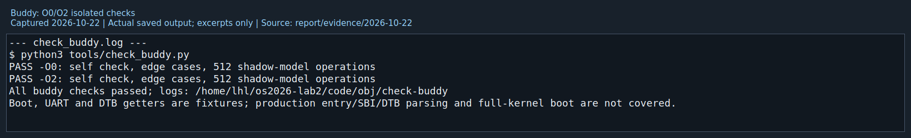

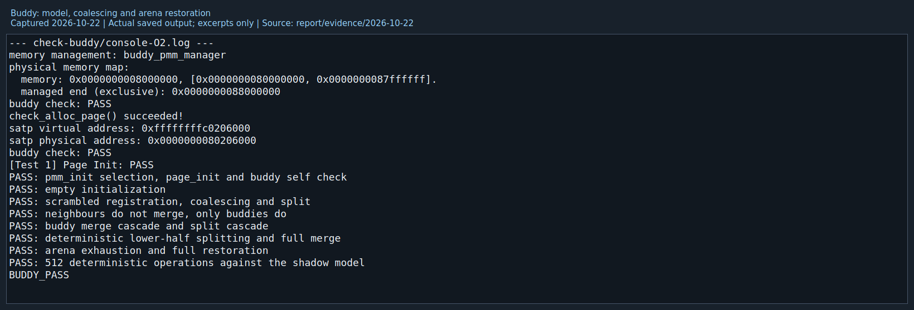

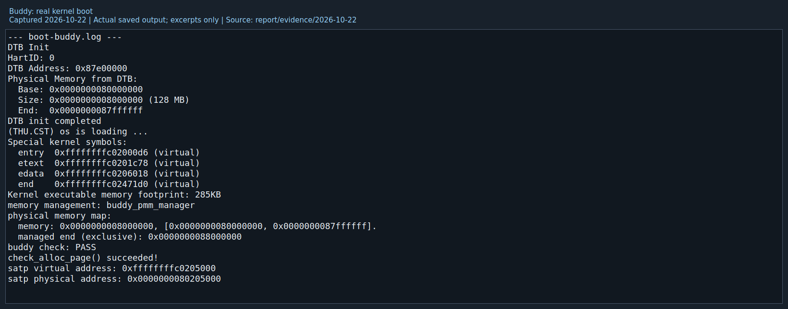

### 5.7 QEMU 页表与 TLB 调试结果

**负责人：** 2412181－肖子昂。

客户机 GDB 的实测结果如下：

```text
pc   = 0xffffffffc020010e
satp = 0x8000000000080205
```

这说明 CPU 已经跳转到内核高地址，Sv39 分页已经启用，页表根的物理地址为 `0x80205000`。页表根对应的高地址别名为 `0xffffffffc0205000`；其中 `root[2]` 和 `root[511]` 均为 `0x200000cf`，表示低地址恒等映射和内核高地址映射都存在。

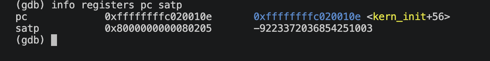

在同一页表下，客户机 GDB 对高地址和物理地址反汇编得到相同指令：

```text
0xffffffffc02000d6: auipc a0,0x6
0xffffffffc02000da: addi  a0,a0,-190
0xffffffffc02000de: auipc a2,0x47
0xffffffffc02000e2: addi  a2,a2,242

0x802000d6:          auipc a0,0x6
0x802000da:          addi  a0,a0,-190
0x802000de:          auipc a2,0x47
0x802000e2:          addi  a2,a2,242
```

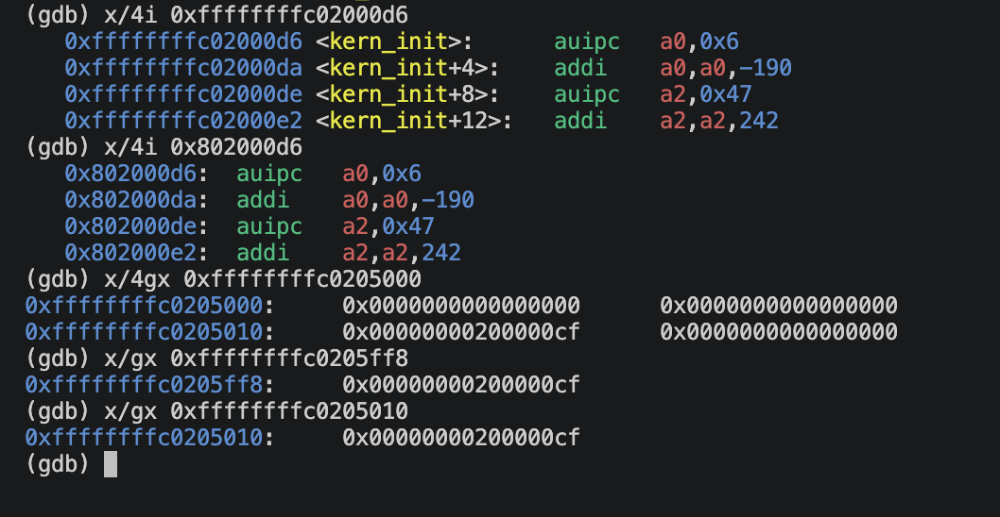

宿主 QEMU 4.1.1 GDB 还在 `victim_tlb_hit` 断点处捕获到：

```text
victim_tlb_hit(... mmu_idx=1, ..., page=0xffffffffc0200000)
```

这条断点只说明进入了 S-mode 高地址的 victim 查询。函数名包含 hit，并不意味着本次查询成功，必须检查返回值。2026-10-22 的补充复核直接记录第一次高地址查询返回 false，随后发生页表遍历和回填，见下方新截图。

原有记录的边界是：客户机 GDB 直接验证映射，QEMU 10 日志验证回填，QEMU 4.1.1 入口断点只证明进入 victim 查询。本次新增宿主 GDB 的局部变量、next/finish 和返回值记录，补上真实页表遍历、victim 未命中与主 TLB 命中的直接证据。

调试过程截图也一并保留：图 10 记录宿主 QEMU GDB 与客户机 GDB 的连接排错过程，图 11 记录使用 QEMU 4.1.1 调试构建启动双终端调试并命中 `victim_tlb_hit` 断点。图 10 中的早期命令输入错误是调试过程记录，不作为最终测试结论；图 8、图 9 用于支持映射结论，函数入口截图用于说明查询路径；返回值和逐步翻译以本次补充的图 16～20、23 为准。

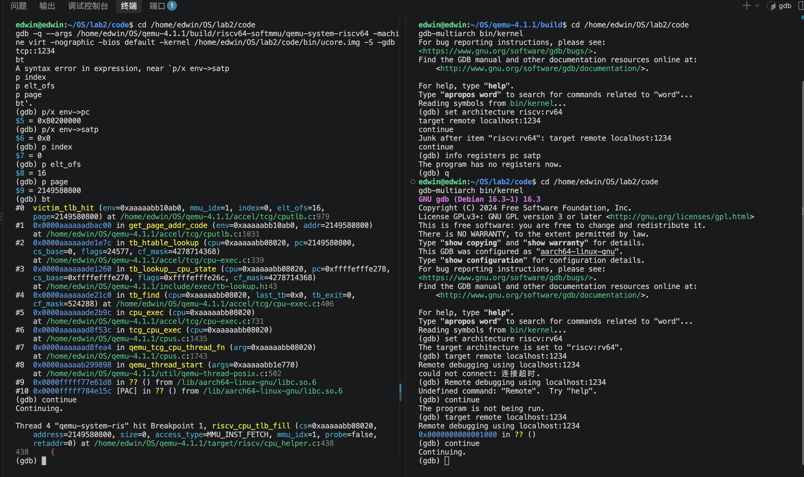

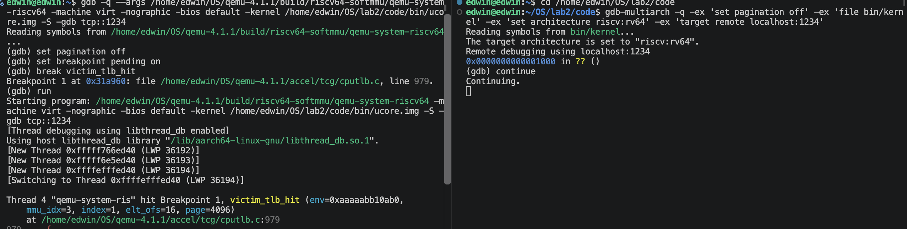

#### 2026-10-22 本机补充复核

本次使用 QEMU 8.2.2 复核客户机寄存器，使用本机 QEMU 4.1.1 调试构建逐步观察宿主源码。后者自带的 OpenSBI 版本为 0.4，与普通启动截图中的 OpenSBI 1.3 不同；两次执行分别保存日志，没有混用版本推导参数。完整调试输出见 [宿主日志](evidence/2026-10-22/host-mmu.log) 和 [客户机日志](evidence/2026-10-22/guest-mmu.log)。

客户机 GDB 观察到：进入 `0x80200000` 时 satp=0；跳到 `kern_init=0xffffffffc02000d6` 时 satp=`0x8000000000080205`。根页表两个叶项均为 `0x200000cf`，虚实别名反汇编一致。

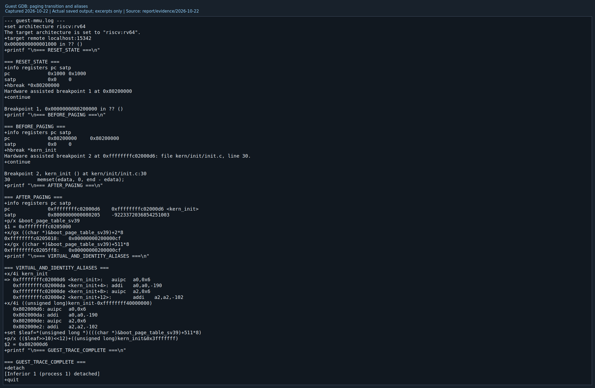

关闭分页时，宿主调用链仍经过 `get_page_addr_code → tlb_fill → riscv_cpu_tlb_fill → get_physical_address`。此时 mmu_idx=1、satp=0，地址 `0x80200000` 返回相同的物理页基址。这说明 QEMU 的软件 TLB 即使在客户机未启用分页时也参与缓存访问路径。

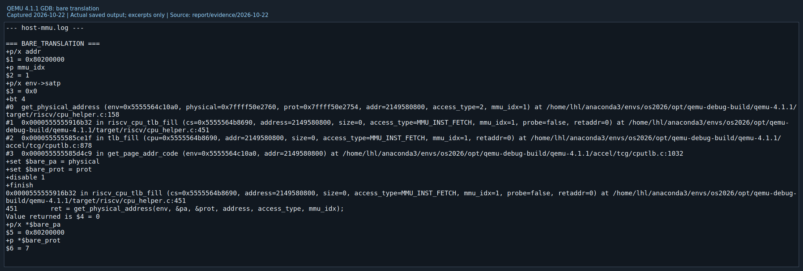

第一次高地址取指先进入 victim 查询，FinishBreakpoint 记录返回 false，随后进入 Sv39 翻译。该记录只支持本次查询未命中，不意味着所有后续 victim 查询都未命中。

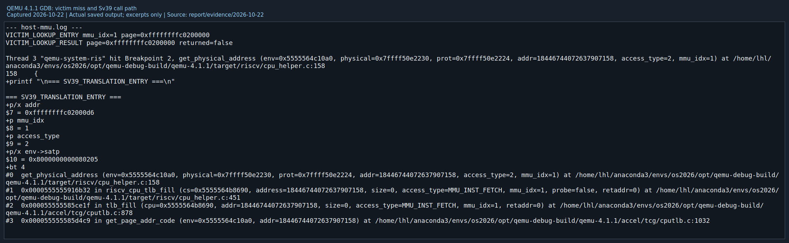

页表遍历中实际打印了 levels=3、i=0、ptshift=18、base=`0x80205000`、idx=`0x1ff`、pte_addr=`0x80205ff8`、pte=`0x200000cf`。`next` 依次经过 V 位和 R/W/X 分支检查，随后到达根级叶项的地址计算。虽然支持三级页表，但本次根级就是叶项，覆盖 1 GiB，因此没有继续访问下两级。

QEMU 4.1.1 的该函数返回供 TLB 使用的 4 KiB 物理页基址 `0x80200000`，不是包含低 12 位偏移的完整字节地址；加上原地址低 12 位 `0xd6`，实际字节物理地址为 `0x802000d6`。返回码为 0、权限值为 7，随后执行 `tlb_set_page()` 回填。

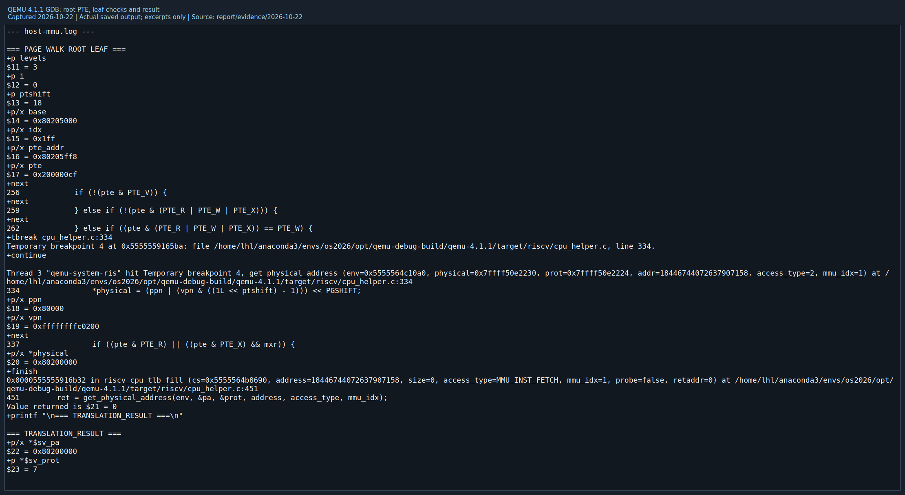

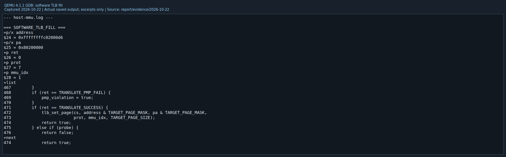

后续在 `get_page_addr_code()` 的主 TLB 比较处，读到 entry->addr_code=`0xffffffffc0200000`，等于当前地址按 4 KiB 对齐后的值；比较为真，单步从 1030 行直接到 1039 行，跳过 victim 查询和 fill 分支。这是主 TLB 命中的直接分支证据。

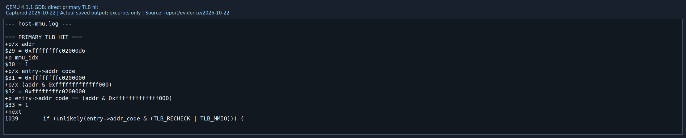

### 5.8 完整启动与最终评分

**负责人：** 2412181－肖子昂。

默认 Best-Fit 构建执行 `make grade` 得到 `Total Score: 20/20`。启用 Buddy 后，`python3 tools/check_buddy.py` 在 `-O0` 和 `-O2` 下均通过，且完整启动输出包含 `buddy_pmm_manager`、`buddy check: PASS` 和 `check_alloc_page() succeeded!`。对应的原始日志保存在 `report/evidence/2026-10-20/`。

P18 报告整理已完成：实际交互摘录、代码结果、截图和原始日志分别位于 `report/prompt.md`、`report/images/` 和 `report/evidence/2026-10-20/`。

2026-10-22 再次对默认路径执行 `make grade`，题目检查 page_init、Best-Fit 均为 OK，总分 20/20。此评分不覆盖 Buddy、SLUB 或完整 QEMU 调试要求。

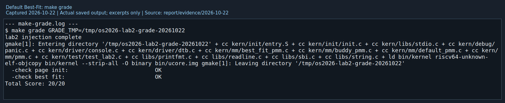

同一版本的初始化、Best-Fit 和反向验证回归结果如下：

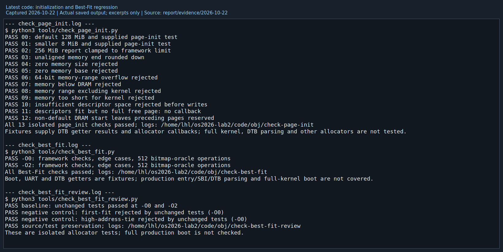

### 5.9 截图覆盖与Challenge交付边界

必做实现、完整启动、评分、Buddy 以及 QEMU 源码调试已分别对应图 1～6、8～9、12～23。图 7、10、11 保留为历史或调试过程，不单独作为最终成功依据。First-Fit 改进和内存范围 Challenge 以文字说明为主，不需要编造运行截图。SLUB 目前只有两份提示词，不具备真实运行截图，因此不计为完成实现与运行验收。

新增图 12～23 是在实际命令/GDB运行完成后，对显示原始日志摘录的 Qt 窗口抓取的截图，并非重新伪造的终端输出；用户原图 1～11 保持原始字节。源日志、摘录位置和图片 SHA-256 见 [证据与截图清单](evidence/2026-10-22/README.md)。

## 六、实验总结与收获

### 对操作系统的理解

| 本阶段知识点 | 对应的 OS 原理 | 联系与差异 |
|--------------|----------------|------------|
| 设备树内存范围 | 物理地址空间与硬件描述 | 提供 RAM 的位置和长度；仍要扣除占用与保留区，不能直接等同于空闲内存 |
| Page 描述符 | 页框管理与页状态 | 用软件结构描述实际物理页面；描述符本身也占用 RAM，需要保留 |
| 地址转换与页对齐 | 分页、虚拟地址与物理地址 | 当前代码采用固定偏移和启动映射；通用系统还需完整的权限、映射和多级页表管理 |
| First-Fit/Best-Fit | 连续分配与外部碎片 | 都要求连续物理页；空闲页总数足够不保证存在足够大的连续块 |
| 块分割与相邻合并 | 动态存储管理 | 管理粒度是页，合并依赖物理连续性，不能通过链表操作跨过已分配页面 |
| 独立检查与反向验证 | 系统软件验证 | 正常通过需要结合覆盖范围解释；故意构造错误能检验测试是否约束了真实策略 |

本阶段让我认识到，分配器正确性不只取决于选块循环。页面是否真的可用、块头是否唯一、链表是否有序、计数是否恢复，都直接影响后续分配。

OS 原理中重要但本阶段尚未对应实现的内容包括：按需分页、缺页处理、页面置换与交换、写时复制、用户地址空间隔离、进程调度以及文件系统。Buddy System、页表切换和 QEMU TLB 调试已在本阶段完成；SLUB Challenge 已附成员 B 提供的实现与测试提示词，当前 `lab2` 分支没有 SLUB 实现或运行结果，不能作为该算法已通过测试的证明。

### AI 协作开发的经验

我先要求解释状态和不变量，再提出实现要求，之后单独审查边界和测试覆盖。这样能把“代码能编译”和“功能经过验证”区分开。

分析中我发现，提示词应明确已有接口、禁止修改的自测和边界条件。例如要求区分 npage 与描述符数量、明确同大小候选的规则，并说明 panic 场景如何隔离。验证时还需要核对实际选择的管理器，不能只看一个 PASS 标记。

本次保留了实际提示词、独立检查和截图，启动入口问题按 5.5 节记录定位和修复过程。后续补充其他模块时，需要重新检查初始化、Best-Fit、Buddy 和正式启动，不能直接沿用本阶段的结论。
