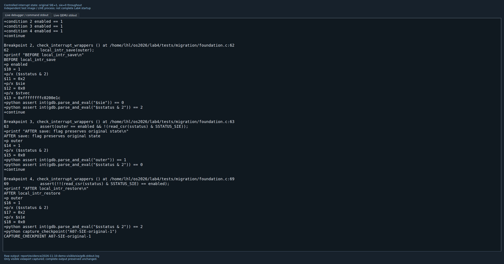
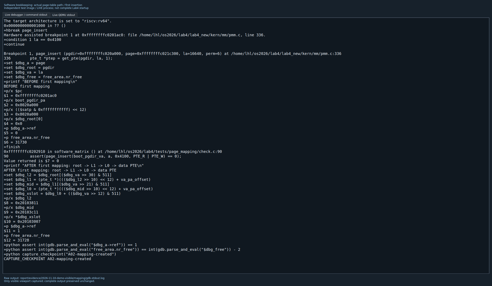
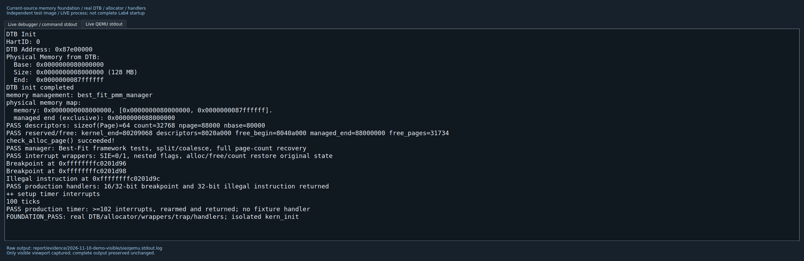
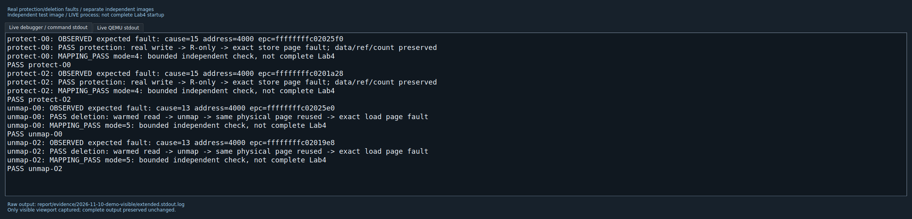

# 实验四：成员A的Challenge说明与GDB演示

姓名：李华濂；学号：2412351。验证日期：2026年11月10日。

本文对应题目中的全部Challenge，以及本人负责的内存依赖迁移和`page_insert/page_remove`。正式源码位于`lab4/lab4_new`。本轮没有修改生产实现、评分测试或同伴的进程与调度模块，也没有提交Git。

## 1. 先明确本次能够演示到哪里

我采用独立启动镜像验证本人部分：链接实际内存管理代码、实际分配器和Trap汇编，使用独立C入口和测试出口；不往正式工程补空进程函数。

| 演示 | 实际链接与测试范围 | 本次结果 |
|---|---|---|
| 内存基础 | 正式entry、DTB解析、pmm、Best-Fit、Trap汇编及已有handler，独立`kern_init` | 描述符、保留区、回收、中断包装、断点/非法指令返回、定时器均通过 |
| 映射软件状态 | 正式pmm/Best-Fit，原PMM检查和独立检查，受控Trap观察器 | 首次映射、重映射、替换、共享、删除、分配失败回滚、索引边界通过 |
| 真实访存 | 调用者预先建立符合架构要求的中间页表，再调用正式映射接口 | 只读后写入触发cause=15；删除后读取触发cause=13，均符合预期 |
| 自动建表后的真实访存 | 未修补正式`get_pte()`生成的中间项 | 仍失败：读取0x4000触发cause=13 |

当前`get_pte()`建立的非叶子项仍含`PTE_U`，框架`check_pgdir()`也要求该位。Sv39规范要求非叶子的U/A/D清零，因此“软件检查通过”和“MMU可以使用该页表”是两个结论。本轮保留冲突和失败证据，没有改评分条件，也没有悄悄清掉生产页表中的U位。[架构依据：RISC-V特权规范，Supervisor章节](https://raw.githubusercontent.com/riscv/riscv-isa-manual/main/src/priv/supervisor.adoc)。

正式工程上轮构建仍缺`proc_init`、`cpu_idle`等同伴实现，本轮未重跑正式`make grade`或声称完整Lab4启动通过。独立镜像通过也不能消除上述页表格式冲突。Sv32和Sv48在本文中只做原理比较，没有实现或运行这两种模式。

## 2. Challenge：局部中断保存、关闭和恢复

### 2.1 代码调用链

源码位置：`lab4_new/kern/sync/sync.h`、`kern/driver/intr.c`及`libs/riscv.h`。

```c
#define local_intr_save(x) \
    do { x = __intr_save(); } while (0)
#define local_intr_restore(x) __intr_restore(x);

static inline bool __intr_save(void) {
    if (read_csr(sstatus) & SSTATUS_SIE) {
        intr_disable();
        return 1;
    }
    return 0;
}
static inline void __intr_restore(bool flag) {
    if (flag) intr_enable();
}
```

`SSTATUS_SIE`是`0x2`，对应`sstatus`第1位。`intr_disable()`用`clear_csr`清除此位，`intr_enable()`用`set_csr`设置此位。`__intr_save()`先读出原来的开关状态，原来开着才关闭并返回1；原来关着就返回0。保存的是一个布尔标志，不是整个`sstatus`寄存器。恢复时只在标志为1时重新开启，避免把调用前已经关闭的中断错误打开。

| 进入前SIE | 保存标志 | 临界区SIE | 恢复后SIE |
|---|---|---|---|
| 0 | 0 | 0 | 0 |
| 1 | 1 | 0 | 1 |

`do { ... } while (0)`的循环体执行一次，作用是把宏包装成一条语句，提供块作用域，便于在`if/else`等位置安全使用；它没有等待条件，不是自旋锁，也不负责开关中断。当前宏体只有一个赋值，这种包装主要保持多语句宏的通用写法。

### 2.2 嵌套为什么可以工作，有哪些前提

原SIE=1时，外层保存`outer=1`并关中断；内层保存时看到SIE=0，得到`inner=0`。先恢复内层不会开中断，最后恢复外层才开启。原SIE=0时，两层标志均为0，退出后仍关闭。

前提是每层使用独立标志，按后进先出顺序恢复，临界区内不擅自重新开启中断。不能重复使用同一个标志变量覆盖外层状态。还要注意：本实现的`restore(0)`只是“不执行开启”，不是主动清SIE；若临界区错误地开过中断，`restore(0)`不会替它补救。

### 2.3 局部屏蔽的边界

SIE控制当前hart的S态中断响应，不会阻止同步异常，也不等同于关闭所有更高特权级中断。另一hart仍能访问共享数据，因此多核场景需要锁等同步机制，不能只用本地关中断。它也不能单独充当通用内存屏障。当前页表检查以单hart、串行修改为前提；物理页接口内部的关中断不代表整个页表映射事务自动获得跨核保护。

### 2.4 本次实际观察

我在独立`foundation`镜像中观察`local_intr_save`之前、之后及`local_intr_restore`之后。测试代码负责正常设置初始状态，GDB只读取寄存器和变量。开始前安装了实际Trap入口，并令`sie=0`屏蔽所有S态中断来源，避免只为了演示SIE就引入不受控异步中断。

| 分组 | 保存前`sstatus & 2` | `outer` | 保存后`sstatus & 2` | 恢复后`sstatus & 2` | `sie` |
|---|---|---|---|---|---|
| 原SIE=0 | 0x0 | 0 | 0x0 | 0x0 | 0x0 |
| 原SIE=1 | 0x2 | 1 | 0x0 | 0x2 | 0x0 |

这里`0x2`表示SIE位为1，不是SIE的编号变成2。嵌套保存和物理页分配/释放/计数包装的恢复由独立镜像中的断言进一步检查。GDB截图展示的是外层前后状态，不冒充逐条展示了全部嵌套路径。



## 3. Challenge：Sv32、Sv39、Sv48与重复的页表代码

### 3.1 三种模式的共同结构和差别

| 项目 | Sv32 | Sv39 | Sv48 |
|---|---|---|---|
| 运行架构 | RV32 | RV64 | RV64 |
| 页表级数 | 2 | 3 | 4 |
| 虚拟地址拆分 | 10+10+12 | 9+9+9+12 | 9+9+9+9+12 |
| 单项大小 | 4字节 | 8字节 | 8字节 |
| 每张表项数 | 1024 | 512 | 512 |
| 每张表大小 | 4KiB | 4KiB | 4KiB |
| 基本页大小 | 4KiB | 4KiB | 4KiB |
| 有效VA位数 | 32 | 39 | 48 |
| 该模式地址格式可表达的PA位数 | 34 | 56 | 56 |

RV64地址仍装在64位寄存器中；Sv39要求高位是bit38的符号扩展，Sv48要求高位是bit47的符号扩展。PA位数是格式能力，不表示本机拥有相同容量的RAM。硬件可支持较小的实际物理地址范围。本机演示使用128MiB。

三者都从`satp`给出的根表物理页号开始，用当前级索引定位PTE；非叶子PTE的PPN给出下一张表，叶子PTE给出物理页和权限，再结合页内偏移完成地址翻译。遍历还要验证合法位、权限和保留位。上层也可以是大页叶子，不必每次走到最低层；本实验的`get_pte()`按普通4KiB映射路径查找，不能直接拿它拆解任意大页叶子。[格式与遍历依据：RISC-V特权规范，Sv32/Sv39/Sv48章节](https://raw.githubusercontent.com/riscv/riscv-isa-manual/main/src/priv/supervisor.adoc)。

### 3.2 本实验Sv39具体怎样走

实际宏在`kern/mm/mmu.h`中：

```text
VA[38:30] -> PDX1(la)，根表索引
VA[29:21] -> PDX0(la)，中间表索引
VA[20:12] -> PTX(la)，最低表索引
VA[11:0]  -> 页内偏移
```

例如`0x4100`的三级索引是`0、0、4`，偏移是`0x100`。根表第0项指向L1，L1第0项指向L0，L0第4项对应包含0x4100的整个4KiB页。`0x4000`和`0x4100`共用同一个PTE；0x5000才属于下一页。

页表项保存下一张表的**物理页号**，内核C代码需要借助`KADDR`转为可访问的内核虚拟地址后解引用。MMU硬件读取页表时使用物理地址，不需要调用C语言`KADDR`。软件遍历和硬件遍历描述同一结构，但运行主体和访问方式不同。

### 3.3 get_pte为什么有两段相似代码

实际代码在`kern/mm/pmm.c:244`起。第一段检查根表项`pdep1`，必要时分配L1页表；第二段检查L1中的`pdep0`，必要时分配L0页表。两段都遵循“检查V、按create决定是否分配、引用置1、清零页表、父项写入新表页号、继续下降”，只是使用的地址索引不同。最后返回L0中的叶子槽位指针，而不是替调用者分配数据页。

重复来自多级页表具有相同的节点结构。Sv32在根表之下只有一层页表，类似步骤只需一次；Sv39需要两次；Sv48需要三次。因此相似不表示无意义复制，也不意味着必须把三种模式全部重新实现。

### 3.4 查找和分配合并，好在哪里，代价是什么

本实验用`create`参数合并两种需求：`create=0`用于纯查找，缺表就返回NULL；`create=1`用于准备映射路径，缺表时按需创建。优点是调用简单、索引遍历只写一份，分配、清零和链接规则集中维护，创建映射时不用先走一遍查找再走一遍分配。这里的“按需创建页表”不是缺页调入数据，也不是页面置换。

代价是查找函数隐藏了分配、引用计数、TLB同步和失败处理。调用者若误传create=1，删除或查询也可能消耗内存。多个分配步骤还会出现“上一级成功，下一级失败”：如果直接返回NULL，会留下本次新建的中间表和已扣除的页数，不能仅凭叶子尚未建立就认定没有泄漏。

本实现记录`old_pde1`和`new_pd`。第二次分配失败时，仅在`new_pd != NULL`时恢复原父项、刷新TLB、撤销新表引用并释放该页；原先已有的父表不属于本次分配，不能回收。页表路径准备失败发生在数据页引用调整之前，因此输入页引用和已有数据映射必须保持不变。成功创建结构后也会做全局本地TLB刷新。

对当前教学规模，保留合并接口并明确`create`和回滚契约即可；本轮没有为思考题重构公共接口。如果后续出现复杂并发、可阻塞分配、多种大页或更严格资源所有权，可以拆成无副作用的查找和显式确保路径存在的接口，让分配与回滚边界更清晰。代价是接口增多、可能重复遍历，还要处理两次遍历间页表被别人改变的情况。拆分不是自动正确，合并也不是必然错误。

正常`page_remove()`只清除数据叶子，不自动回收空中间表，与现有检查由调用者清理表页的约定一致。失败回滚“只撤销本次新建资源”和删除时“保留原有表结构”是不同的责任，不能混为一谈。

## 4. 本次使用的镜像、工具和证据

以下简写只用于阅读，终端命令均给出完整路径：

```text
证据目录：lab4/report/evidence/2026-11-10-demo-visible
映射镜像：software-image/kernel + software-image/ucore.img
基础镜像：foundation-image/kernel + foundation-image/ucore.img
映射日志：mapping/gdb.stdout.log、mapping/qemu.stdout.log
SIE日志：sie/gdb.stdout.log、sie/qemu.stdout.log
```

两个镜像均在本轮由当前源码重新构建，GDB加载同目录ELF，QEMU启动同目录二进制；用objcopy重新导出并逐字节比较，确认配对一致。构建命令完整保存在各自`build.log`。生产源码前后SHA256比较一致，截图SHA256及原始输出前缀摘要在`screenshot-manifest.json`和`verification.json`中。

实际工具为QEMU8.2.2、GDB15.1、RISC-V GCC13.2；命令优先在`os2026`环境执行。编译原`tools/test_lab4.c`会出现线程回调类型警告，线程段不属于本独立镜像的测试入口；它不能作为线程模块已编译运行正确的证据。

## 5. 模块一GDB演示：两个终端的命令

以下端口37133对应本次真实记录。若端口被其他实例占用，应在QEMU和GDB两侧一致换一个空闲端口，不要结束别人的QEMU。每次从第一步演示，应重新启动本镜像。

### 5.1 终端一启动QEMU并停在复位入口

```bash
conda activate os2026
qemu-system-riscv64 \
  -machine virt -m 128M -smp 1 -nographic -bios default -monitor none \
  -kernel /home/lhl/os2026/lab4/report/evidence/2026-11-10-demo-visible/software-image/ucore.img \
  -S -gdb tcp:127.0.0.1:37133
```

`-S`使CPU启动时暂停；`-gdb`开放调试端口。此时终端没有继续输出是预期现象，需要另一终端的GDB继续执行。

### 5.2 终端二连接同一镜像

```bash
conda activate os2026
gdb-multiarch -q -nx \
  -ex 'set pagination off' \
  -ex 'file /home/lhl/os2026/lab4/report/evidence/2026-11-10-demo-visible/software-image/kernel' \
  -ex 'set architecture riscv:rv64' \
  -ex 'target remote 127.0.0.1:37133'
```

以下命令均输入GDB。`set $dbg_...`只创建调试器便利变量，不修改目标的寄存器或内存；未使用GDB调用内核函数制造映射。

### 5.3 首次插入：观察三级路径和页数

```gdb
hbreak page_insert
condition 1 la == 0x4100
continue
set $dbg_a = page
set $dbg_root = pgdir
set $dbg_va = la
set $dbg_free = free_area.nr_free
p/x $pc
p/x boot_pgdir_pa
p/x (($satp & 0xfffffffffff) << 12)
p/x $dbg_root[0]
p $dbg_a->ref
p free_area.nr_free
finish
set $dbg_l2 = $dbg_root[($dbg_va >> 30) & 511]
set $dbg_l1 = (pte_t *)((($dbg_l2 >> 10) << 12) + va_pa_offset)
set $dbg_mid = $dbg_l1[($dbg_va >> 21) & 511]
set $dbg_l0 = (pte_t *)((($dbg_mid >> 10) << 12) + va_pa_offset)
set $dbg_xslot = $dbg_l0 + (($dbg_va >> 12) & 511)
p/x $dbg_l2
p/x $dbg_mid
p/x *$dbg_xslot
p $dbg_a->ref
p free_area.nr_free
```

`hbreak`按当前ELF符号设置硬件断点；`condition`只停在测试指定请求。`finish`实际执行完当前调用并停回调用者，之后读取的是函数执行后的真实状态。

当前ELF中`page_insert`入口断点为`0xffffffffc0201ac0`；根表物理地址和satp解出的根地址均为`0x8020a000`。插入前根第0项为0、A.ref=0、空闲页31730；插入后L2=`0x20103811`、L1=`0x20103c11`、叶子=`0x20103007`、A.ref=1、空闲页31728，恰好新分配两张页表。

根、中间、叶子的读取是软件路径观察。父项低位`0x11`正是保留的非叶子U位冲突；不能在此声称CPU已经通过该路径访问0x4100。根表本身属于当前镜像已有资源，没有在这次插入时重复计费。新数据页已在测试调用前分配，所以A.ref=0不等于A已经释放。



### 5.4 同页重映射：只更新权限，不多加引用

```gdb
condition 1 la == 0x4000 && page == $dbg_a && perm == 0
continue
p/x *$dbg_xslot
p $dbg_a->ref
p free_area.nr_free
finish
p/x *$dbg_xslot
p $dbg_a->ref
p free_area.nr_free
```

实际叶子从`0x20103007`变为`0x20103001`；A.ref保持1，空闲页保持31728。perm=0是本次软件契约检查，用来证明不会残留旧R/W位；这种最低级只有V的项不能视为可供硬件读写的正常数据叶子。

### 5.5 多地址共享后替换：只撤销一个引用

测试在上一步之后，先由真实代码把A共享到0x5000，再用B替换0x4000。使用条件断点跳到这次替换：

```gdb
condition 1 la == 0x4000 && page != $dbg_a && perm == 2
continue
set $dbg_b = page
p $dbg_a->ref
p $dbg_b->ref
p free_area.nr_free
finish
p/x *$dbg_xslot
p $dbg_a->ref
p $dbg_b->ref
p free_area.nr_free
```

替换前A.ref=2、B.ref=0；替换后叶子为`0x20103403`、A.ref=1、B.ref=1，空闲页仍为31728。A还被0x5000引用，所以不能释放。这里`perm=2`对应PTE_R，以当前源码宏为准。

### 5.6 删除最后引用：叶子清零，数据页回收

```gdb
disable 1
hbreak page_remove
condition 2 la == 0x5100
continue
set $dbg_yslot = $dbg_l0 + 5
p/x *$dbg_yslot
p $dbg_a->ref
p free_area.nr_free
finish
p/x *$dbg_yslot
p $dbg_a->ref
p free_area.nr_free
condition 2 la == 0x4000
continue
p $dbg_b->ref
finish
p/x *$dbg_xslot
p $dbg_b->ref
p free_area.nr_free
delete breakpoints
detach
quit
```

删除0x5100实际删除的是0x5000所在页：叶子由`0x20103015`清零，A.ref从1降0，空闲页31728→31729；随后删除0x4000，B.ref从1降0，叶子清零，空闲页31729→31730。两张中间页表仍保留，所以不能要求此处已经恢复到数据页分配前的总页数。测试随后自行清理表页，检查完整页数恢复。

`detach`让目标脱离调试并继续执行；`quit`退出GDB。独立镜像结束后QEMU自行退出，不需要按名称杀所有QEMU。上述0x4000/0x5100是测试请求值，符号地址及物理页号只适用于本次配对ELF；重新构建后应重新读取。

## 6. 中断Challenge的GDB演示命令

另开一轮QEMU，使用基础镜像，端口43157：

```bash
# 终端一
conda activate os2026
qemu-system-riscv64 \
  -machine virt -m 128M -smp 1 -nographic -bios default -monitor none \
  -kernel /home/lhl/os2026/lab4/report/evidence/2026-11-10-demo-visible/foundation-image/ucore.img \
  -S -gdb tcp:127.0.0.1:43157
```

```bash
# 终端二
conda activate os2026
gdb-multiarch -q -nx \
  -ex 'set pagination off' \
  -ex 'file /home/lhl/os2026/lab4/report/evidence/2026-11-10-demo-visible/foundation-image/kernel' \
  -ex 'set architecture riscv:rv64' \
  -ex 'target remote 127.0.0.1:43157'
```

GDB中执行：

```gdb
hbreak kern_init
continue
delete 1
hbreak /home/lhl/os2026/lab4/tests/migration/foundation.c:62
hbreak /home/lhl/os2026/lab4/tests/migration/foundation.c:63
hbreak /home/lhl/os2026/lab4/tests/migration/foundation.c:69
condition 2 enabled == 0
condition 3 enabled == 0
condition 4 enabled == 0
continue
p enabled
p/x ($sstatus & 2)
p/x $sie
p/x $stvec
continue
p outer
p/x ($sstatus & 2)
continue
p outer
p/x ($sstatus & 2)
p/x $sie
condition 2 enabled == 1
condition 3 enabled == 1
condition 4 enabled == 1
continue
p enabled
p/x ($sstatus & 2)
p/x $sie
p/x $stvec
continue
p outer
p/x ($sstatus & 2)
continue
p outer
p/x ($sstatus & 2)
p/x $sie
delete breakpoints
detach
quit
```

第62行位于外层save之前，第63行在其之后，第69行在外层restore之后。每个`continue`到下一处断点，读取前后状态；没有用`set $sstatus`修改现场。断点行号已按本轮实际测试源码和O0镜像验证，改动fixture后应重新核对行号。

脱离后基础镜像继续运行原handler和受控时钟测试。其实际输出包含`sizeof(Page)=64`、描述符32768个、`npage=0x88000`、`nbase=0x80000`、Best-Fit名称、页数恢复及`FOUNDATION_PASS`。npage是管理上界对应的页号，不是描述符个数；描述符个数是npage-nbase。此基础镜像的空闲页初值31734与另一映射镜像的31730属于不同构建/执行阶段，不能直接相减判定泄漏。



## 7. 自动复现命令和原始输出

### 7.1 使用已经验证的GDB命令文件

先按第5节启动对应QEMU，再在终端二执行以下命令可自动走完映射演示。该文件保留真实断点、读取和断言，去掉了只供截图界面使用的等待握手：

```bash
conda activate os2026
gdb-multiarch -q -nx -batch \
  -x /home/lhl/os2026/lab4/report/evidence/2026-11-10-demo-visible/mapping/manual.gdb
```

SIE演示需另启动第6节QEMU，再执行：

```bash
gdb-multiarch -q -nx -batch \
  -x /home/lhl/os2026/lab4/report/evidence/2026-11-10-demo-visible/sie/manual.gdb
```

本轮实际运行的是同目录`session.gdb`，它在相同调试步骤间额外调用主机Python函数暂停、通知界面截图；没有额外目标寄存器或内存写入。`manual.gdb`是去掉截图握手后的命令文件，本轮没有额外再运行该裁剪文件。完整命令回显见`gdb.stdout.log`，当前ELF反汇编另存`software-image/gdb-disassembly.log`。

### 7.2 独立检查

```bash
conda activate os2026
cd /home/lhl/os2026
python3 lab4/tests/page_mapping/run.py --mode extended
# 下列命令预期退出码1，用于保留自动建表的真实失败证据
python3 lab4/tests/page_mapping/run.py --mode generated
```

本轮截图重跑extended六个镜像：software、protect、unmap各O0/O2。软件检查复用了原`check_pgdir`和题目PMM检查，额外检查权限精确替换、同页/共享/替换/删除、四种OOM布局、2MiB和1GiB索引边界及页数恢复。分配失败注入只在独立支架生效。

真实访存检查先正常写入/读取以建立可用访问，再变更映射：

- protect：改只读后读取仍成功，写入在指定指令处触发store page fault，cause=15、stval=0x4000；数据、引用和页数保持。
- unmap：先读取，删除并回收，再把同一物理页分配给其他对象；旧VA读取在指定指令处触发load page fault，cause=13、stval=0x4000。

这些结果验证当前QEMU中修改后真实访问受到新映射和权限约束，不只是观察到`sfence.vma`指令。但本轮没有直接读取QEMU内部TLB，也没有证明所有硬件TLB实现的行为。硬件用例使用规范的预置中间表；自动建表用例保持原始生成路径并明确失败。



### 7.3 截图工具与截图真实性

本轮建立了连接实时GNU GDB、QEMU及测试子进程的只读窗口前端`tests/demo/capture_live.py`，显示正在运行的子进程stdout。GDB在正常断点上暂停，窗口显示相应输出后捕获；不是把历史日志排版成终端图，也没有重绘截图或改测试值。原始stdout按字节保存。

首次`QScreen.grabWindow`在当前X11环境返回全黑图，已移到`report/evidence/2026-11-10-demo/black-screen-captures`并标记无效。有效十张图来自Qt对当前实际显示的窗口进行`QWidget.grab()`，逐张检查非空，并人工查看了基础输出、映射、SIE和访存故障图。两轮原始运行日志均保留，未以黑屏结果充数。

如需再次实时捕获，应使用新的证据目录和图片目录，避免覆盖本次记录；命令使用base环境已有的PyQt5启动界面，内部构建/测试仍复用os2026：

```bash
cd /home/lhl/os2026
LAB4_DEMO_EVIDENCE=/home/lhl/os2026/lab4/report/evidence/demo-recapture \
LAB4_DEMO_IMAGES=/home/lhl/os2026/lab4/report/images-recapture \
  /home/lhl/anaconda3/bin/python3 lab4/tests/demo/capture_live.py
```

目录必须尚不存在，当前图形会话需要可用。脚本第一次整轮和修正抓取方式后的整轮已经运行；后来增加的两个目录环境变量仅做语法检查，未为此再重复整轮。若环境无法捕获图形，可按第5、6节在每组`finish`或restore之后截图，按表中证明事项分别保存，不生成替代图片。

## 8. 截图、证明事项和日志对应表

有效截图均位于`report/images`。下表中的日志均相对`report/evidence/2026-11-10-demo-visible/`。

| 图片 | 证明事项 | 原始日志 | 适用边界 |
|---|---|---|---|
| [A01-memory-foundation.png](images/A01-memory-foundation.png) | DTB、64字节描述符、保留区、Best-Fit及回收、Trap基础 | `sie/qemu.stdout.log` | 独立C入口，正式依赖 |
| [A02-mapping-created.png](images/A02-mapping-created.png) | 三级路径、A.ref 0→1、分配2张表 | `mapping/gdb.stdout.log` | 软件状态，非硬件可用性结论 |
| [A03-same-page-remap.png](images/A03-same-page-remap.png) | 权限覆盖，引用和空闲页不变 | 同上 | perm=0的软件契约 |
| [A04-shared-page-replaced.png](images/A04-shared-page-replaced.png) | A仍被Y引用，替换X后A/B各1引用 | 同上 | 软件状态 |
| [A05-unmap-and-free.png](images/A05-unmap-and-free.png) | 叶子清零、最后引用释放、每次回收1页 | 同上 | 保留中间表 |
| [A06-SIE-original-0.png](images/A06-SIE-original-0.png) | 原关中断，save/restore后仍关 | `sie/gdb.stdout.log` | 单hart，sie=0 |
| [A07-SIE-original-1.png](images/A07-SIE-original-1.png) | 原开中断，临界区关，退出恢复开 | 同上 | 单hart，sie=0 |
| [A08-software-tests.png](images/A08-software-tests.png) | O0/O2软件、OOM、边界及页数恢复 | `extended.stdout.log` | 包含题目PMM检查，不含线程/调度 |
| [A09-real-access-faults.png](images/A09-real-access-faults.png) | 权限更新和删除后的真实异常 | 同上；完整单镜像console见`live-extended` | 预置规范中间页表，受控Trap观察器 |
| [A10-known-generated-failure.png](images/A10-known-generated-failure.png) | 自动建表路径仍有非叶子U位问题 | `generated.stdout.log`及`live-generated` | 失败记录，不是通过截图 |

截图只包含窗口当前展示阶段，完整上下文应查原始日志。`screenshot-manifest.json`记录每次截图对应日志的前缀长度/摘要、图片摘要和尺寸；`verification.json`记录逐图校验、ELF/镜像匹配及生产文件未变化。

## 9. 答辩自查问答

**问：新分配页ref=0，为什么不能说它已经空闲？** 答：它已从分配器取出，只是尚未建立映射引用；是否在空闲管理器中与映射引用计数是不同状态。不能只看ref就再次分配它。

**问：同页重映射为什么不能先无条件删除再重建？** 答：若这是最后引用，删除会把仍准备使用的页释放给分配器。当前实现识别同页，只覆盖权限并刷新TLB，引用不变。

**问：A映射在两个VA，替换其中一个后能否释放A？** 答：不能，它还有一个映射引用。只有撤销最后引用、引用减到0时才释放数据页。

**问：没有建立叶子，为什么仍可能泄漏？** 答：前一级页表分配成功、后一级失败时，叶子不存在，但已经消耗一张表页；必须回滚本次新建资源，不能回收原本已有的父表。

**问：更新PTE后为什么还要考虑TLB？** 答：处理器可能继续使用缓存中的旧地址或权限。页表存储与TLB同步缺一不可；本实验在真实访存中检查了更新后的效果，并未直接读出内部TLB条目。

**问：page_remove后页数为什么不一定恢复到最初？** 答：数据页引用清零时会释放，但中间页表按接口约定保留，后续由拥有者清理；还应区分共享页是否仍有其他引用。

**问：SIE原来为0，restore为什么不能直接开中断？** 答：本接口应恢复调用前状态，可能身处更外层临界区；无条件开启会破坏外层保护。

**问：为什么SIE=1的演示里sie仍为0？** 答：SIE是总开关，sie是各S态中断源使能。本演示隔离异步来源，安全观察总开关变化；实际时钟测试在随后受控配置中另行开启。

**问：页表一共有多大？** 答：每张Sv39表4KiB、512个8字节PTE；整个地址空间会按需要拥有多张表，总占用取决于映射布局，不能说三级页表总共固定12KiB。

**问：为什么get_pte只有两段创建代码，Sv39却有三级？** 答：根表由调用者提供，只需创建下方L1和L0两层；最后再定位L0中的叶子。

**问：软件检查都PASS，为什么还保留一张FAIL截图？** 答：原软件契约检查不等于硬件页表格式验证。当前非叶子U位和严格Sv39要求冲突，必须呈现实际故障，不能拿预置规范表的通过来替代自动建表验证。

## 10. 本轮交付与仍需接续的事项

本轮新增本说明、实时截图脚本、十张有效截图和对应原始运行/调试证据；无新增生产功能。全部Challenge已按题目回答，演示所覆盖的本人实现未发现新的软件记账错误。当前不能据此下结论“整个Lab4实现没有问题”：自动建表格式冲突仍需明确处理，正式线程创建、调度与切换仍由同伴接续。最终整合时必须再使用正式启动入口回归，不能直接把本独立镜像的通过替换为最终验收。
